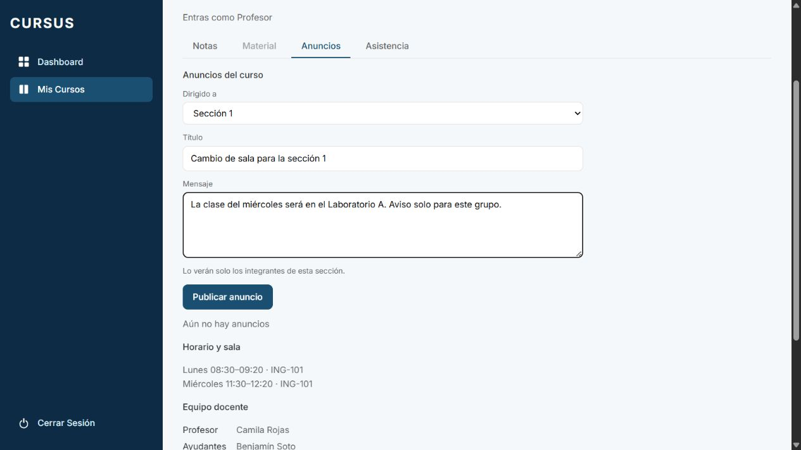
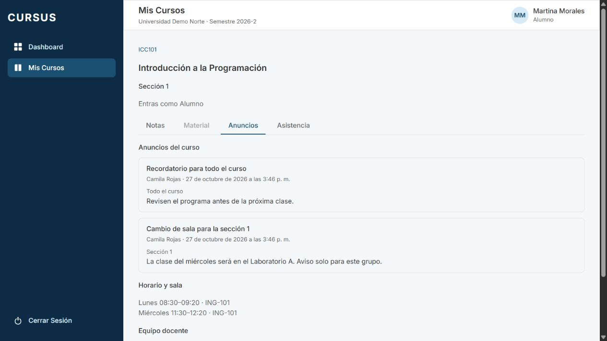
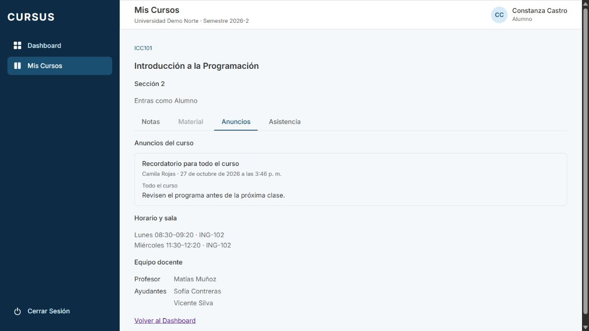

# ANU-02: el profesor publica un anuncio para una sección

Tarjeta: [F4 · ANU-02](https://trello.com/c/fzI9Mv5M). Referencia: RN-09. Depende de [ANU-01](anu-01-anuncios-curso.md).

## Comportamiento

En la pestaña **Anuncios**, el profesor elige **Todo el curso** (predeterminado) o **Sección N**, la sección cuyo espacio está abierto. Para publicar en otra sección a su cargo, entra a su espacio. El formulario conserva título y mensaje obligatorios, estados de carga y error, confirmación y recarga de la lista.

Mientras se envía, destinatario, título, mensaje y botón quedan bloqueados para evitar duplicados y cambios de destino. Si falla, conserva el destinatario y el texto para reintentar. Un UUID válido con letras mayúsculas se normaliza a minúsculas antes de comprobar el destino.

Cada tarjeta indica **Todo el curso** o **Sección N**, además de autor, fecha y contenido. La API devuelve los anuncios generales del curso y los dirigidos a la sección consultada, del más nuevo al más antiguo. No envía títulos, mensajes ni metadatos de anuncios de otras secciones.

Los anuncios de sección solo los reciben su profesor, ayudantes activos y alumnos con inscripción activa. Un profesor de otra sección del mismo curso no los recibe. El Director conserva su lectura de anuncios generales de ANU-01; los dirigidos a sección quedan reservados a sus integrantes. El Administrativo sigue sin acceso a anuncios. Se mantienen el aislamiento por universidad y los controles del guard de ESP-06.

Decisiones a validar con el cliente: el Director no ve anuncios dirigidos pese a su vista consolidada en otras áreas; y el selector ofrece Todo el curso o la sección abierta, debiendo navegar a otra sección a cargo para publicar allí. Se mantiene la interpretación estricta de “solo los integrantes” de ANU-02.

## API y persistencia

Se extienden las rutas de ANU-01:

- `POST /api/espacio/secciones/:id/anuncios`: `{ titulo, cuerpo, seccionId? }`. Omitir `seccionId` o enviar `null` publica para todo el curso. Un UUID igual al `:id` publica solo para esa sección. Responde 201.
- Un destinatario que no es UUID o que difiere del `:id` produce 400 sin guardar. No permite utilizar el espacio de una sección para publicar en otra, aunque sea del mismo curso.
- `GET /api/espacio/secciones/:id/anuncios`: lista ya filtrada en el servidor. Cada `Anuncio` agrega `seccion: { id, numero } | null`; `null` identifica un anuncio general.
- Se conservan los 401, 403 y 404 y la validación de título y cuerpo de ANU-01. El INSERT vuelve a verificar profesor y vigencia de sección y curso.

La migración nueva `1792600000000-DirigirAnuncioSeccion` agrega `anuncio.seccion_id` nullable y un índice parcial para los anuncios de sección. La FK compuesta `fk_anuncio_seccion` exige que sección, curso y universidad coincidan. Los anuncios existentes conservan `NULL` y su visibilidad general. RLS conserva el aislamiento institucional; el guard y el filtro SQL aplican la pertenencia a la sección, como el resto del espacio.

Al revertir, los anuncios dirigidos se archivan antes de quitar la columna para evitar que su contenido pase a ser público para todo el curso. No se elimina su contenido. Los generales se conservan activos.

## Revisión local

```bash
git fetch origin
git switch feature/anu-02-anuncio-seccion
npm ci
# Preparar .env desde .env.example si falta.
docker compose up -d --wait
npm run migration:run --workspace=backend
npm run seed --workspace=backend
# En dos terminales:
npm run dev:back
npm run dev:front
```

1. Levantar PostgreSQL con `docker compose up -d --wait`, aplicar `npm run migration:run --workspace=backend` y cargar `npm run seed --workspace=backend`.
2. Iniciar backend y frontend. Entrar con `camila.rojas@norte.cursus.test`, usando `SEED_PASSWORD`, y abrir ICC101 sección 1 → Anuncios.
3. Publicar con **Sección 1**: comprobar confirmación, etiqueta y aparición en la lista. Publicar otro con **Todo el curso**.
4. Entrar con `matias.munoz@norte.cursus.test` y abrir ICC101 sección 2: solo debe aparecer el general. Repetir con la alumna `constanza.castro@norte.cursus.test` y la ayudante `sofia.contreras@norte.cursus.test` de la sección 2.
5. Entrar con `martina.morales@norte.cursus.test`, alumna de la sección 1: debe ver ambos, con **Sección 1** y **Todo el curso** como etiquetas y sin formulario. Un usuario sin pertenencia recibe 403 si intenta abrir su ruta directamente.
6. Con Director, comprobar que solo se reciben los generales; Administrativo no accede a anuncios. Al retirar una inscripción o asignación de prueba, su usuario pierde el acceso. Usuarios de otra universidad no reciben ni títulos ni contenido.
7. Probar POST con `seccionId` de otra sección, otro curso, inexistente o mal formado: rechazo sin guardar. Omitirlo o enviar `null` conserva la publicación general. Verificar la lista y etiquetas al recargar y con conexión lenta, errores y pantalla estrecha.
8. Aplicar las suites de abajo y revisar CI. La migración se revierte solo en bases de prueba: los anuncios privados se archivan y no vuelven a ser generales activos. Archivar o retirar únicamente los datos creados para revisar, según el procedimiento del entorno.

## Pruebas

`PestanaAnuncios.test.tsx` prueba la selección del destinatario, el body del POST, la confirmación, las etiquetas y el restablecimiento del formulario. Conserva los casos de publicación general, lectura, validación y errores de ANU-01.

Se comprueba también la lectura de destinatario como alumno/ayudante, el bloqueo mientras se envía, la ausencia de un segundo POST y la conservación de campos ante un fallo.

`anuncios.db-spec.ts` prueba la persistencia del destinatario, la lectura de profesor/ayudante/alumno, la exclusión de la otra sección y del Director, el retiro de una inscripción, anuncios archivados, `null` para curso completo, destinatarios inválidos y la FK de curso/sección. `esquema-inicial.db-spec.ts` incluye la reversión de la migración.

```bash
npm run lint
npm test
npm run test:e2e --workspace=backend
npm run test:db --workspace=backend
npm run build
npm run format:check
```

## Evidencia de navegador

Prueba real con API y PostgreSQL en una base aislada, seed de facultad completa y usuarios ficticios. Se publican un anuncio de sección y otro general, se comprueba la lectura desde Martina (sección 1) y Constanza (sección 2), y el rechazo de acceso de Constanza a la sección 1. La base de prueba y los scripts temporales se retiran al finalizar; no se cambian el seed ni los datos de la base habitual.






