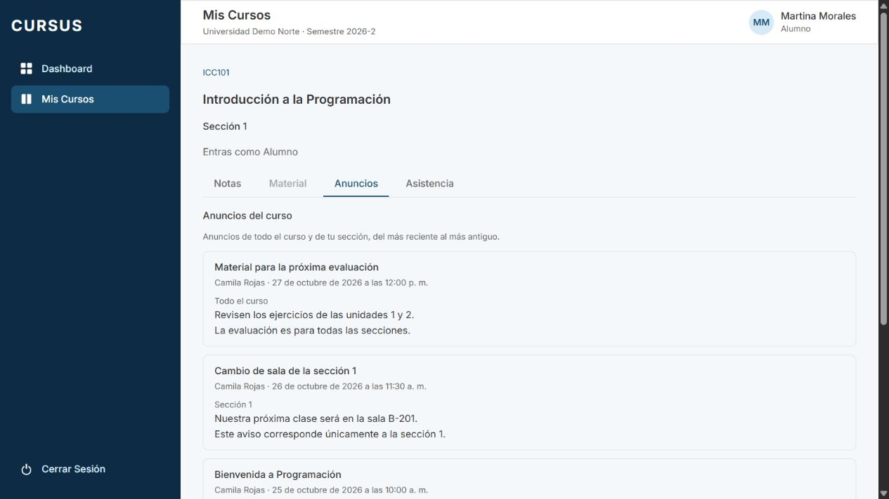
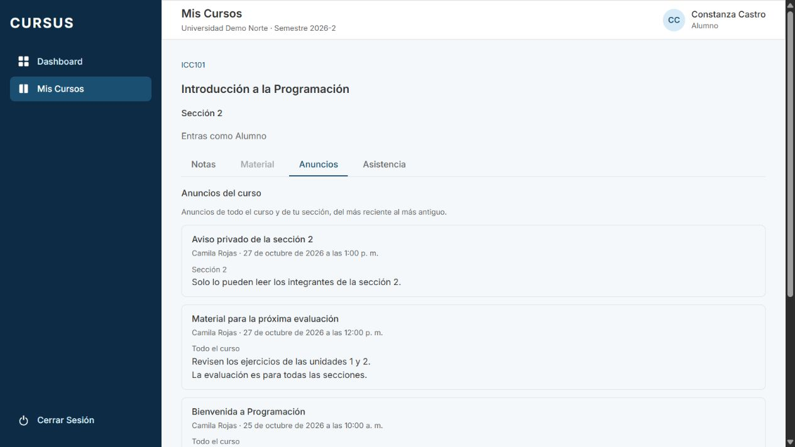

# ANU-03: el alumno lee los anuncios de sus cursos por fecha

Tarjeta: [F4 · ANU-03](https://trello.com/c/ZP2OZ6rf/141). Referencia: RN-09. Depende de [ANU-01](anu-01-anuncios-curso.md) y reutiliza la privacidad por sección de [ANU-02](anu-02-anuncios-seccion.md), ya integrada en `develop`.

## Comportamiento y alcance

El alumno entra desde su dashboard o Mis Cursos, abre una sección en la que está inscrito y elige **Anuncios**. La lista mezcla anuncios generales del curso y los dirigidos a su sección, del más reciente al más antiguo. Cada anuncio presenta título, cuerpo con saltos de línea, autor, fecha y destinatario. La fecha se muestra en español de Chile y en la hora local del navegador, con el instante ISO en el elemento `time`.

Se reutiliza `GET /api/espacio/secciones/:id/anuncios`, sin otro endpoint ni migración. ANU-01/02 ya aportaban los datos, la autorización y el orden. ANU-03 hace explícitos el alcance y el orden en la interfaz del alumno, usa una lista ordenada semántica y agrega pruebas de aceptación combinadas. El alumno tiene solo lectura y no ve el formulario de publicación.

La consulta filtra en SQL `seccion_id IS NULL OR seccion_id = $3` y ordena por `created_at DESC, id DESC`. La fecha decide el orden, aunque la inserción ocurra en otro orden; el ID desempata fechas iguales de forma estable. No se agrupan primero los generales o los privados. Se excluyen anuncios archivados, de otros cursos, universidades o secciones antes de devolver título, cuerpo o metadatos. El guard exige una inscripción activa. RLS solo aísla universidades: futuras lecturas y conteos deben conservar el filtro de destinatario del servicio.

Se conservan los estados de carga, lista vacía y error con reintento. Los mensajes se renderizan como texto, sin interpretar HTML. Se mantiene la decisión de ANU-02: el Director solo recibe anuncios generales y el Administrativo no tiene acceso a anuncios.

## Preparación para revisar

Usar una base local de desarrollo/prueba y las variables de `.env.example`; las credenciales de los ejemplos pertenecen al seed ficticio. No ejecutar el seed ni pruebas de rollback en una base de producción.

```bash
git fetch origin
git switch feature/anu-03-listado-anuncios-alumno
npm ci
docker compose up -d --wait
npm run migration:run --workspace=backend
npm run seed --workspace=backend
# En dos terminales:
npm run dev:back
npm run dev:front
```

1. Entrar como `camila.rojas@norte.cursus.test` usando `SEED_PASSWORD`. Abrir ICC101 sección 1 → Anuncios. Publicar un anuncio **Todo el curso**, después uno **Sección 1** y finalmente otro **Todo el curso**, con títulos distintos y cuerpos de varias líneas.
2. Entrar como `matias.munoz@norte.cursus.test`, profesor de ICC101 sección 2. Publicar un anuncio **Sección 2**, más reciente que los anteriores.
3. Entrar como `martina.morales@norte.cursus.test`. Desde el dashboard abrir ICC101 sección 1 → Anuncios. Debe ver los dos generales y el privado de sección 1 mezclados por fecha descendente. Verificar título, cuerpo, autor, fecha y etiqueta; no debe haber formulario. Recargar y comprobar persistencia.
4. En Network, revisar el GET de anuncios: no debe incluir ID, título ni cuerpo del privado de sección 2. Intentar abrir la URL de esa sección como Martina debe mostrar Sin acceso.
5. Entrar como `constanza.castro@norte.cursus.test`, inscrita en sección 2: debe ver los generales y su privado, nunca el privado de sección 1. Abrir otro curso inscrito: no deben aparecer anuncios de ICC101.
6. Abrir una sección sin anuncios: Aún no hay anuncios. Simular conexión lenta o un fallo del GET: se muestra carga/error y Reintentar permite recuperar la lista. Verificar que el cuerpo conserva los saltos de línea y no interpreta etiquetas HTML.
7. Ejecutar las pruebas siguientes y comprobar CI. La prueba PostgreSQL construye datos fuera de orden temporal y con empate de fecha; no es necesario modificar fechas manualmente para revisar el desempate.

## Pruebas automatizadas

- `PestanaAnuncios.test.tsx`: datos completos en cada artículo, orden recibido del servidor, alcance general/propio, fecha ISO y presentación local, carga y contenido HTML literal. Conserva los casos de vacío, error/reintento, solo lectura y publicación de ANU-01/02.
- `anuncios.db-spec.ts`: peticiones autenticadas contra la API y PostgreSQL real en una base aislada. Mezcla anuncios generales y propios de varios autores; inserta fuera de orden temporal, prueba empate de fecha y lecturas repetidas; excluye privados ajenos, otro curso y archivados. Contrasta la respuesta del alumno de sección 1 con la del alumno de sección 2, incluyendo todos los campos del anuncio. Conserva permisos, aislamiento, revocación, FK y rollback de ANU-01/02.

```bash
npm run lint
npm test
npm run test:e2e --workspace=backend
npm run test:db --workspace=backend
npm run build
npm run format:check
```

## Evidencia en navegador

Comprobación con API real y PostgreSQL en una base temporal exclusiva para ANU-03, seed completo y usuarios ficticios. Martina abre ICC101 desde su dashboard y ve los generales de los días 27 y 25, junto al privado de su sección del día 26. Constanza abre la sección 2 y ve sus generales y su privado, sin el de Martina. No se muestran errores en la consola de esa sesión. Se retiran los servidores, el script y la base temporal al terminar.




