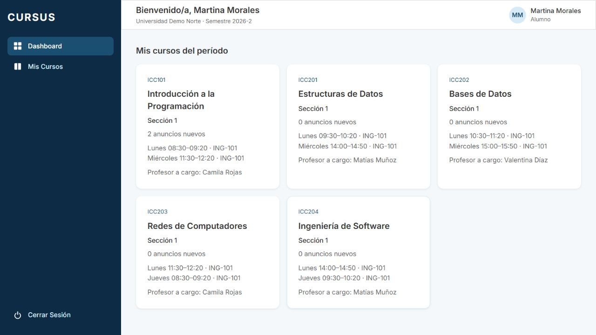
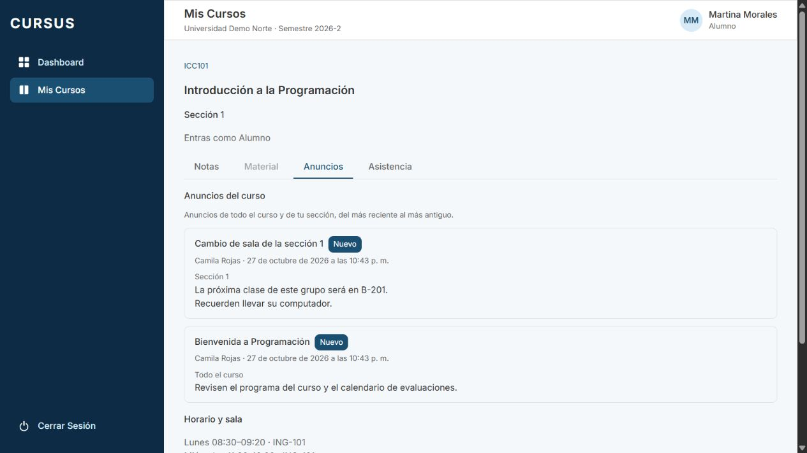
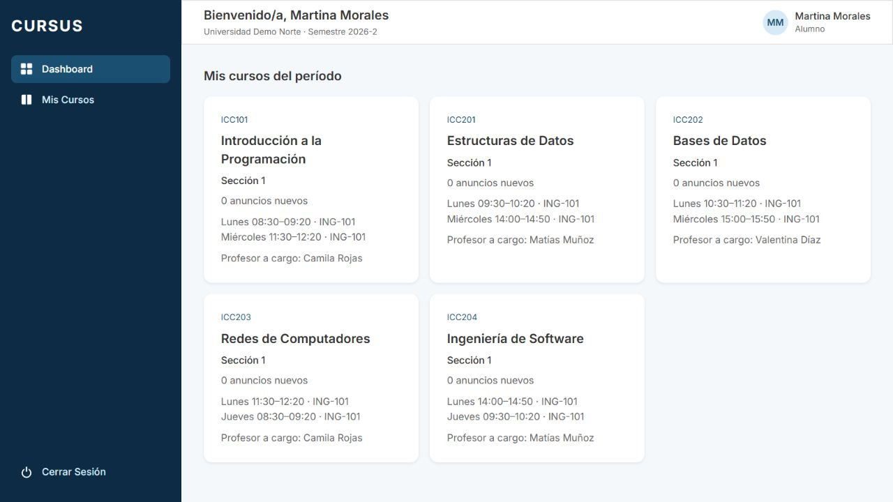
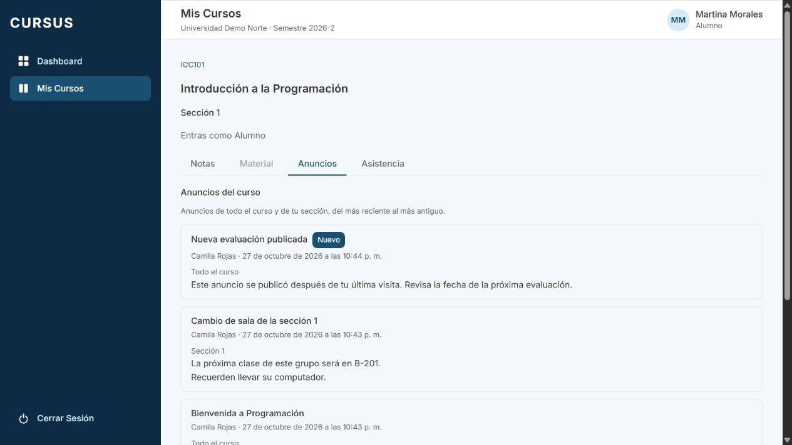

# ANU-04: anuncios nuevos desde la última visita del alumno

Tarjeta: [F4 · ANU-04](https://trello.com/c/LVcO2pZA/142). Referencia RN-09. Depende de [ANU-03](anu-03-lectura-anuncios-alumno.md), ya integrada en `develop`.

## Comportamiento

Cada tarjeta del dashboard del alumno indica cuántos anuncios nuevos tiene su sección: `0 anuncios nuevos`, `1 anuncio nuevo` o el plural correspondiente. Cuenta únicamente anuncios activos del curso completo y de esa sección que ese alumno todavía no ha visto. El privado de otra sección no suma ni aparece en la lista.

Abrir el dashboard o el resumen del curso no registra una visita a Anuncios. Cuando el alumno abre la pestaña **Anuncios** y la lista carga correctamente, aparecen las etiquetas **Nuevo** según el estado anterior a esa visita y se registra automáticamente el conjunto recibido. Las etiquetas se mantienen durante esa lectura para que pueda distinguir qué acaba de llegar. Al volver al dashboard se consulta el contador actualizado; al volver a abrir la pestaña, los vistos ya no llevan etiqueta. Un anuncio posterior vuelve a aparecer como nuevo.

Si se vuelve al dashboard mientras el registro todavía está pendiente, su confirmación notifica a la vista para volver a consultar el contador. Así no queda desactualizado por una respuesta lenta. Esto no altera las etiquetas del snapshot de Anuncios.

Decisiones de esta tarjeta:

- La primera visita considera nuevos todos los anuncios visibles existentes; no se inventan visitas anteriores al despliegue.
- La lectura se guarda en el servidor por alumno y anuncio, conservándose entre sesiones y dispositivos. Otro alumno conserva su propio estado. Si el mismo alumno está inscrito en dos secciones del mismo curso, el general leído desde una no vuelve a contarse en la otra; sus privados siguen siendo independientes.
- Una visita registra lo efectivamente recibido, no un corte global de reloj. Así, una publicación concurrente, incluso creada antes del GET pero confirmada después, no se marca sin haberse mostrado. Se conserva el orden por fecha de ANU-03.
- Si falla el GET, no se registra lectura. Si falla el registro, la lista sigue visible y se ofrece **Reintentar actualización**. Se reenvían los mismos IDs, sin ocultar anuncios ni avanzar una marca temporal del curso. Los lotes previos que ya tuvieron éxito se conservan y el reintento es idempotente.
- Profesor, ayudante y Director conservan su lectura de ANU-01/02/03 y no registran lecturas de alumno. El Administrativo sigue sin acceso a anuncios.

## API, privacidad y persistencia

- `GET /api/espacio/secciones/:id/anuncios`: conserva la respuesta de ANU-03 y agrega `nuevo: boolean` únicamente para el alumno. Es solo lectura.
- `POST /api/espacio/secciones/:id/anuncios/lecturas`: `{ anuncioIds: string[] }`, máximo `MAX_ANUNCIOS_LECTURA` (100) UUID distintos por petición; responde 204. Solo alumno inscrito, con usuario y universidad derivados de su sesión. El cliente envía los IDs nuevos recibidos y divide listas grandes en lotes.
- El backend vuelve a validar la inscripción, vigencia de sección/curso y alumno; mantiene locks compartidos hasta el commit. Inserta únicamente los IDs visibles del curso y sección autorizados. IDs ajenos, archivados o inexistentes se ignoran sin revelar su existencia. Un `alumnoId` o cualquier campo extra en el body produce 400; inscripción revocada, rol incorrecto o sección ajena producen 403; sin sesión, 401.
- `GET /api/dashboard/secciones-alumno` agrega `anunciosNuevos: number`. Una sola consulta incorpora el contador de cada tarjeta; no se hace una petición adicional por curso.

`anuncios.sql.ts` comparte el predicado de destinatario entre lista, contador y registro, junto con el predicado de lectura pendiente. RLS solo aísla universidades: no sustituye el filtro de destinatario ni de alumno de estas consultas. Los privados no se descargan para filtrarlos en el navegador.

La migración **`1792610000000-CrearLecturaAnuncio`** agrega `lectura_anuncio` con PK `(alumno_id, anuncio_id)`, universidad y `visto_en` de la primera lectura, generado por PostgreSQL. Sus FKs compuestas impiden mezclar universidades. Las filas son de solo adición: RLS permite SELECT/INSERT al rol alumno de la universidad, sin UPDATE ni DELETE; la API siempre filtra además por el alumno de la sesión. `ON CONFLICT DO NOTHING` conserva la primera lectura y la inserción ordena los IDs para evitar órdenes de bloqueo opuestos entre pestañas.

Aplicar la migración antes de arrancar el backend actualizado. No necesita backfill ni modifica anuncios. Se verificó que el timestamp no colisiona con `develop` ni con MAT-08 (#79, `1792590000000`). La reversión quita la tabla de lecturas y su FK/constraint auxiliar, conservando los anuncios intactos; pierde el seguimiento y al reaplicar vuelven a estar nuevos. Probar rollback únicamente en bases de prueba y con la versión del backend compatible. El test de esquema conserva el orden de reversión de todas las migraciones anteriores.

## Revisión local

Usar una base de desarrollo/prueba y `.env.example`; los usuarios siguientes son ficticios y usan `SEED_PASSWORD` del entorno.

```bash
git fetch origin
git switch feature/anu-04-anuncios-nuevos
npm ci
docker compose up -d --wait
npm run migration:run --workspace=backend
npm run seed --workspace=backend
# En dos terminales:
npm run dev:back
npm run dev:front
```

1. Como `camila.rojas@norte.cursus.test`, abrir ICC101 sección 1 → Anuncios. Publicar un anuncio **Todo el curso** y otro **Sección 1**. Como `matias.munoz@norte.cursus.test`, publicar un privado **Sección 2**. Usar títulos distintos.
2. Como `martina.morales@norte.cursus.test`, abrir el dashboard. ICC101 sección 1 debe contar el general y el privado propio, sin sumar el de sección 2. Si ya tenía visitas o anuncios, comparar el aumento correspondiente. Abrir solo el resumen del curso y volver al dashboard: el contador debe conservarse.
3. Abrir **Anuncios**: los dos pendientes se muestran con **Nuevo**, título, cuerpo, autor, fecha y destino. No aparece el privado de sección 2. Las etiquetas permanecen durante esa lectura. En Network, comprobar GET con `nuevo` y POST `lecturas` con únicamente los IDs recibidos, sin enviar alumno ni universidad; debe responder 204.
4. Volver al dashboard: el contador baja. Reabrir Anuncios: los ya vistos no llevan **Nuevo**. Cerrar y abrir sesión de nuevo, o usar otro navegador con Martina: mantiene el estado leído.
5. Publicar otro general con Camila. Al volver a cargar el dashboard de Martina aparece un anuncio nuevo. Abrir Anuncios: solo ese anuncio tiene **Nuevo**, los anteriores no. Repetir con un nuevo privado de sección 2: no debe aumentar el contador de Martina.
6. Como `constanza.castro@norte.cursus.test`, alumna de sección 2, comprobar su estado independiente: recibe sus generales y privados, nunca los de sección 1. La visita de Martina no limpia el contador de Constanza.
7. Simular fallo del GET: no debe enviarse un registro de lectura. Simular fallo solo del POST de lecturas: se conserva la lista y aparece **Reintentar actualización**; al recuperarse, actualiza el contador. Probar dos pestañas, recargas y una publicación durante la lectura: no hay duplicados y lo no recibido sigue nuevo.
8. Con API, enviar IDs de otra sección, otro curso, universidad o archivados: no se registran. Intentar suplantar `alumnoId` produce 400. Inscripción retirada o rol diferente no puede marcar lecturas. Verificar todo el CI antes de aprobar.

## Pruebas

- PostgreSQL y API real: primera visita, GET/dashboard sin escritura, registro, contador, otra sesión/alumno, ID manipulado y curso/sección/universidad, archivados, misma fecha, commit tardío, dos pestañas, primera fecha inmutable, permisos, revocación, DTO, lotes y rollback. Se conservan las pruebas de ANU-01/02/03.
- Frontend: etiqueta y snapshot de lectura, curso abierto sin marcar, contador al volver, reentrada sin etiqueta, error de GET/registro, reintento, roles y más de 100 anuncios en lotes.
- Esquema/RLS: timestamps únicos y ordenados, aplicación/reversión conjunta, grants y políticas de la nueva tabla.

```bash
npm run lint
npm run test --workspace=frontend -- --maxWorkers=2
npm run test --workspace=backend
npm run test:e2e --workspace=backend
npm run test:db --workspace=backend
npm run build
npm run format:check
```

## Evidencia de navegador

API real, seed completo, cuentas ficticias y PostgreSQL en una base temporal exclusiva. Se comprueba el ciclo **2 → 0 → 1**: dos pendientes, visita correcta y nueva publicación por la API autenticada del profesor. El privado ajeno nunca se cuenta. Se observan etiquetas, su desaparición en visitas posteriores y consola sin errores. Se retiran base, servidores y script temporal al terminar.








