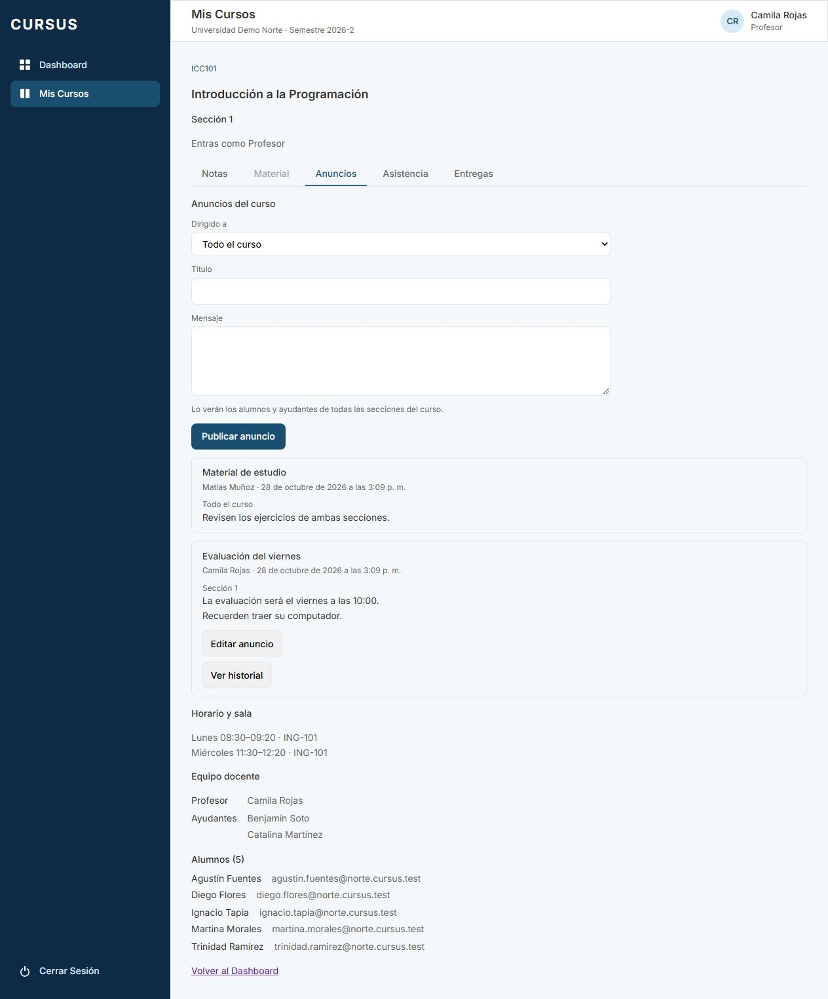
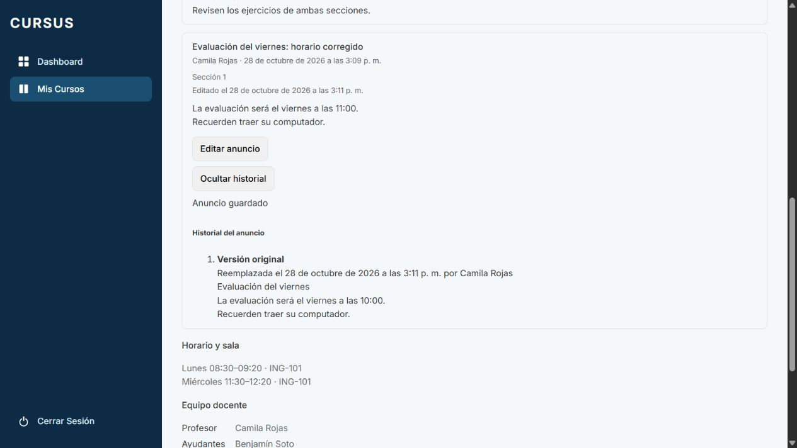
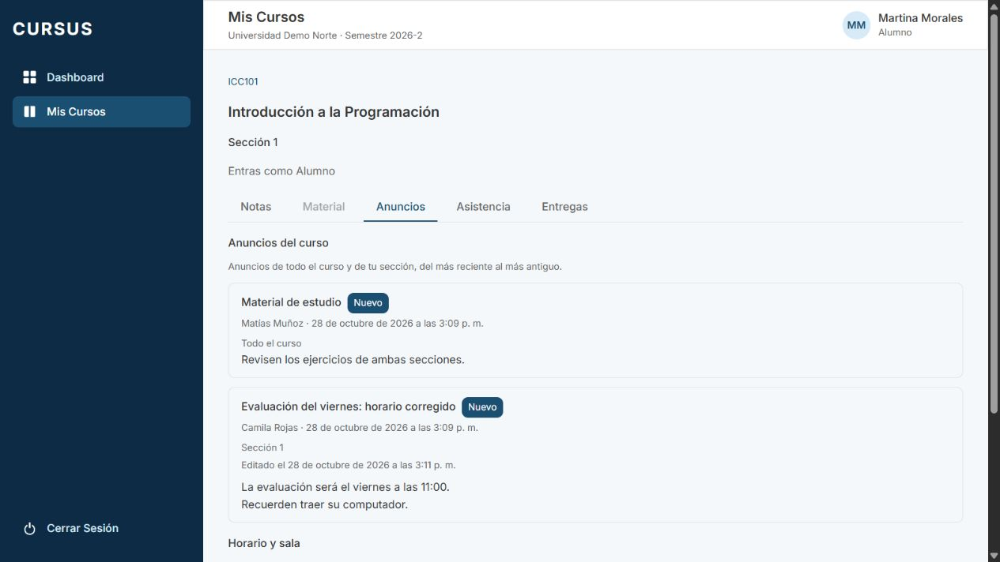

# ANU-05: el autor edita un anuncio con historial

Tarjeta: [F4 · ANU-05](https://trello.com/c/VPXZbjFp/143). Referencia RN-09. Depende de ANU-01; parte de `develop` con ANU-02/03/04, MAT-08 y MT-04 integradas.

## Comportamiento y decisiones

En la pestaña Anuncios, el profesor ve **Editar anuncio** y **Ver historial** únicamente en sus publicaciones. Editar precarga título y cuerpo, permite cancelar y bloquea los campos y botones durante el guardado. Si falla, conserva lo escrito para reintentar. Las validaciones son las de publicación: límites compartidos, título de una línea, cuerpo multilínea, contenido obligatorio y rechazo de caracteres de control.

Tras una corrección real, el anuncio muestra **Editado el [fecha y hora]**, además de su fecha de publicación original. Todos sus lectores autorizados ven la versión corregida y la marca. El historial queda reservado al autor con acceso vigente al espacio: no se expone al alumno, ayudante, otro profesor, Director, Administrativo ni Superadmin.

El historial lista las versiones anteriores en orden de cambio, con título, cuerpo, fecha en que fueron reemplazadas y responsable. La primera se identifica como **Versión original**. Cada cambio conserva la versión inmediatamente anterior; el contenido actual permanece en el anuncio. Guardar los mismos valores normalizados no crea una edición ni cambia la fecha.

Decisiones de alcance:

- Se editan título y cuerpo; no autor, curso, sección destinataria, fecha de publicación ni archivo. Se mantienen el ID y la posición por fecha de publicación de ANU-03.
- El autor necesita seguir teniendo acceso como profesor al espacio desde el que edita. Perder la sección o archivarse el curso/sección impide editar, aunque haya publicado el anuncio antes.
- Editar no convierte un anuncio leído en **Nuevo** ni modifica los contadores o las lecturas de ANU-04. Para volver a avisar al grupo se publica otro anuncio.
- Dos guardados concurrentes se serializan: prevalece el último guardado y el historial conserva ambos estados anteriores. No se incorpora un bloqueo optimista del formulario en esta tarjeta.

## API y persistencia

- `PATCH /api/espacio/secciones/:id/anuncios/:anuncioId`: `{ titulo, cuerpo }`, ambos obligatorios; responde 200 con el anuncio actualizado. Usa el mismo DTO base de contenido que publicar. Un campo extra como `autorId` o `seccionId` produce 400. El ID de anuncio debe ser UUID.
- `GET /api/espacio/secciones/:id/anuncios/:anuncioId/historial`: `CambioAnuncio[]`, solo para el autor autorizado. Cada entrada incluye `id`, `titulo`, `cuerpo`, `fecha` ISO y `responsable: { id, nombre }`. `fecha` indica cuándo se reemplazó esa versión, no cuándo se publicó o empezó a existir.
- `Anuncio` agrega `editadoEn` ISO solo después de una edición real. El listado y la publicación conservan el resto del contrato.
- El permiso CASL `update Anuncio` pertenece al Profesor. El guard exige pertenencia; el servicio vuelve a verificar rol, vigencia y autoría. Un anuncio privado ajeno, de otro curso/universidad o archivado devuelve 404, sin exponer su historial. Un anuncio general visible de otro autor devuelve 403. Sin sesión, 401. Superadmin no recibe edición de anuncios.

La migración **`1792670000000-CrearHistorialAnuncio`** agrega `anuncio.editado_en` y la tabla `anuncio_cambio`, con FKs compuestas por universidad, índices y RLS. Conserva su timestamp al integrar NOT-05 (`1792660000000`) desde `develop`. La reversión conjunta retira CrearHistorialAnuncio, luego CrearNota y luego las cuatro migraciones de MT-04, en ese orden.

Antes de modificar el contenido, el servicio bloquea la vigencia de sección/curso/usuario y la fila del anuncio. Un trigger conserva `OLD.titulo` y `OLD.cuerpo`, registra al autor y fija `editado_en` con `clock_timestamp()` en la misma operación. Para el rol de la API exige además que `app.anuncio_autor_id`, fijado desde la sesión con alcance local a la transacción, coincida con el autor. Si falla la auditoría se revierten contenido y fecha.

El historial es de solo adición: sin UPDATE/DELETE para la API y con trigger que rechaza esas operaciones incluso para el dueño de la tabla. RLS permite leer el historial a cualquier Profesor de la misma universidad: no distingue al autor. La restricción «solo el autor», junto con el acceso vigente y el destinatario, la aplica el servicio; las futuras consultas deben reutilizar esa validación y no exponer `anuncio_cambio` directamente. No se envían versiones antiguas a lectores que solo pueden ver el contenido actual.

Aplicar la migración antes del backend actualizado. No necesita backfill: la primera corrección captura la versión original que ya existía. El rollback elimina historial, funciones y marca de edición, pero conserva el contenido corregido, los anuncios y sus lecturas. Al reaplicar, empieza un historial nuevo; el seguimiento anterior no se recupera. Probar rollback solo en una base de prueba con backend compatible. Se conserva la reversión de todas las migraciones anteriores.

## Preparación y revisión manual

Usar una base local de desarrollo/prueba, `.env.example` y las cuentas ficticias del seed con `SEED_PASSWORD` del entorno.

```bash
git fetch origin
git switch feature/anu-05-editar-anuncio
npm ci
docker compose up -d --wait
npm run migration:run --workspace=backend
npm run seed --workspace=backend
# En dos terminales:
npm run dev:back
npm run dev:front
```

1. Como `camila.rojas@norte.cursus.test`, abrir ICC101 sección 1 → Anuncios. Publicar un anuncio **Sección 1** con título y cuerpo de varias líneas. Como `matias.munoz@norte.cursus.test`, publicar uno **Todo el curso** desde sección 2.
2. Volver a Camila: solo su anuncio debe ofrecer Editar anuncio y Ver historial. Antes de editar, el historial está vacío. Abrir edición: precarga el contenido; Cancelar edición no guarda nada.
3. Corregir título y una hora del cuerpo y guardar. Verificar respuesta 200, el mismo ID, fecha de publicación y destinatario, el nuevo contenido y **Editado el** con fecha/hora. Recargar y comprobar persistencia.
4. Abrir Ver historial: debe aparecer la **Versión original**, con el texto anterior, quién lo cambió y la fecha del cambio. Corregir de nuevo: aparecen ambas versiones anteriores y el anuncio conserva la última. Guardar sin cambios no agrega entradas ni cambia la marca.
5. Como `martina.morales@norte.cursus.test`, alumna de sección 1, verificar contenido corregido y marca Editado, sin botones de edición/historial. Como Constanza de sección 2, el privado no aparece. Un general corregido se ve desde ambas secciones, con la marca.
6. Por API, Matías no puede editar ni consultar el historial del general publicado por Camila: 403. Privado de otra sección, otro curso, universidad, archivado o UUID inexistente: rechazo sin cambios. Alumno, ayudante, Director, Administrativo o Superadmin no pueden editar ni leer el historial. No basta con ocultar el botón.
7. Probar título/cuerpo inválidos, campos extra, caracteres de control, conexión lenta y error de red: se conserva la edición; durante el envío se bloquean campos y doble envío. Un fallo al cargar historial permite Reintentar.
8. Probar dos pestañas que guardan cambios distintos: el historial conserva la cadena de versiones. La suite PostgreSQL verifica también fallo de auditoría con rollback completo, inmutabilidad y retirada de la migración sin perder el contenido publicado.

## Pruebas

- PostgreSQL/API: autoría, datos completos, normalización y no-op, múltiples versiones, concurrencia, permisos, privacidad, validación, anuncios leídos y rollback atómico si falla el historial. Historial inmutable y comprobación adicional de autor en el trigger.
- Esquema/RLS: migraciones únicas/ordenadas, aplicación/reversión conjunta, políticas, grants y exclusión de la auditoría de los permisos del Superadmin. SQL directo como `cursus_app`/Profesor de Norte: SELECT sin filtro solo ve su historial e INSERT con referencias válidas de Sur se rechaza con 42501; insertar para Norte sí está permitido. Estas pruebas detectan quitar el filtro de universidad de cualquiera de las dos políticas de `anuncio_cambio`.
- Frontend: controles solo del autor, precarga, cancelación, errores y reintento, bloqueo durante envío, marca/fecha, versión original, cuerpo como texto y lectores sin controles.

Comprobación de regresión RLS: se retiró temporalmente el filtro `universidad_id = universidad_actual()` y ambas pruebas nuevas fallaron (lectura ajena e inserción indebida). Se restauró la migración original antes de ejecutar la suite completa.

```bash
npm run lint
npm run test --workspace=frontend -- --maxWorkers=2
npm run test --workspace=backend
npm run test:e2e --workspace=backend
npm run test:db --workspace=backend
npm run build
npm run format:check
```

## Evidencia de navegador

API real, PostgreSQL temporal y usuarios ficticios. Camila ve controles solo en su anuncio, corrige la evaluación de las 10:00 a las 11:00 y consulta la versión original. Martina ve el contenido corregido y Editado sin controles del autor. Consolas sin errores. Se retiran servidores, script y base temporal al finalizar; no se alteran datos de la base habitual.






