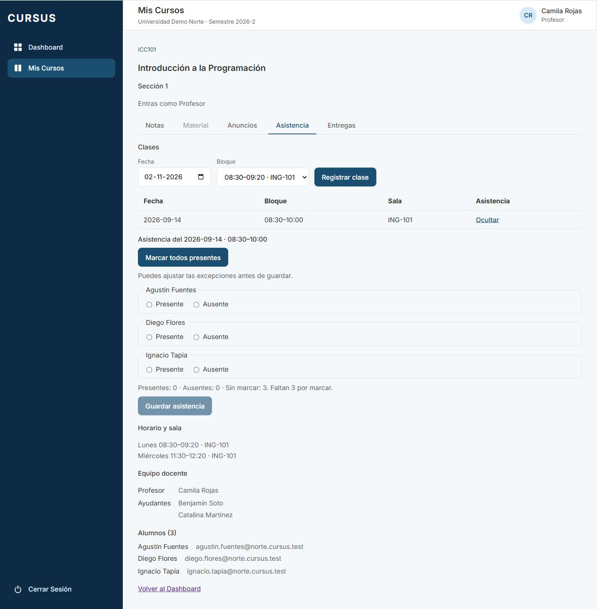
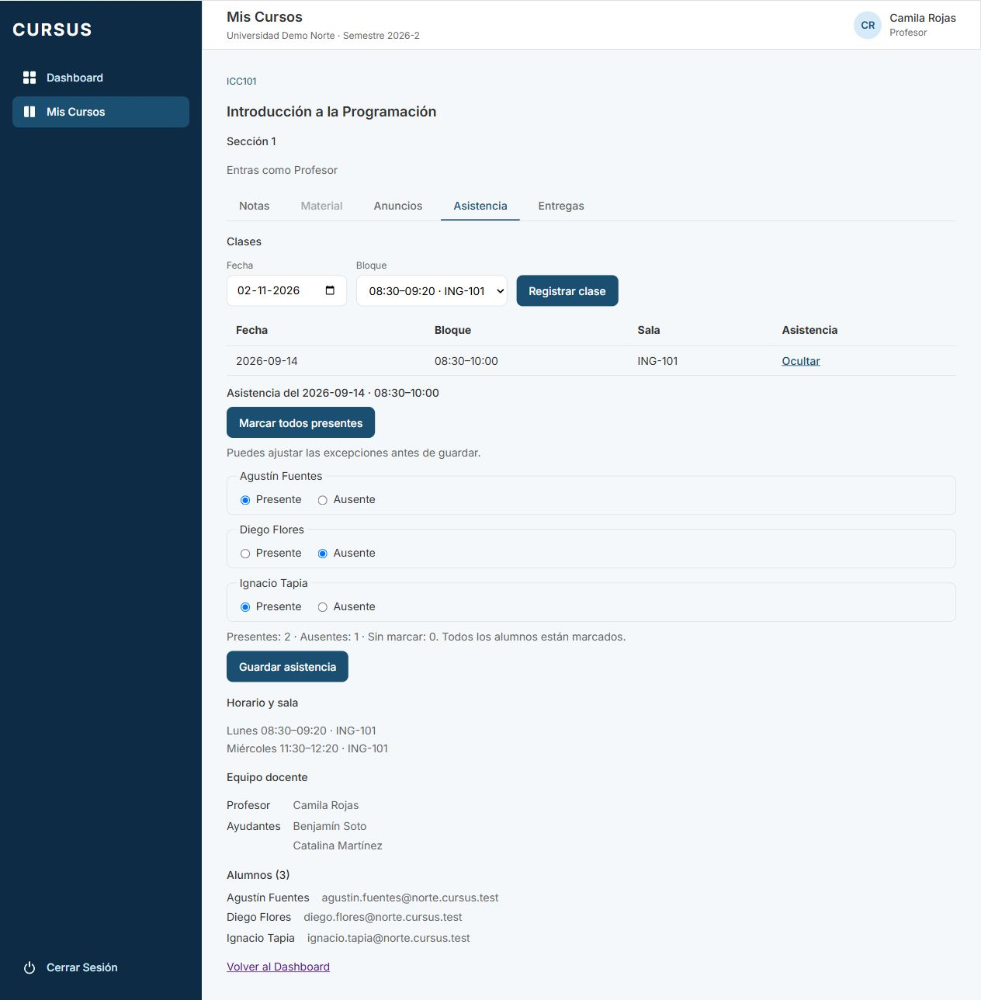
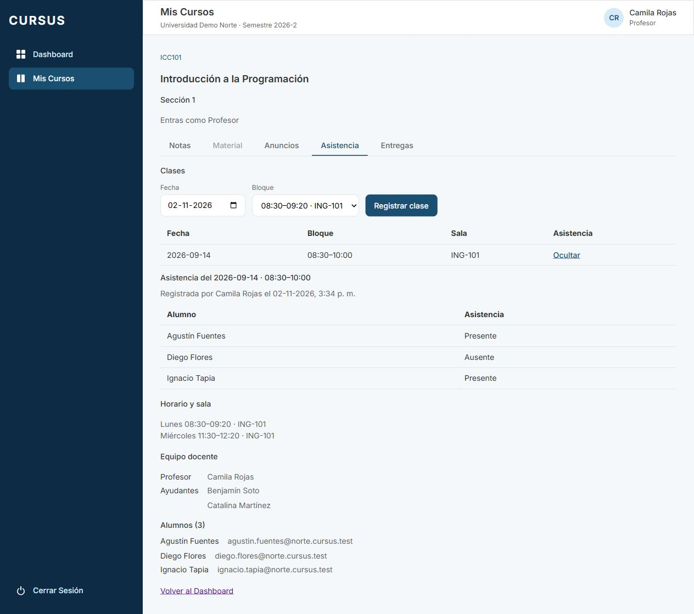

# ASI-03: marcar todos presentes y ajustar excepciones

Tarjeta: [F4 · ASI-03](https://trello.com/c/4ZUrvrDB/146-f4-asi-03-profesor-marca-a-todos-presentes-y-ajusta-las-excepciones). Referencia RN-13. Depende de ASI-02, integrada en `develop`.

## Comportamiento

El profesor abre una clase pendiente desde **Mis Cursos → sección → Asistencia → Ver**. El botón **Marcar todos presentes** selecciona Presente para todos los alumnos de la lista, incluso los que antes estaban marcados Ausente. No guarda ni hace una petición al backend: permite cambiar las excepciones a Ausente antes de pulsar **Guardar asistencia**.

El resumen anuncia **Presentes**, **Ausentes** y **Sin marcar** con `aria-live="polite"`, tanto al marcar individualmente como al usar el botón. Una opción todavía sin seleccionar no se cuenta como Ausente. Guardar se habilita únicamente cuando todos tienen marca.

Decisiones:

- Volver a pulsar Marcar todos presentes reinicia toda la lista a Presente. Se pueden ajustar las excepciones de nuevo.
- Durante el guardado se bloquean el botón masivo, los radios y Guardar. Permanecen bloqueados hasta que la recarga muestre la asistencia registrada. Un error libera los controles y conserva las marcas y el conteo para reintentar.
- El formulario sigue disponible solo para el profesor y en clases sin asistencia con alumnos inscritos. Una clase registrada sigue en solo lectura; corregirla corresponde a ASI-04. El ayudante no recibe controles de marcado.
- Los cambios pendientes viven en el formulario: cerrar la clase o recargar la página antes de guardar los descarta.

## API y despliegue

Se reutiliza sin cambios `POST /api/espacio/secciones/:id/clases/:claseId/asistencia` con `{ marcas: [{ alumnoId, presente }] }`. El servidor de ASI-02 sigue validando profesor, sección, universidad, lista exacta de inscritos y duplicados dentro de su transacción. La acción masiva usa la misma ruta que el marcado individual.

Esta tarjeta modifica el frontend, sus pruebas y documentación. No requiere migraciones ni cambios del contrato compartido. Las respuestas existentes por lista modificada (400), asistencia ya registrada (409) y problemas de conexión mantienen su comportamiento.

## Pruebas

`frontend/src/pages/AsistenciaDeClase.test.tsx` verifica:

- Marcado total sin envío automático; ajuste de una excepción, conteos y un único POST con las marcas finales.
- Lista parcialmente marcada, todos ausentes, repetir la acción y cambiar de vuelta a Presente.
- Bloqueo de todos los controles durante una petición pendiente, sin doble envío; error con conservación de marcas/conteos y posibilidad de seguir ajustando.
- Regresiones ASI-02: marcado individual, sin alumnos, ayudante sin formulario, clase registrada sin marcado masivo, lista modificada, conflicto y recarga.

```bash
npm run lint
npm run test --workspace=frontend -- --maxWorkers=2
npm run test --workspace=backend
npm run test:e2e --workspace=backend
npm run test:db --workspace=backend -- test/asistencia/asistencia.db-spec.ts test/asistencia/clases.db-spec.ts
npm run build
npm run format:check
```

CI ejecuta además toda la suite PostgreSQL.

## Revisión manual

Preparar `.env` desde `.env.example`, con credenciales propias de prueba y `SEED_PASSWORD`. Usar una base local de desarrollo/prueba con Node y dependencias del proyecto.

```bash
git fetch origin
git switch feature/asi-03-marcar-todos-presentes
npm ci
docker compose up -d --wait
npm run migration:run --workspace=backend
npm run seed --workspace=backend
# En dos terminales:
npm run dev:back
npm run dev:front
```

1. Ingresar como `camila.rojas@norte.cursus.test`, abrir ICC101 sección 1 → Asistencia. Registrar una clase en una fecha del período y un bloque del horario; abrirla con Ver.
2. Al inicio, Presentes y Ausentes son 0 y Sin marcar coincide con la cantidad de alumnos. Guardar está deshabilitado. Marcar individualmente a alguno y comprobar los conteos.
3. Pulsar Marcar todos presentes: todos los radios Presente quedan seleccionados, Presentes coincide con la lista, Ausentes y Sin marcar son 0. En Network no debe aparecer un POST de asistencia.
4. Cambiar un alumno a Ausente: Presentes baja en 1 y Ausentes sube en 1. El resto permanece Presente. Todavía no se guarda. Repetir Marcar todos presentes vuelve a todos a Presente; ajustar otra vez una excepción.
5. Pulsar Guardar asistencia. Con conexión lenta, comprobar controles bloqueados y un solo POST. La vista pasa a solo lectura con las marcas finales, profesor y fecha. Ocultar y reabrir la clase conserva el resultado; no hay botón masivo.
6. En otra clase pendiente, simular un error de red al guardar. Debe conservar marcas y conteo, mostrar el error y permitir ajustar/reintentar. Si cambian los inscritos, usar Volver a cargar y completar la lista actual antes de guardar.
7. Como ayudante, comprobar que no puede marcar una clase pendiente y que ve una ya registrada en solo lectura. Una sección sin alumnos no ofrece el formulario.

## Evidencia

Comprobación con API real, PostgreSQL temporal y datos ficticios: tres alumnos, marcado total, una excepción y guardado. Antes de Guardar se comprobó que `asistencia` tenía 0 filas; después se verificó el resultado al reabrir la clase. Consola sin errores ni avisos. Se retiran base, script y servidores temporales; la base habitual no se modifica.






