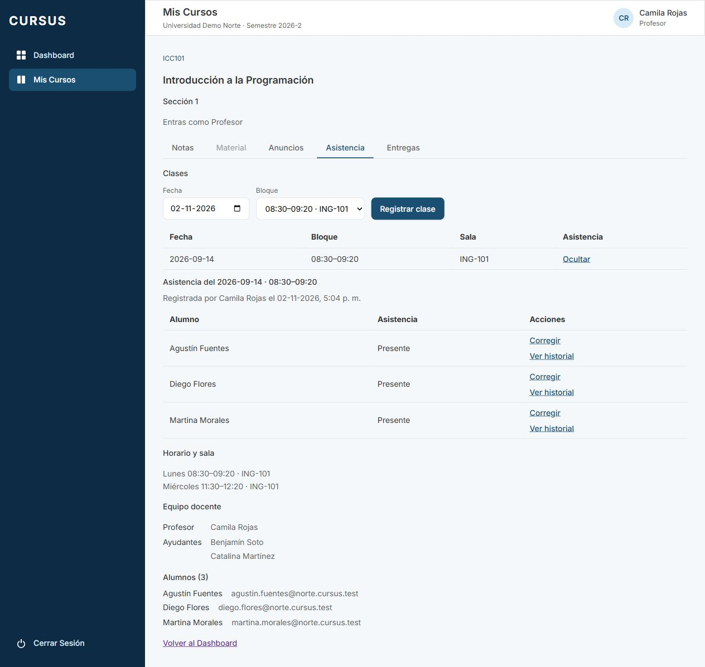
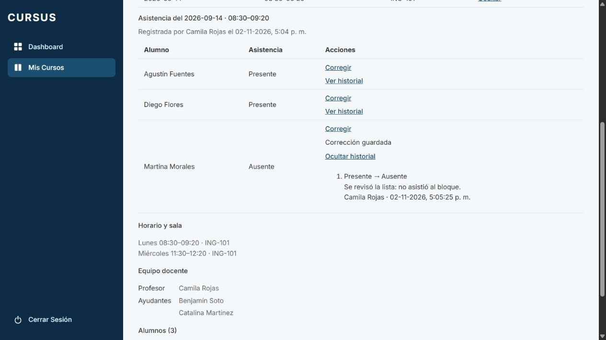
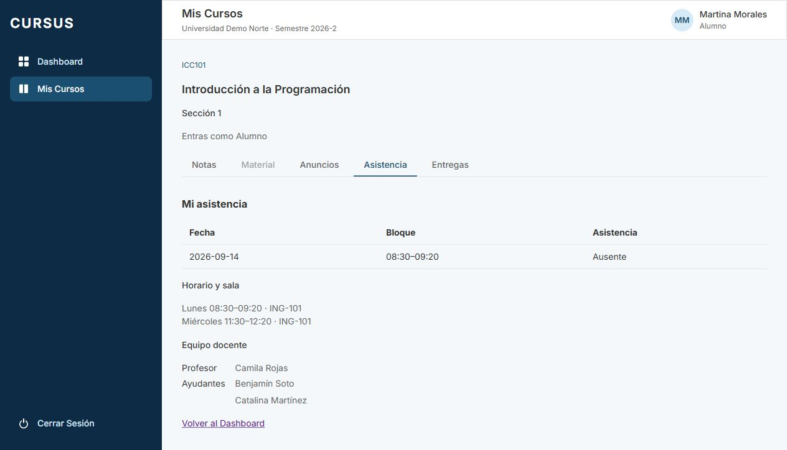

# ASI-04: corregir una marca con historial

Tarjeta: [F4 · ASI-04](https://trello.com/c/LJHk3JE1/147-f4-asi-04-profesor-corrige-una-marca-dejando-registro-del-cambio). Referencias RN-13 y RE-05. Depende de ASI-02; incluye ASI-03 desde `develop`.

## Comportamiento

En **Mis Cursos → sección → Asistencia → Ver**, el profesor puede corregir una marca ya guardada. Cada fila ofrece **Corregir** y **Ver historial**. El formulario muestra la marca actual, propone la opuesta y exige un motivo de hasta 500 caracteres. Permite cancelar sin enviar; durante el envío bloquea campos y botones. Si falla, conserva el motivo y permite reintentar o volver a cargar.

Cada corrección real conserva valor anterior, valor nuevo, fecha del cambio, profesor responsable y motivo. El historial se consulta a pedido, ordenado del más antiguo al más reciente, con carga, vacío, error y reintento. El texto se muestra escapado, sin interpretar HTML.

El alumno abre **Asistencia → Mi asistencia** y ve únicamente sus marcas guardadas con fecha y bloque, incluida la corrección vigente. No recibe marcas ajenas, motivos ni historial. Al reabrir la pestaña o recargar obtiene el estado actual; no se agrega actualización en tiempo real. Esta lectura mínima cubre el tercer criterio sin desarrollar los indicadores o reportes de ASI-06.

## Permisos y decisiones

- Corrige y consulta historial el **profesor actualmente a cargo de la sección**, aunque la asistencia original la haya registrado otro profesor. La sección, curso, clase y profesor deben seguir vigentes.
- El ayudante y el Director siguen leyendo las marcas vigentes, sin corrección ni historial. Alumno, Administrativo y Superadmin no pueden corregir. El alumno tiene una ruta propia; el GET de toda la clase permanece cerrado para él.
- Se corrigen marcas históricas ya guardadas aunque el alumno haya dejado la sección. La salida de la sección revoca su acceso al espacio, conforme a ESP-06.
- Guardar el mismo valor es un no-op: no agrega un evento. La interfaz no permite enviarlo y la API lo tolera si la versión anterior coincide.
- La petición incluye el valor que el profesor estaba viendo (`anterior`). Si ya cambió, responde 409 antes de escribir; el profesor debe recargar y revisar. Dos correcciones concurrentes de la misma versión producen un cambio y un conflicto, sin perder historia.
- **Persistencia:** se actualiza la marca vigente y se conserva su fecha y responsable de registro inicial. Un trigger inserta el evento inmutable de corrección. Esta implementación sustituye la previsión de archivar/recrear filas indicada originalmente en ASI-02: evita cambiar la identidad y metadatos de registro y conserva todos los valores anteriores en `asistencia_cambio`. No se elimina asistencia.

## API

| Método | Ruta                                                                      | Acceso y respuesta                                                                                               |
| ------ | ------------------------------------------------------------------------- | ---------------------------------------------------------------------------------------------------------------- |
| PATCH  | `/api/espacio/secciones/:id/clases/:claseId/asistencia/alumnos/:alumnoId` | Profesor vigente; `{ anterior: boolean, presente: boolean, motivo: string }`; 200 `AsistenciaClase` actualizada. |
| GET    | La misma ruta, con `/historial`                                           | Profesor vigente; `CambioAsistencia[]`: id, anterior, nuevo, motivo, fecha ISO y profesor `{ id, nombre }`.      |
| GET    | `/api/espacio/secciones/:id/mi-asistencia`                                | Solo alumno integrante; `AsistenciaPropia[]`, cada entrada con clase y presente, de más reciente a más antigua.  |

Sesión, universidad e identidad del profesor/alumno se resuelven en el servidor. No se admiten campos extra en la corrección (por ejemplo profesorId o universidadId). La lectura propia no toma un alumno desde query ni body. Se validan UUID, booleanos estrictos y motivo no vacío, normalizado y sin controles salvo tabulaciones/saltos de línea.

Errores: 401 sin sesión; 403 por rol o falta de pertenencia; 404 por universidad ajena o marca/clase inexistente, archivada, de otra sección o clase aún sin asistencia; 400 por body inválido; 409 por versión desactualizada. Un fallo de auditoría revierte toda la corrección.

## Migración y seguridad

**`1792690000000-CrearAsistenciaCambio`**, posterior a GES-23 (`1792680000000`). Se revisaron `develop` y los PR abiertos antes de asignarlo. Agrega:

- `asistencia_cambio`: FKs compuestas por universidad a la marca y al responsable; anterior/nuevo booleanos distintos, motivo obligatorio de 1–500 caracteres, fecha con `clock_timestamp()` e índices por marca/fecha y responsable.
- Trigger `BEFORE UPDATE` de asistencia: captura `OLD.presente` y `NEW.presente` en la misma operación y exige el profesor vigente y motivo fijados mediante `set_config(..., true)`. Si falla, se revierte también la marca. La API toma un lock de actualización sobre la marca y locks compartidos sobre clase, sección, curso y profesor; reasignar/archivar esas entidades espera al cierre de la transacción.
- Historial de solo adición: sin UPDATE/DELETE/TRUNCATE para `cursus_app` y trigger que rechaza UPDATE/DELETE incluso al dueño. RLS permite SELECT/INSERT únicamente a profesores de su universidad; la pertenencia a la sección se restringe adicionalmente en el servicio. Las futuras lecturas deben reutilizar esa validación.
- RLS de lectura del alumno sobre asistencia: exige universidad e id del alumno fijado localmente desde la sesión (`app.asistencia_alumno_id`). Además, la consulta filtra alumno, sección, vigencia e inscripción. El historial queda invisible para el alumno incluso por SQL sin filtro.

Aplicar la migración antes del backend. No requiere backfill: la primera corrección registra el primer valor anterior. El rollback retira historial, funciones y filtro adicional de alumno, conservando las marcas corregidas y los metadatos originales. Al reaplicar empieza un historial nuevo; el anterior se pierde. Probarlo únicamente en una base de prueba con backend compatible. La reversión conjunta conserva el orden de todas las migraciones anteriores.

## Pruebas

- PostgreSQL/API: ambos sentidos, datos completos y metadatos originales, motivo normalizado/obligatorio/límites, no-op, conflicto, concurrencia, roles, privacidad, marcas históricas, clases inválidas, SQL directo, FKs, RLS sin filtros, inmutabilidad, fallo de auditoría con rollback y retirada/reaplicación de la migración.
- Frontend: corrección con motivo, envío exacto, cancelación, bloqueo y doble envío, conservación ante 409 y recarga, reintento del historial, texto sin HTML y alumno viendo el valor vigente al reabrir. Una recarga causada por otra fila no desbloquea un PATCH aún pendiente.
- E2E y matriz CASL: solo Profesor recibe update Asistencia; sesiones y roles rechazan corrección/historial sin llegar al servicio.

```bash
npm run lint
npm run test --workspace=frontend -- --maxWorkers=2
npm run test --workspace=backend
npm run test:e2e --workspace=backend
npm run test:db --workspace=backend
npm run build
npm run format:check
```

## Revisión manual

Usar una base local de desarrollo/prueba, `.env.example`, Node/dependencias del proyecto y las cuentas ficticias del seed con `SEED_PASSWORD` del entorno.

```bash
git fetch origin
git switch feature/asi-04-corregir-asistencia
npm ci
docker compose up -d --wait
npm run migration:run --workspace=backend
npm run seed --workspace=backend
# En dos terminales:
npm run dev:back
npm run dev:front
```

1. Como `camila.rojas@norte.cursus.test`, abrir ICC101 sección 1 → Asistencia, registrar una clase dentro del período y en un bloque de su horario, abrirla con Ver y guardar su asistencia usando ASI-02/03. Anotar una marca Presente y la fecha/responsable de registro.
2. En esa fila, abrir Corregir. Verificar marca actual y nueva propuesta Ausente. Sin motivo no permite guardar; Cancelar no envía PATCH. Escribir un motivo y guardar: cambia solo esa marca y conserva el registro inicial.
3. Abrir Ver historial: comprobar Presente → Ausente, motivo, fecha/hora y profesor. Corregir de vuelta a Presente con otro motivo: conserva ambos eventos y muestra el valor actual. Ocultar/reabrir la clase confirma persistencia.
4. Como ese alumno (por ejemplo Martina, si se eligió su marca), entrar a ICC101 sección 1 → Asistencia: ve su propia marca vigente, sin nombres/marcas ajenas, controles de corrección ni motivos. Cambiar otra vez como profesora y reabrir la pestaña del alumno para verificar el nuevo valor.
5. Probar motivo vacío, espacios y longitud máxima. Con red lenta, los controles se bloquean y no hay doble envío. Ante error conserva el motivo. Para provocar 409, abrir la misma marca en dos sesiones/pestañas: guardar una y después la otra; la segunda pide recargar, sin evento adicional.
6. Como ayudante, comprobar lectura de la clase sin botones de corrección/historial. Alumno, Administrativo, Director y Superadmin no pueden corregir por API. Profesor de otra sección/universidad no accede a la marca ni al historial.
7. Prueba focalizada: `npm run test:db --workspace=backend -- test/asistencia/asistencia.db-spec.ts test/database/esquema-inicial.db-spec.ts test/multitenant/rls.db-spec.ts`. Revisar CI completo, incluido GES-20, antes de aprobar.

## Evidencias

API real y PostgreSQL temporal con usuarios ficticios. Camila corrige a Martina de Presente a Ausente, registra el motivo y consulta el historial. En una sesión independiente, Martina ve Ausente sin marcas ajenas. Consolas sin errores ni avisos. Al terminar se retiran base, script y servidores temporales; la base habitual no se modifica.






