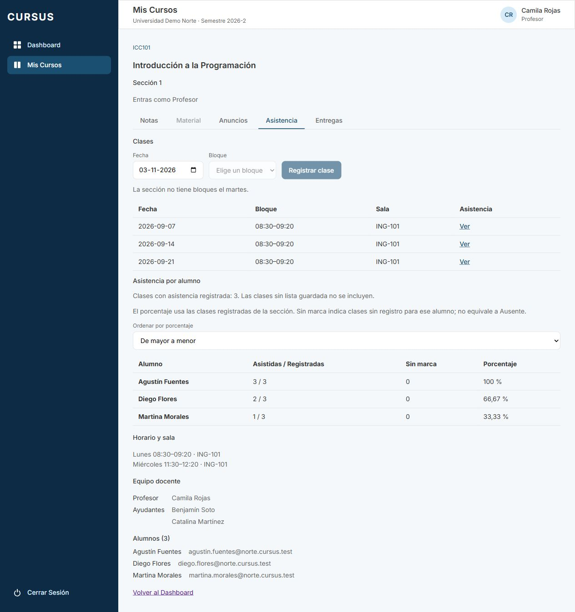
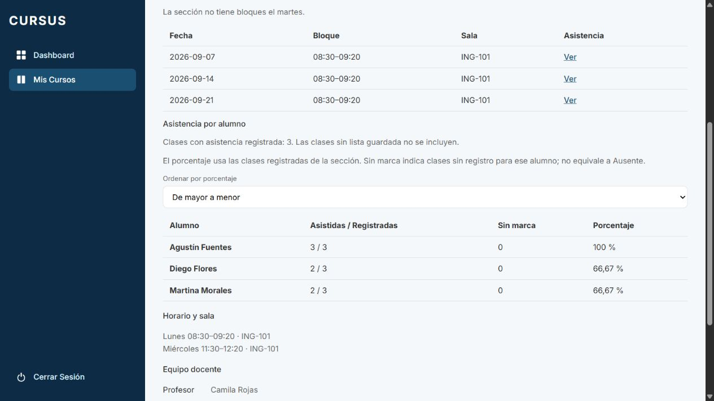

# ASI-05: porcentaje de asistencia por alumno

Tarjeta: [F4 · ASI-05](https://trello.com/c/5KZINxkG/148-f4-asi-05-profesor-ve-el-porcentaje-de-asistencia-de-cada-alumno). Referencia RN-13. Depende de ASI-02; parte de `develop` con ASI-03/04 y NOT-07 integradas.

## Comportamiento y cálculo

En **Mis Cursos → sección → Asistencia**, el profesor ve **Asistencia por alumno** con nombre, clases asistidas/registradas, clases sin marca y porcentaje. El orden inicial es de menor a mayor para detectar inasistencias; el selector permite invertirlo. Los empates se ordenan por nombre y después id; sin registros va al final en ambos sentidos. Cambiar el orden no recalcula los porcentajes.

Definiciones de alcance:

- **Registradas:** clases no archivadas de la sección que tienen al menos una marca de asistencia activa. Una clase creada pero sin lista guardada no cuenta. El denominador es común a toda la sección.
- **Asistidas:** marcas activas Presente de ese alumno en esas clases. Ausente no suma al numerador. Se toma el valor vigente, incluidas las correcciones de ASI-04; el historial no se cuenta como otra clase.
- **Porcentaje:** `round(asistidas * 100 / registradas, 2)`, calculado en PostgreSQL. Sin clases registradas devuelve `null` y muestra **Sin registros**, en lugar de 0 %.
- **Sin marca:** clases del denominador sin marca activa para ese alumno. Permite distinguir incorporaciones posteriores o marcas archivadas de una ausencia explícita. Si ingresó después, las clases anteriores siguen en el denominador de la sección; se muestra el faltante, sin etiquetarlo Ausente. Esta decisión sigue el criterio «sobre las registradas en la sección» y queda explícita para validación del cliente.
- **Lista:** alumnos con inscripción activa y usuario vigente con rol ALUMNO. Los retirados y usuarios archivados no aparecen; sus marcas históricas pueden seguir determinando que una clase tenga asistencia registrada.

La consulta calcula numeradores y denominador en una sola sentencia/snapshot, sin una consulta por alumno. No hay porcentajes almacenados ni caché de cálculo. Excluye otras secciones/universidades y clases/marcas archivadas. Si todas las marcas de una clase se archivan, deja de contar como registrada, coherente con la lectura de ASI-02.

Desde ASI-06, el denominador usa `public.total_clases_asistencia(seccion)` y el redondeo usa la expresión compartida `porcentaje.sql.ts`, también utilizados por la vista propia del alumno. Así ambos muestran el mismo porcentaje, incluso con clases sin marca. La migración y los límites de acceso de la función agregada se explican en la [guía ASI-06](asi-06-asistencia-alumno.md#migración-y-conteo-seguro).

## Permisos y API

`GET /api/espacio/secciones/:id/asistencia/resumen` devuelve `ResumenAsistenciaSeccion`:

```json
{
  "clasesRegistradas": 3,
  "alumnos": [
    {
      "id": "uuid",
      "nombre": "Alumno",
      "asistidas": 2,
      "sinMarca": 0,
      "porcentaje": 66.67
    }
  ]
}
```

Solo el profesor vigente de la sección puede consultarlo. Se exige sesión, permiso `read Asistencia`, pertenencia y rol Profesor en el servicio. La consulta vuelve a filtrar profesor de sesión, universidad, sección, curso y profesor vigentes. Ayudante, alumno, Director, Administrativo y Superadmin no reciben este resumen. No se agregan permisos de escritura ni se amplía la lectura del alumno.

La universidad y el profesor salen de la sesión: query/body no pueden elegir otros. Sin sesión responde 401; id inválido 400; falta de permiso/pertenencia 403; sección inexistente, archivada o de otra universidad 404. El resultado no incluye correos ni historial/motivos.

## Actualización al guardar o corregir

Después de un POST de asistencia confirmado o un PATCH de corrección exitoso se vuelve a pedir el resumen al backend. No cambia por marcas aún sin guardar, errores o conflictos. Conserva el sentido de orden elegido.

La notificación local lleva el id de la sección: no refresca resúmenes de otras secciones. También funciona si el profesor cambia de pestaña y regresa mientras la petición está pendiente: la confirmación del guardado refresca el resumen actualmente abierto. Las respuestas anteriores de una carga reemplazada se descartan mediante `useDatos`. No agrega actualizaciones en tiempo real entre navegadores; reabrir la pestaña consulta de nuevo.

No necesita migración ni backfill. Publicar backend y frontend compatibles; el backend calcula siempre a partir de las marcas vigentes. Los endpoints de ASI-02/04 conservan su contrato.

## Pruebas

- PostgreSQL/API: cero clases, clase pendiente, sección vacía, 0/66.67/100 %, denominador sin multiplicar por marcas, recálculo tras registro/corrección, otra sección, inscritos nuevos y sin marca, retiro, usuario archivado, clase/marca archivada y roles/otras universidades.
- Frontend: valores recibidos del backend, orden ascendente/descendente y desempates, null/vacío, error/reintento, permisos, actualización tras POST/PATCH confirmado, errores sin refresco, orden conservado y navegación durante guardado pendiente.
- E2E: sesión, id inválido y permisos CASL. La prueba de fecha de ASI-04 ahora compara con el reloj de PostgreSQL en vez de mezclar relojes de Windows y Docker.

```bash
npm run lint
npm run test --workspace=frontend -- --maxWorkers=1
npm run test --workspace=backend
npm run test:e2e --workspace=backend
npm run test:db --workspace=backend
npm run build
npm run format:check
```

## Revisión manual

Preparar una base local de prueba y `.env` desde `.env.example`. Usar las cuentas ficticias y `SEED_PASSWORD` del entorno.

```bash
git fetch origin
git switch feature/asi-05-porcentaje-asistencia
npm ci
docker compose up -d --wait
npm run migration:run --workspace=backend
npm run seed --workspace=backend
# En dos terminales:
npm run dev:back
npm run dev:front
```

1. Ingresar como `camila.rojas@norte.cursus.test`, abrir ICC101 sección 1 → Asistencia. Sin listas guardadas, los alumnos muestran Sin registros. Crear una clase sin guardar su asistencia: todavía no debe contar.
2. Guardar tres listas con un alumno presente en dos y ausente en una. El resumen debe mostrar 2/3 y 66,67 %, calculado en la respuesta del GET. Comprobar otros alumnos con 0 % y 100 %.
3. Cambiar el selector entre menor/mayor y mayor/menor. Verificar orden numérico, empates por nombre y que se mantiene la elección al guardar.
4. Guardar asistencia de otra clase: el denominador y los porcentajes se actualizan sin recargar la página. Corregir una ausencia a Presente con motivo: sube el numerador, sin sumar otra clase. Cancelar o provocar un error/409 no debe cambiar el resumen.
5. Con red lenta, comenzar un guardado, ir a Anuncios y volver a Asistencia antes de que termine. Al confirmarse, el resumen abierto debe actualizarse. Probar error del GET y Reintentar.
6. Inscribir a un alumno después de registrar clases: aparece sin marcas anteriores y se indica la cantidad. Retirarlo deja de mostrarlo. Comprobar que no aparecen alumnos de otras secciones/universidades y que los otros roles no ven ni solicitan el resumen.
7. Pruebas focalizadas: `npm run test:db --workspace=backend -- test/asistencia/asistencia.db-spec.ts` y `npm run test --workspace=frontend -- src/pages/ResumenAsistencia.test.tsx src/pages/AsistenciaDeClase.test.tsx src/pages/PestanaAsistencia.test.tsx --maxWorkers=1`. Aprobar con CI completo en verde, incluido GES-20.

## Evidencias

API real y PostgreSQL temporal, con tres alumnos ficticios. Dos listas iniciales: 100/50/50 %. Al guardar la tercera, 100/66,67/33,33 %. Al corregir una ausencia de Martina a Presente, 100/66,67/66,67 %. El orden descendente se conserva y el GET se refresca automáticamente en ambos cambios. Consola sin errores/avisos; script, servidores y base temporal retirados sin alterar la base habitual.





