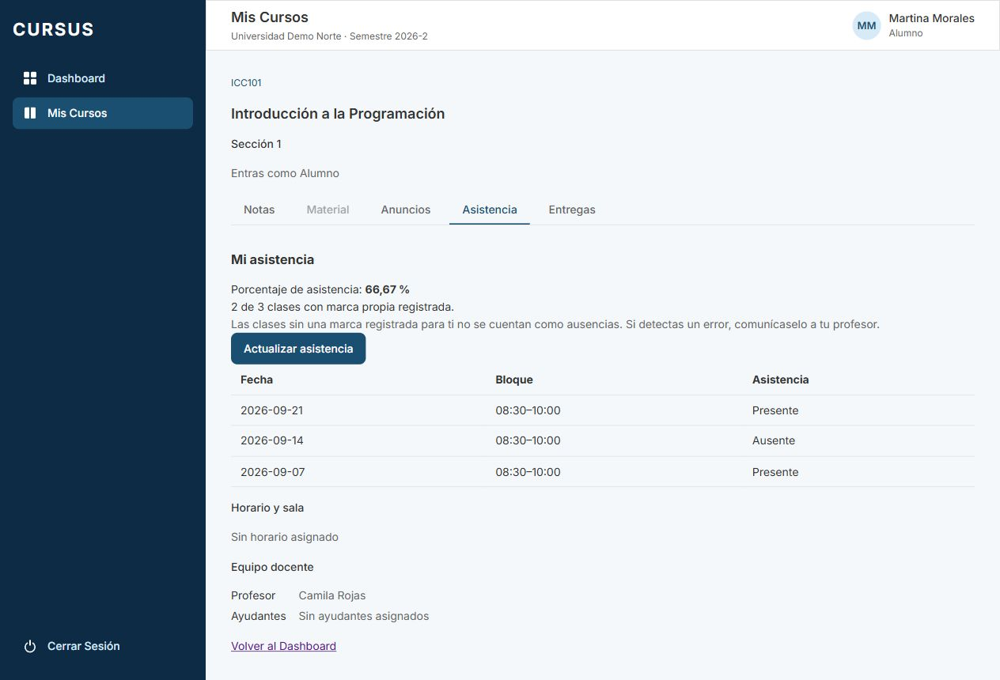
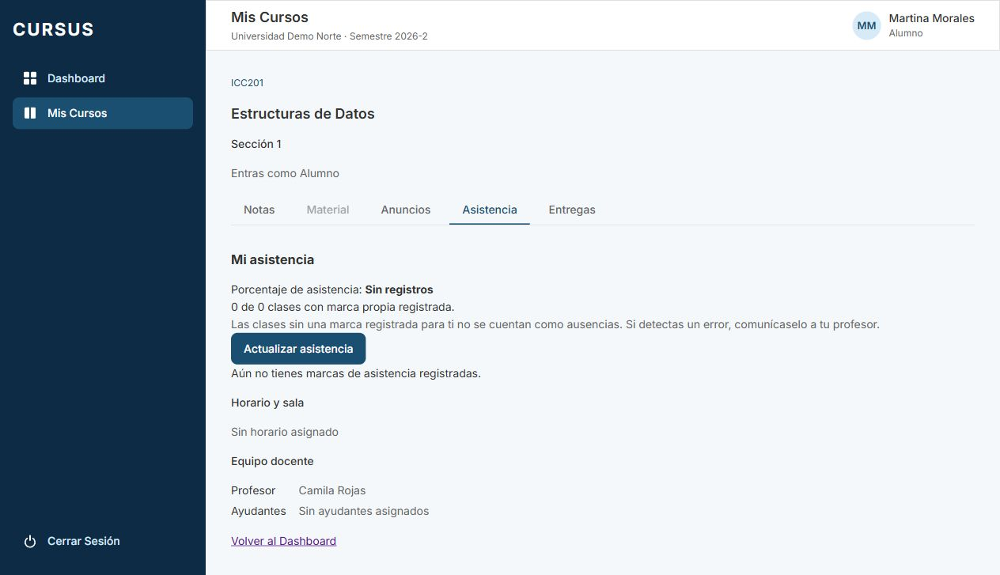

# ASI-06 · El alumno ve su asistencia por curso

[Tarjeta Trello](https://trello.com/c/FusfXQrE/149-f4-asi-06-alumno-ve-su-asistencia-por-curso). RN-13; depende de ASI-02 y amplía la lectura mínima que incorporó ASI-04.

## Comportamiento

Desde Dashboard o Mis Cursos, el alumno abre su sección y la pestaña **Asistencia**. Ve cada marca propia vigente con fecha, bloque y Presente/Ausente, de fecha más reciente a más antigua; en un mismo día, el bloque más reciente primero. El contexto del curso y la sección permanece visible.

El backend devuelve el porcentaje redondeado a dos decimales, junto con la fracción de clases asistidas y registradas. Por ejemplo: dos presentes y un ausente → **66,67 %**, **2 de 3**. Sin marcas devuelve `null`, que se presenta como **Sin registros**, nunca como 0 %. El navegador solo aplica el formato español al número recibido.

**Denominador explícito para revisión funcional:** son las clases con una marca propia activa del alumno en esa sección; una clase pendiente o sin marca propia (por ejemplo, anterior a su inscripción) no se inventa como Ausente ni entra en el porcentaje. Las marcas y clases archivadas se excluyen. ASI-05 usa el total común de clases registradas de la sección y expone `sinMarca`: ambos porcentajes coinciden si el alumno tiene marca en todas ellas, pero pueden diferir para una incorporación tardía. La interfaz explica el alcance. No se modifica el criterio de ASI-05 en esta tarjeta; validar con el cliente si se desea unificarlo en el futuro.

**Actualizar asistencia** vuelve a consultar las marcas y el porcentaje; también se consultan al volver a abrir la pestaña. Así se reciben guardados y correcciones de ASI-02/ASI-04 sin persistir un porcentaje derivado. No hay sincronización automática entre navegadores. Carga, error y reintento conservan los estados del sistema. Ante un error de recarga se retira la tabla hasta un reintento exitoso. Cambiar de sección remonta la vista para no conservar datos del curso anterior.

## API y aislamiento

`GET /api/espacio/secciones/:id/mi-asistencia/resumen` → `ResumenAsistenciaPropia`:

```json
{
  "clases": [
    {
      "clase": {
        "id": "uuid",
        "fecha": "2026-09-14",
        "inicio": "08:30",
        "termino": "10:00",
        "sala": "ING-101"
      },
      "presente": true
    }
  ],
  "registradas": 1,
  "asistidas": 1,
  "porcentaje": 100
}
```

Requiere sesión, rol ALUMNO y pertenencia activa a la sección. El guard de ESP-06 verifica acceso; el servicio comprueba el rol de sesión y de sección, y SQL revalida inscripción y curso/sección/clase activos. Universidad e identidad salen de la sesión, no de parámetros de consulta. Los JOIN incluyen universidad. Una sola sentencia SQL agrega únicamente las filas propias y produce lista, contadores y porcentaje en el mismo snapshot. El `numeric` redondeado se convierte a `double precision` para entregar un número JSON.

Se conserva RLS de ASI-04: `app.asistencia_alumno_id` se fija desde la sesión en la transacción y se combina con universidad/rol. El alumno no recibe nombres, correos, marcas ajenas, responsable, motivos ni historial de correcciones. Los endpoints completos del profesor continúan denegados. Sin sesión: 401; sección mal formada: 400; sin acceso: 403; sección/curso archivados o sección de otra universidad: 404, según ESP-06.

El GET anterior `/mi-asistencia` sigue devolviendo `AsistenciaPropia[]`, reutilizando la consulta del resumen. No se requieren migraciones, seed nuevo, cambios de RLS ni permisos nuevos.

## Pruebas automatizadas

Desde la raíz, con dependencias instaladas y PostgreSQL disponible (`docker compose up -d postgres`):

```sh
npm run build
npm run lint
npm run format:check
npm run test --workspace=frontend -- --maxWorkers=1
npm run test --workspace=backend
npm run test:e2e --workspace=backend
npm run test:db --workspace=backend
```

Focales:

```sh
npm run test --workspace=frontend -- src/pages/MiAsistencia.test.tsx src/pages/AsistenciaDeClase.test.tsx --maxWorkers=1
npm run test:db --workspace=backend -- test/asistencia/asistencia.db-spec.ts
```

La suite DB cubre ausencia de registros, 0/66,67/100 %, orden por fecha/bloque, clases pendientes, archivo, inscripción retirada, guardado/corrección mediante HTTP real, ids de alumno/universidad manipulados, otra sección del mismo curso, otra universidad y roles no autorizados. Conserva las pruebas directas de RLS de ASI-04 (sin identidad, solo marca propia y denegación del historial). Frontend verifica fracción, formato, porcentaje recibido sin recalcular, estados vacíos/error/reintento, Actualizar, reapertura y ausencia de solicitudes a listas de compañeros.

## Pasos para el compañero que revisa

1. Usar un entorno de pruebas con un curso del período activo, sección con profesor y dos alumnos inscritos. Preparar tres clases distintas y una cuarta pendiente con ASI-01. Anotar las cuentas de los alumnos; no usar datos reales.
2. Como profesor, guardar para el alumno A dos Presente y un Ausente; para B usar marcas distintas. Mantener la cuarta sin guardar.
3. Iniciar sesión como A. Dashboard → tarjeta del curso → Asistencia. Esperar tres filas propias en orden descendente, sus bloques y marcas, **66,67 %** y **2 de 3**. La clase pendiente no aparece. No debe haber nombres/marcas de B ni acciones de corrección/historial.
4. Como profesor en otro navegador, corregir el Ausente de A a Presente con motivo. Como A, pulsar Actualizar asistencia: tres presentes, **100 %**, **3 de 3**. No aparece el motivo. También se actualiza al salir de la pestaña y volver.
5. Abrir otro curso inscrito sin marcas. Esperar **Sin registros**, **0 de 0** y mensaje vacío; no quedan marcas del curso anterior. Para un curso con una única marca Ausente, esperar **0 %**.
6. En Red, repetir el GET propio agregando `?alumnoId=<B>&universidadId=<otra>`: sigue entregando solo A. Cambiar el id de sección a una sin inscripción debe negar acceso; a otra universidad, 404. Como A no se puede consultar la lista completa del profesor ni historial. Una sesión cerrada responde 401.
7. Retirar la inscripción de A en el entorno de pruebas y reintentar: acceso denegado. Simular un error de red: mensaje y Reintentar; al recuperar la conexión vuelve a cargar. Revisar consola sin errores no manejados.

## Evidencia local

Capturas con Nest y PostgreSQL reales en una base temporal aislada, datos simulados, sesión de alumno. Tres clases marcadas y una pendiente en ICC101; ICC201 sin marcas. Se verificó Actualizar y navegación entre cursos, sin errores ni warnings de consola. La base temporal se eliminó al terminar.




