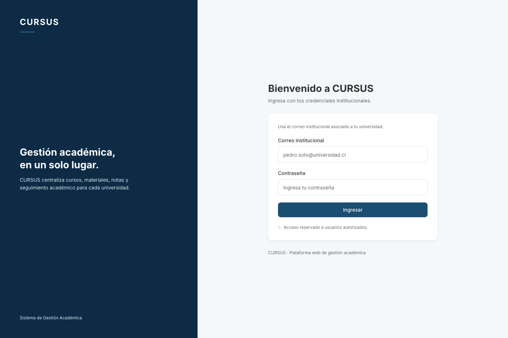
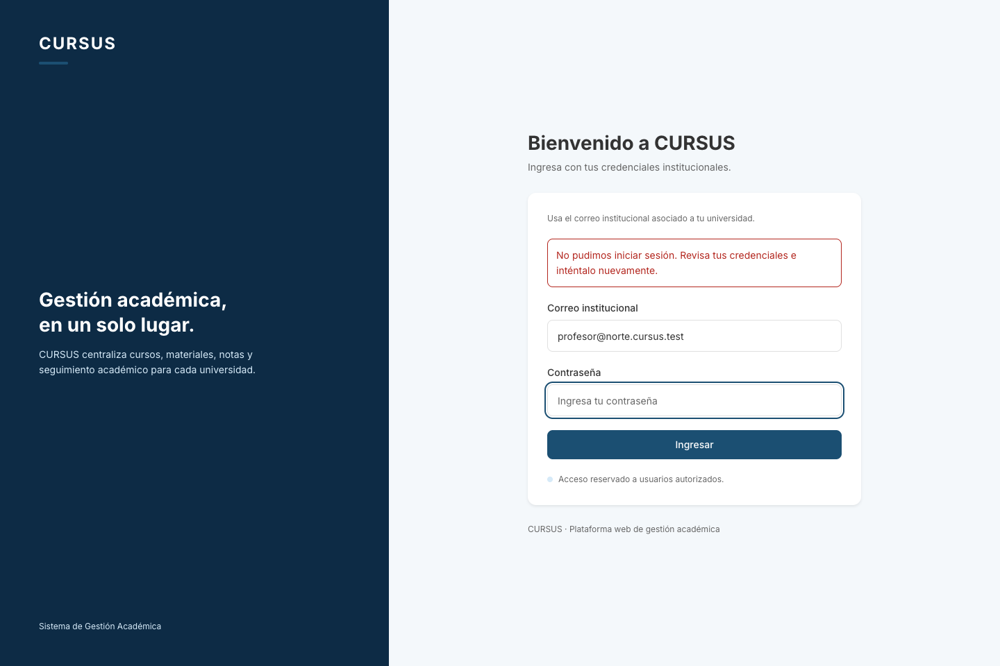

# AUTH-02: mensaje ante credenciales inválidas

Historia: **F1 · [AUTH-02] Usuario ve un mensaje claro ante credenciales inválidas**. Depende de AUTH-01. Referencia de la tarjeta: RE-01; el informe de la Entrega 5 también describe este comportamiento en CU-01, asociado a RN-01.

## Comportamiento

Cuando falla el inicio de sesión, el formulario muestra **«No pudimos iniciar sesión. Revisa tus credenciales e inténtalo nuevamente.»**. El mensaje es el mismo para un correo inexistente y una contraseña incorrecta. No se muestra el detalle recibido del servidor.

El formulario conserva el correo ingresado, vacía la contraseña y devuelve el foco a ese campo. El error se anuncia mediante `role="alert"` y ambos campos lo referencian con `aria-describedby`. Al enviar otro intento desaparece el error y se deshabilita Ingresar mientras llega la respuesta. Si el reintento es correcto, se abre la ruta protegida solicitada o el Dashboard.

También se permite reintentar cuando la API no responde, usando el mismo mensaje genérico. El aviso existente de sesión expirada se conserva; un error de login tiene prioridad para evitar avisos simultáneos.

La API ya responde **401** con **«Credenciales inválidas»** ante credenciales incorrectas. Las pruebas verifican que la respuesta no incluye tokens ni `Set-Cookie`, y que no se crean filas en `sesion_auth` ni `refresh_token`. Esta historia no requiere migraciones.

## Pruebas automáticas

Desde la raíz del repositorio, con las dependencias instaladas:

```bash
npm run lint
npm test
npm run test:e2e --workspace=backend
npm run build
```

Con PostgreSQL local levantado mediante `docker compose up -d --wait`:

```bash
npm run test:db --workspace=backend
```

Las pruebas del frontend cubren los dos tipos de credenciales inválidas, la limpieza de la contraseña, el foco, la descripción accesible, la ausencia de acceso protegido, el reintento correcto, la espera de respuesta y la pérdida de conexión. Las pruebas con PostgreSQL comprueban el mismo error para contraseña incorrecta, correo inexistente y dominio incorrecto, sin emitir tokens ni crear sesiones.

## Revisión en local

1. Hacer checkout de `feature/auth-credenciales-invalidas`, ejecutar `npm ci`, copiar `.env.example` a `.env` si falta y levantar `docker compose up -d --wait`.
2. Ejecutar `npm run migration:run --workspace=backend` y `npm run seed --workspace=backend`. Levantar `npm run dev:back` y `npm run dev:front` en terminales distintas. Usar la dirección que indique Vite.
3. Sin una sesión activa, abrir `/mis-cursos`. Se muestra el login. Ingresar `profesor@norte.cursus.test` con una contraseña incorrecta.
4. Comprobar que aparece el mensaje genérico, se conserva el correo y la contraseña queda vacía y con foco. En Network, `/api/auth/login` debe responder 401 con `Credenciales inválidas`, sin tokens en el cuerpo ni una cabecera `Set-Cookie`.
5. Repetir con `nadie@norte.cursus.test`. Debe aparecer exactamente el mismo mensaje y seguir sin acceso al menú ni al contenido protegido.
6. Volver a usar `profesor@norte.cursus.test` y escribir la contraseña del seed (`SEED_PASSWORD` de `.env`). Debe abrir Mis Cursos y desaparecer el error.
7. Cerrar sesión, desconectar la red desde DevTools e intentar ingresar. Se conserva el correo, se limpia la contraseña y se habilita un nuevo intento. Reconectar y comprobar que se puede ingresar.

Los 401 de los intentos rechazados son esperados. El PR se abre hacia `develop` y requiere los checks de GitHub en verde y revisión de un compañero.

## Evidencia




