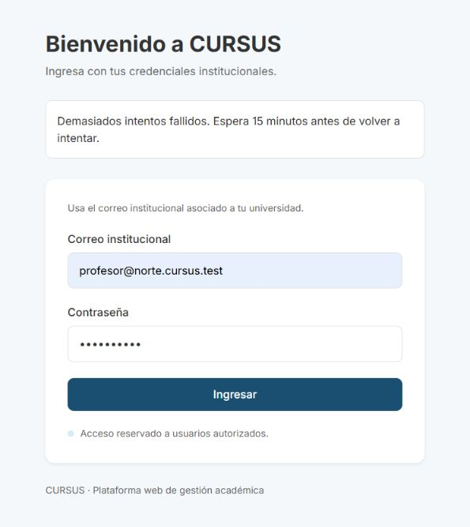

# AUTH-07: rate limiting en el login

Tarjeta: [F1 AUTH-07 Rate limiting en el login](https://trello.com/c/CmvFtXbi/80-f1-auth-07-rate-limiting-en-el-login). Referencia: Diseño técnico 5.2.1. Dependencia: AUTH-01.

## Reglas observables

- Se cuentan por separado los fallos de la cuenta y los de la IP en los últimos 15 minutos. El correo se normaliza con trim y minúsculas, igual que en AUTH-01. IPv6 se normaliza para evitar contadores distintos por representaciones equivalentes.
- Los primeros cuatro fallos de credenciales responden 401. El quinto responde 429; los siguientes también, incluso con contraseña correcta, mientras cualquiera de los dos contadores conserve cinco fallos dentro de la ventana.
- La ventana es móvil: cada fallo deja de contar al cumplir 15 minutos. El bloqueo termina cuando ambos contadores quedan por debajo de cinco; los reintentos bloqueados no agregan fallos ni prolongan la espera.
- 429 incluye `Retry-After` en segundos y `{ statusCode: 429, message, retryAfter }`. No emite tokens ni cookie. La interfaz muestra la espera redondeada hacia arriba en minutos, con un aviso accesible `role="alert"`.
- Un login exitoso, cuando no hay bloqueo activo, limpia los contadores de esa cuenta y de esa IP. Los errores de formato (400) no cuentan como fallos de credenciales. Tampoco los errores internos del servidor.
- No se revela si el correo existe: cuentas inexistentes y contraseñas incorrectas siguen el mismo límite y mensaje.

## Persistencia y concurrencia

La migración `CrearIntentosLogin1792436000000` agrega `limite_login`, con una clave SHA-256 de `cuenta:<correo normalizado>` o `ip:<dirección normalizada>` y hasta cinco marcas de tiempo. No guarda correos, IP ni contraseñas en claro. Los resúmenes son deterministas y no constituyen anonimización irreversible.

Los contadores viven en PostgreSQL, compartidos entre instancias y reinicios. Cada intento toma bloqueos de fila en orden consistente para sus dos claves. La verificación de contraseña y emisión de tokens usan la misma conexión/transacción; así las peticiones concurrentes no sobrepasan el umbral ni consumen otra conexión mientras mantienen bloqueos. Las excepciones HTTP se generan después del commit para conservar los fallos registrados. Un error interno revierte toda la operación.

Las marcas caducadas se descartan al consultar el contador; las filas pueden permanecer con claves y marcas antiguas. No se agrega un proceso de limpieza global en esta tarjeta. Si el volumen crece, se deberá definir una retención y limpieza periódica de filas inactivas.

## IP y proxy

En local (`ORIGIN_SECRET` vacío), se usa la dirección del socket y se ignoran cabeceras de IP enviadas por el cliente. Las solicitudes a través del proxy de Vite comparten la IP de loopback: para probar diferentes IP locales se usa la prueba de integración con el origen simulado.

Con `ORIGIN_SECRET` configurado, el middleware valida primero el secreto de origen y luego usa `x-vercel-forwarded-for`, una única IP válida. No se activa `trust proxy` global ni se toma la primera IP de una cadena arbitraria `X-Forwarded-For`. Si falta la cabecera o es inválida, login responde 400 para evitar agrupar a todos los usuarios bajo la dirección de un proxy. Los demás endpoints conservan su comportamiento.

Este contrato depende del flujo existente Vercel → API Gateway → ECS y de que el backend siga protegido por el secreto de origen. Vercel documenta que sobrescribe las cabeceras de IP para evitar suplantaciones y define `x-vercel-forwarded-for` como equivalente a su IP de cliente: [Request headers](https://vercel.com/docs/headers/request-headers). Si se cambia el proxy, debe revisarse este contrato. Antes de integrar, comprobar también el login a través del preview/staging; la verificación local no prueba el transporte real de cabeceras en AWS.

## Preparación y validación

Desde la raíz del repositorio:

```bash
npm ci
# Si falta .env, prepararlo desde .env.example.
docker compose up -d --wait
npm run migration:run --workspace=backend
npm run seed --workspace=backend
npm run lint
npm test
npm run test:db --workspace=backend
npm run test:e2e --workspace=backend
npm run build
```

Los tests de PostgreSQL crean y eliminan bases propias. Verifican cuenta/IP independientes, reinicio tras éxito, ventana móvil, no prolongación, concurrencia, persistencia al recrear la API y cabeceras de origen. Los de frontend comprueban el aviso, `Retry-After`, valores faltantes/incorrectos y nuevo ingreso tras el bloqueo.

## Pasos manuales para el reviewer

1. Levantar `npm run dev:back` y `npm run dev:front` en dos terminales. Abrir `http://localhost:5173/login` y DevTools > Network.
2. Con `profesor@norte.cursus.test`, ingresar una contraseña incorrecta cuatro veces. Esperado: 401 y sin acceso a rutas protegidas.
3. Enviar el quinto intento incorrecto. Esperado: 429, cabecera `Retry-After` entre 1 y 900 segundos y mensaje de espera visible. La respuesta no contiene tokens ni crea una cookie de sesión.
4. Reintentar con contraseña correcta. Esperado: continúa en 429 durante el bloqueo. Cambiar de correo en la misma IP tampoco evade el contador de IP. Recargar o reiniciar la API no elimina el bloqueo.
5. Esperar a que se cumplan 15 minutos desde los fallos. Ingresar con la contraseña `SEED_PASSWORD` de `.env` (por defecto local: `cursus_demo`). Esperado: 200 y acceso a la aplicación. La expiración también se verifica automáticamente sin esperar 15 minutos.
6. Para comprobar el reinicio: desde un estado sin bloqueo, fallar tres veces, ingresar correctamente, cerrar sesión y fallar cuatro veces. Esperado: esos cuatro responden 401; el siguiente responde 429. El login exitoso reinició la cuenta y la IP.
7. Revisar la prueba `backend/test/auth/limite-login.db-spec.ts` para los casos de cuenta constante/cambio de IP, IP constante/cambio de cuenta y simultaneidad. No falsificar cabeceras de IP contra producción para probarlos.
8. En preview/staging operativo, abrir el frontend de Vercel y comprobar el mismo flujo. Si devuelve 400 con `IP de origen inválida`, revisar el transporte de `x-vercel-forwarded-for` entre Vercel y la API antes de aprobar. No usar el endpoint directo de AWS para esta comprobación.

Los 401 y 429 de estas pruebas son esperados. Revisar que no haya errores inesperados de aplicación o servidor. Una IP compartida por varios usuarios comparte el límite, tal como exige el criterio por IP.

## Despliegue y rollback

Aplicar la migración antes de arrancar la nueva API. Es aditiva, no cambia migraciones previas y la versión anterior ignora la tabla nueva. En rollback puede conservarse el esquema; la versión anterior no aplica el límite. No se agregan dependencias ni variables de entorno.


