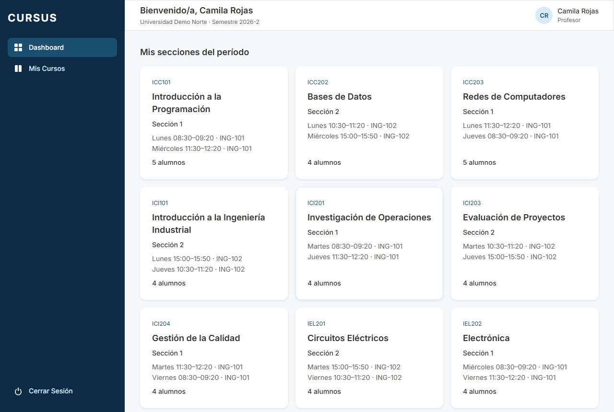
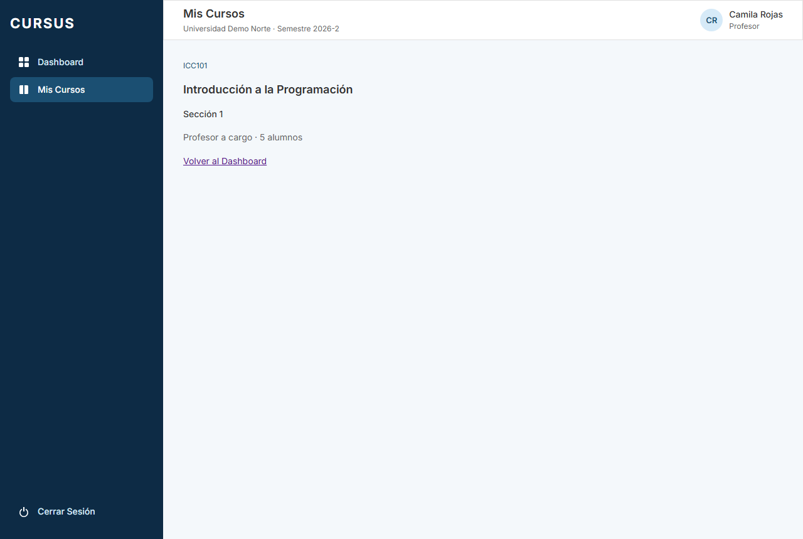

# ESP-01: el profesor ve sus secciones del período en su dashboard

Tarjeta: [F3 · ESP-01 Profesor ve sus secciones del período en su dashboard](https://trello.com/c/W7UpeZ2O/111-f3-esp-01-profesor-ve-sus-secciones-del-per%C3%ADodo-en-su-dashboard). Referencia: journeys de usuario (Entrega 2). Sin dependencias dentro de la fase.

## Comportamiento

El dashboard del profesor (`/`) muestra **Mis secciones del período**, con una tarjeta por cada sección a su cargo en el período activo de su universidad. Cada tarjeta muestra:

- el código y el nombre del curso;
- el número de la sección;
- el horario, un bloque por línea (día, hora de inicio y término, y sala), o "Sin horario asignado";
- la cantidad de alumnos con inscripción activa.

Las tarjetas se ordenan por código de curso y número de sección. Incluyen las secciones de cursos de otras facultades que tenga asignadas. No aparecen las secciones de otro profesor, las archivadas, las de un curso archivado ni las de otro período. Los bloques de horario y las inscripciones archivadas no cuentan.

Si no tiene secciones, o su universidad no tiene período activo, el dashboard muestra "No tienes secciones a tu cargo en el período activo". Si la carga falla, muestra un error con **Reintentar**.

Al hacer clic en una tarjeta se abre la vista del curso en `/mis-cursos/secciones/:id`. **En esta entrega la vista es parcial:** muestra el código y el nombre del curso, el número de sección y la cantidad de alumnos, con los mismos datos del dashboard, así que también carga al entrar directo por la URL. ESP-04 la completa con horario, sala y equipo docente, usando el espacio de la sección de ESP-06. Si la sección no está entre las del profesor, la vista lo indica con un mensaje neutro y un enlace para volver al dashboard.

Los otros roles ven su dashboard igual que antes: no se piden las secciones del profesor. ESP-02 (ayudante) y ESP-03 (alumno) agregan sus propias tarjetas.

## API y datos

- `GET /api/dashboard/mis-secciones` devuelve `SeccionDashboard[]` (`@cursus/shared`):

  ```ts
  { id, numero, curso: { id, codigo, nombre }, horario: BloqueHorario[], alumnos }
  ```

- La ruta exige solo sesión (`@SoloSesion()`): la consulta filtra siempre por el usuario de la sesión, así que cada uno recibe solo sus secciones, y no se agregan permisos en `shared/src/permisos.ts`. Para un rol distinto de Profesor devuelve `[]` sin consultar la base. Sin sesión responde 401.
- La consulta usa `consultarEnUniversidad` ($1 = universidad, con RLS). El horario reutiliza `BLOQUES_HORARIO` de GES-10, sin modificarlo.
- El módulo vive en `backend/src/dashboard/` y no comparte archivos con el espacio de la sección (`backend/src/espacio/`, ESP-06).

No hay migración: se usan `seccion.profesor_id` (GES-12), `horario_seccion` (GES-10), `inscripcion` (GES-15) y `periodo.activo` (GES-02). Solo se leen datos: nada se crea, modifica ni archiva.

## Verificación

Desde la raíz, con Node 24.15+, dependencias instaladas y PostgreSQL disponible:

```bash
npm run lint
npm test
npm run test:e2e --workspace=backend
npm run test:db --workspace=backend
npm run build
```

`backend/test/dashboard/mis-secciones.db-spec.ts` cubre:

- Una tarjeta por sección a su cargo, en orden, incluida una de otra facultad.
- Exclusión de la sección de otro profesor, la archivada, la de un curso archivado y la de otro período.
- Horario sin bloques archivados y conteo sin inscripciones archivadas, y una sección sin horario ni alumnos.
- Lista vacía para un profesor sin secciones, sin período activo y para Alumno, Director y Administrativo.
- 401 sin sesión.

`frontend/src/pages/Dashboard.test.tsx` cubre las tarjetas con sus datos, el clic que abre la vista del curso, la entrada directa por la URL, una sección ajena, el estado vacío, el error con reintento y que los otros roles no piden las secciones.

## Revisión en local

1. Ejecutar las migraciones (`npm run migration:run --workspace=backend`) y el seed de facultad completa (`npm run seed --workspace=backend`). Levantar backend y frontend.
2. Ingresar con `camila.rojas@norte.cursus.test` (profesora de demo de Ingeniería Norte) y la contraseña `SEED_PASSWORD` del `.env`. El dashboard debe mostrar sus diez secciones con horario y alumnos.
3. Hacer clic en una tarjeta: se abre la vista con el curso y la sección. Recargar la página: debe seguir mostrándola.
4. Ingresar con `profesor@sur.cursus.test`: ve el estado vacío.
5. Ingresar como alumno, ayudante, Administrativo o Director: el dashboard no muestra tarjetas.

## Evidencia




