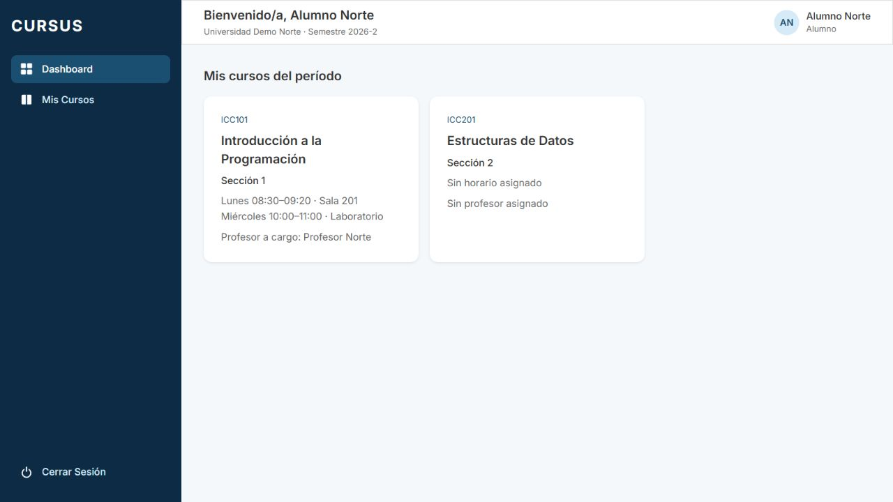
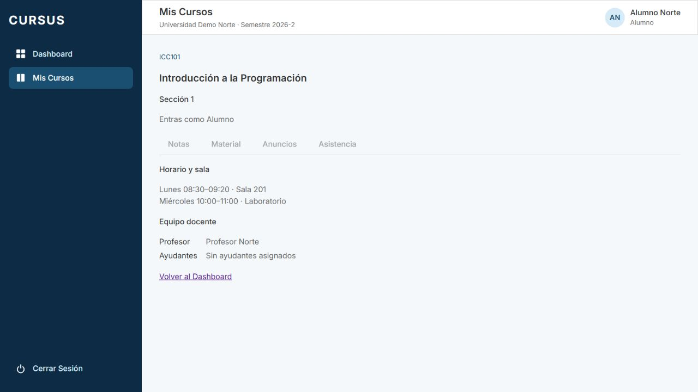

# ESP-03: cursos del alumno en el dashboard

Tarjeta: [F3 · ESP-03 Alumno ve sus cursos del período en su dashboard](https://trello.com/c/zLIBk2Oz/113-f3-esp-03-alumno-ve-sus-cursos-del-per%C3%ADodo-en-su-dashboard). Referencia: Journeys de usuario (Entrega 2).

## Comportamiento y contrato

El alumno ve **Mis cursos del período** en `/`: una tarjeta por inscripción vigente a una sección del período activo de su universidad. Muestra código/nombre del curso, sección, bloques de horario ordenados (día, horas y sala) y profesor. No agrupa tarjetas por curso.

Sin horario muestra **Sin horario asignado**; sin profesor vigente, **Sin profesor asignado**. Sin inscripciones o período activo muestra el estado vacío. Durante la consulta muestra carga y ante error ofrece Reintentar. Cada tarjeta es un enlace completo, también accesible por teclado, a `/mis-cursos/secciones/:id`, la vista ya integrada de ESP-04 con control de integrantes de ESP-06.

`GET /api/dashboard/secciones-alumno` requiere sesión y devuelve `SeccionAlumno[]`:

```json
[
  {
    "id": "uuid-seccion",
    "numero": 1,
    "curso": {
      "id": "uuid-curso",
      "codigo": "ICC101",
      "nombre": "Introducción a la Programación"
    },
    "horario": [
      { "dia": 1, "inicio": "08:30", "termino": "09:20", "sala": "Sala 201" }
    ],
    "profesor": { "id": "uuid-profesor", "nombre": "Profesor Norte" }
  }
]
```

Usuario y universidad provienen exclusivamente de la sesión; agregar parámetros en la query no permite elegir a otro alumno. Se aplica RLS y se filtran inscripciones, secciones y cursos sin archivar, y el período activo de esa universidad. Un profesor archivado no se muestra. Para otros roles devuelve `[]`, siguiendo el patrón del ayudante. Sin sesión: 401.

No entrega correos, contraseñas ni información de otros alumnos. El resumen vuelve a verificar la inscripción: un enlace deja de dar acceso si esta se retira. El alumno no consulta la lista de compañeros de ESP-05. Se reutilizan bloques, estilos y vista existentes; no hay migraciones, dependencias ni cambios de permisos o seed.

Nota de consistencia: ESP-03 oculta profesores archivados o que ya no tienen rol PROFESOR. El endpoint de ESP-02 todavía no aplica ese filtro y puede mostrar el nombre al ayudante. Se conserva el criterio de ESP-03 y queda documentada la alineación pendiente de ESP-02.

## Preparación y pasos de revisión

```bash
git fetch origin
git switch feature/esp-03-alumno-cursos-dashboard
npm ci
# Preparar .env desde .env.example si falta.
docker compose up -d --wait
npm run migration:run --workspace=backend
npm run seed --workspace=backend
# En dos terminales:
npm run dev:back
npm run dev:front
```

1. En una base local de prueba, ingresar como `administrativo.ingenieria@norte.cursus.test` con `SEED_PASSWORD` del entorno (`cursus_demo` en el ejemplo). El seed no agrega inscripciones: deben prepararse para esta prueba.
2. Agregar el alumno existente `alumno@norte.cursus.test` a ICC101, sección 1. Asignar profesor Norte y horario lunes 08:30–09:20, Sala 201, y miércoles 10:00–11:00, Laboratorio. Inscribirlo también en ICC201, sección 2, sin profesor ni horario.
3. Cerrar sesión e ingresar como ese alumno. En `/` deben verse exactamente dos tarjetas, con curso/sección, horario/profesor o los textos alternativos. Las secciones sin inscripción no aparecen.
4. Pulsar una tarjeta: abre la vista del curso con “Entras como Alumno”. Probar Tab/Enter, URL directa y recarga. No se pide ni muestra la lista de alumnos del profesor. Volver al dashboard.
5. Retirar una inscripción desde gestión y recargar: desaparece la tarjeta. La URL directa debe denegar acceso. Curso o sección archivados también se excluyen.
6. Preparar una inscripción en un curso de otro período no activo: no aparece. Activar ese período y recargar: solo aparecen inscripciones de ese período. Restaurar el período original al terminar.
7. Comprobar alumno sin inscripciones y universidad sin período activo: estado vacío. Con alumno de Sur no aparecen cursos de Norte. Sin sesión el GET da 401; agregar `usuarioId` o `universidadId` en query no cambia al usuario consultado.
8. Simular fallo de red en la consulta y probar Reintentar. Revisar pantalla estrecha, títulos largos y navegación por teclado. Profesor y ayudante conservan sus propias tarjetas; administrativo y Director no piden este endpoint.
9. Ejecutar suites y revisar CI. Archivar solamente datos creados para la prueba según el procedimiento del entorno.

## Pruebas

```bash
npm run lint
npm test
npm run test:db --workspace=backend
npm run test:e2e --workspace=backend
npm run build
```

Las 17 pruebas de `secciones-alumno.db-spec.ts` usan PostgreSQL real: campos/orden del contrato, inscripciones propias, secciones distintas del mismo curso, horario archivado, aislamiento entre usuarios/universidades, inscripciones/secciones/cursos archivados, profesor archivado, período activo/ausente/distinto, roles, sesión y acceso/revocación al resumen.

`SeccionesAlumno.test.tsx` cubre tarjetas por sección, horario/profesor y textos alternativos, clic y URL directa, vacío/carga/error/reintento, acceso retirado y ausencia de consultas por otros roles. Se conservan las regresiones del profesor y ayudante.

Los tests de Header personalizan el usuario solamente en `/api/auth/yo` y dejan las demás rutas en el comportamiento por defecto de `simularBackend`. Tanto esos tests como el de redirección desde EditarCurso esperan a que termine la consulta del dashboard del alumno. La comprobación de revisión ejecuta la suite frontend completa con 100 ms antes de cada cleanup; esa espera se retira después y no forma parte del código final.

## Evidencia

Verificación en navegador real con API, PostgreSQL y dos inscripciones demo en una base aislada. Se comprueban el dashboard, el clic, la recarga de la URL de la sección como Alumno y la vuelta al dashboard. La base y los scripts de esta verificación se retiran al terminar; no se cambian el seed ni las inscripciones de la base habitual.




