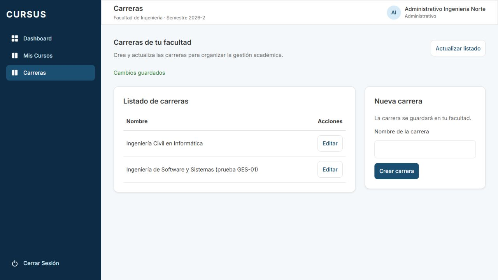
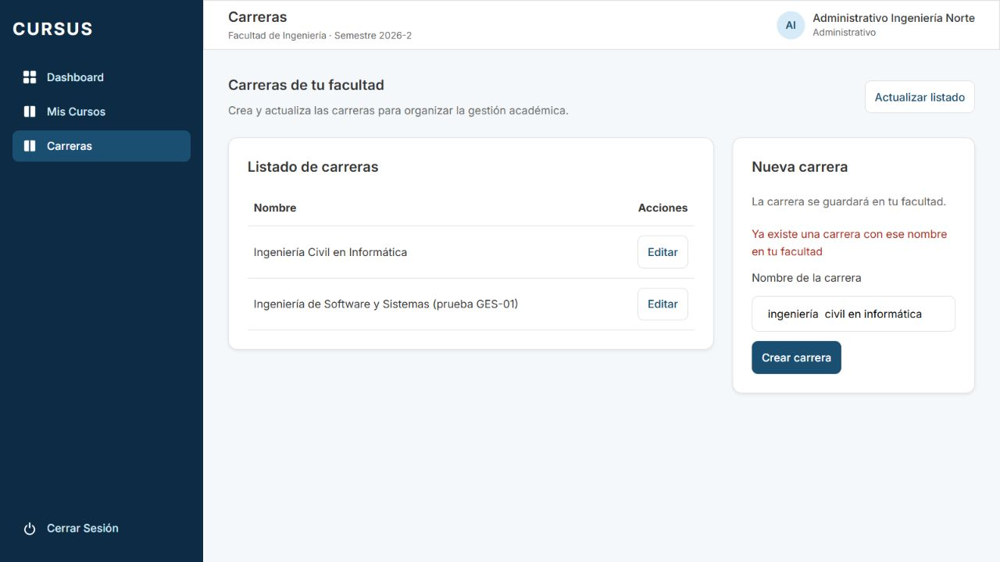

# GES-01: carreras de la facultad

Tarjeta: [F2 GES-01 Administrativo gestiona las carreras de su facultad](https://trello.com/c/SdVsAO7q/88-f2-ges-01-administrativo-gestiona-las-carreras-de-su-facultad). Referencia: prerrequisito de RN-04.

## Comportamiento

El administrativo encuentra **Carreras** en el menú. Puede listar sus carreras, crear una y editar su nombre. El formulario acepta nombres de 1 a 150 caracteres después de eliminar espacios de los extremos y colapsar espacios consecutivos. Un error de guardado conserva el nombre escrito; un éxito actualiza el listado y muestra una confirmación. Hay estados de carga, listado vacío, error y reintento. La página se adapta a pantallas angostas y los controles tienen etiquetas accesibles.

La facultad y universidad no se eligen ni se envían desde el formulario: se obtienen en el backend de la universidad de la sesión y de la asignación vigente del usuario en la BD. Cada sentencia vuelve a consultar esa asignación; no se utiliza una facultad guardada en el JWT. Se excluyen usuarios, facultades y carreras archivadas.

La sección GES-01 está destinada al administrativo. Los demás roles reciben 403 en esta API y no ven su enlace; no se agrega una vista consolidada para el Director en esta tarjeta. El menú se habilita con el permiso de crear Carrera, que en las reglas actuales solo tiene el administrativo. No se agregan eliminación ni archivado a la interfaz; la asociación de cursos queda para las siguientes historias.

## API

| Método | Ruta                | Cuerpo                               | Resultado                                       |
| ------ | ------------------- | ------------------------------------ | ----------------------------------------------- |
| GET    | `/api/carreras`     | Ninguno                              | 200, arreglo de `{ id, nombre }` de su facultad |
| POST   | `/api/carreras`     | `{ "nombre": "Nombre de carrera" }`  | 201, `{ id, nombre }` creada en su facultad     |
| PATCH  | `/api/carreras/:id` | `{ "nombre": "Nombre actualizado" }` | 200, `{ id, nombre }` actualizada               |

- Las tres rutas exigen sesión. Los permisos de CASL se comprueban antes de ejecutar la operación y el servicio limita estas operaciones al rol administrativo.
- `NombreCarreraDto` y el `ValidationPipe` rechazan tipos incorrectos, nombres vacíos y campos extra, incluidos `facultad_id` y `universidad_id`. Los IDs de PATCH se validan como UUID.
- Las consultas pasan por `BaseDeDatos.consultarEnUniversidad`, con el rol de BD de la aplicación y RLS. Además filtran por la facultad asignada al usuario. No se usa una consulta institucional sin contexto ni se confía en parámetros de ámbito enviados por el cliente.
- Editar una carrera de otra facultad, de otra universidad, archivada o inexistente devuelve el mismo 404. Intentar crear sin una facultad activa asignada devuelve 403. Un listado sin asignación activa no devuelve carreras.
- Un nombre duplicado devuelve 409 con el mensaje `Ya existe una carrera con ese nombre en tu facultad`. No se devuelve el detalle de PostgreSQL al usuario.

## Nombres únicos y migración

`NombreCarreraUnicoNormalizado1792450000000` agrega un índice único sobre facultad y nombre normalizado (`lower` y espacios colapsados/recortados). Así los duplicados se rechazan también con peticiones simultáneas. Nombres iguales en facultades distintas, incluso de universidades distintas, están permitidos.

Se conserva la restricción original y no se modifican migraciones previas. Como esa restricción, el índice incluye carreras archivadas: sus nombres permanecen reservados en esa facultad. No se restaura ni reutiliza una carrera archivada desde esta pantalla.

La migración no renombra ni elimina datos existentes. Si había duplicados que solo se diferenciaban por mayúsculas o espacios, falla y debe resolverse ese dato con el equipo antes de desplegar. Esta consulta de diagnóstico no modifica datos:

```sql
SELECT facultad_id,
       lower(btrim(regexp_replace(nombre, '[[:space:]]+', ' ', 'g'))) AS nombre_normalizado,
       count(*)
FROM carrera
GROUP BY facultad_id, lower(btrim(regexp_replace(nombre, '[[:space:]]+', ' ', 'g')))
HAVING count(*) > 1;
```

Aplicar la migración antes de arrancar la nueva API. Su reversión elimina únicamente el índice nuevo; conserva carreras y la restricción original. Es compatible con la versión anterior de la aplicación, que ignora los endpoints nuevos.

## Preparación

Desde la raíz del repositorio:

```bash
npm ci
# Si falta .env, prepararlo desde .env.example.
docker compose up -d --wait
npm run migration:run --workspace=backend
npm run seed --workspace=backend
npm run dev:back
# En otra terminal:
npm run dev:front
```

## Pasos para el reviewer

1. Abrir `http://localhost:5173`. Ingresar con `administrativo.ingenieria@norte.cursus.test` y la contraseña `SEED_PASSWORD` de `.env` (`cursus_demo` con el ejemplo local). Abrir Carreras. Con el seed inicial debe aparecer Ingeniería Civil en Informática; no Ingeniería Comercial ni Enfermería.
2. Crear un nombre nuevo, por ejemplo `Carrera de prueba GES-01 <iniciales>`. Comprobar confirmación, nueva fila y que el formulario se limpia. Recargar para verificar persistencia.
3. Pulsar Editar en esa carrera, cambiar el nombre y guardar. Comprobar que mantiene su ID en Network y que el listado refleja el nuevo nombre. Cancelar otra edición debe conservar los datos anteriores sin enviar PATCH.
4. Intentar crear `  ingeniería  civil en informática  `. Esperado: 409 y aviso de duplicado; el texto permanece escrito. Crear otra carrera y tratar de renombrarla con ese mismo nombre también debe responder 409 y conservar su nombre anterior.
5. Cerrar sesión e ingresar con `administrativo.economia@norte.cursus.test`. Debe ver Ingeniería Comercial y no las carreras de Ingeniería. Puede crear un nombre igual al de la prueba de Ingeniería porque pertenece a otra facultad.
6. Ingresar con `administrativo@sur.cursus.test`. Debe ver Enfermería y no las carreras de Norte. También puede usar un nombre que exista en otra facultad.
7. Para revisar la protección de escritura, guardar el ID de una carrera de Ingeniería desde su listado/Network y, con la sesión de Economía o Sur, enviar PATCH al mismo ID con `{ "nombre": "Cambio no permitido" }`. Esperado: 404 y ningún cambio. Usar un UUID inexistente debe devolver el mismo mensaje.
8. En POST/PATCH agregar `facultad_id` o `universidad_id` al cuerpo. Esperado: 400. Agregar esos parámetros a GET no cambia el ámbito: sigue listando únicamente lo autorizado.
9. Entrar con un profesor, alumno o Director e intentar `/carreras`: vuelve a su Dashboard y no aparece el enlace. Las tres operaciones de API deben rechazarse con 403 para esos roles; sin sesión, 401.
10. Probar nombre vacío, solo espacios y más de 150 caracteres. Comprobar el error o la limitación del formulario; la API debe rechazar valores inválidos. Sin conexión, actualizar debe mostrar un error con Reintentar, y guardar no debe informar éxito ni borrar el formulario.

Los 400, 403, 404 y 409 de las pruebas negativas son esperados. No publicar tokens ni credenciales privadas en el PR. Las capturas muestran datos de validación local; no se agregan carreras de prueba al seed ni a las migraciones.

## Pruebas automáticas

```bash
npm run lint
npm test
npm run test:db --workspace=backend
npm run test:e2e --workspace=backend
npm run build
```

`backend/test/carreras/carreras.db-spec.ts` usa PostgreSQL real y una base propia que se crea y elimina al terminar. Cubre aislamiento, creación, edición, unicidad concurrente, DTOs, roles, archivado y reasignación de facultad con el token anterior. `frontend/src/pages/Carreras.test.tsx` cubre el flujo, guardado pendiente, errores, duplicados y rutas de otros roles. Las migraciones se verifican también al aplicarlas y revertirlas en la suite del esquema.




