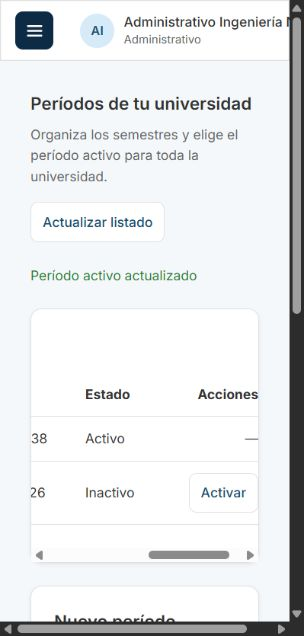
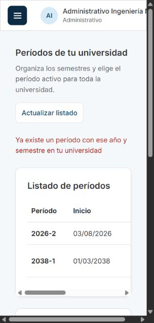

# GES-02: períodos académicos

Tarjeta: [F2 GES-02 Administrativo gestiona los períodos académicos](https://trello.com/c/tBxYnrO6/89-f2-ges-02-administrativo-gestiona-los-per%C3%ADodos-acad%C3%A9micos). Referencia: prerrequisito de RN-04.

## Comportamiento

El administrativo encuentra **Períodos** en el menú. Puede listar los períodos de su universidad, crear uno y activar uno existente. Cada período tiene año, semestre (1 o 2), fecha de inicio, fecha de término y estado activo/inactivo. Se muestra primero el activo y luego los restantes por año y semestre descendentes.

La universidad sale de la sesión, no del formulario. Los períodos son compartidos por las facultades de la misma universidad. La fecha de término debe ser estrictamente posterior a la de inicio; las fechas se validan como fechas reales `YYYY-MM-DD` sin hora y se muestran sin convertir zonas horarias. El año acepta enteros de 1 a 9999. No se exige que el año de ambas fechas coincida con el año académico: la historia no impone esa regla.

Crear un período lo deja inactivo salvo que se marque **Marcar como activo**. Activar otro desactiva el anterior de la misma universidad en una única transacción. No hay un instante confirmado con dos activos, ni se altera otra universidad. Activar el que ya está activo es idempotente. Puede no haber activo si todavía no se ha activado ninguno. La pantalla actualiza el semestre del encabezado después de una creación activa o activación exitosa.

La tarjeta no agrega edición de año/fechas, eliminación, archivado ni desactivación independiente. Un error conserva el formulario y no muestra una confirmación de éxito.

## API y permisos

| Método | Ruta                        | Cuerpo                                                   | Resultado                                            |
| ------ | --------------------------- | -------------------------------------------------------- | ---------------------------------------------------- |
| GET    | `/api/periodos`             | Ninguno                                                  | 200, lista de períodos de su universidad             |
| POST   | `/api/periodos`             | `{ anio, semestre, fechaInicio, fechaTermino, activo? }` | 201, período creado; `activo` por defecto es `false` |
| PATCH  | `/api/periodos/:id/activar` | Ninguno                                                  | 200, período activado                                |

La respuesta `Periodo` tiene `{ id, anio, semestre, fechaInicio, fechaTermino, activo }`. `Periodo` extiende el tipo existente `OpcionPeriodo`; el formulario de cursos sigue consumiendo el mismo endpoint sin cambiar sus campos. `PeriodosController` es el único dueño de GET: se retiran el handler y el servicio de listado de `GestionController`/`GestionService`.

Se mantienen los permisos de lectura existentes para los roles autenticados. La creación y activación son solo para administrativos, con CASL y comprobación en el servicio. La sección de gestión no aparece para otros roles y su ruta vuelve al Dashboard. Las consultas usan RLS y filtran explícitamente por la universidad de la sesión, incluso para el Director en este listado.

- Sin sesión: 401. Sin permiso de escritura: 403.
- Año/semestre repetido en su universidad: 409 con mensaje de duplicado. El mismo par en otra universidad está permitido.
- Fechas inválidas, fin igual/anterior al inicio, año/semestre inválidos, tipos incorrectos o campos extra en POST: 400. No se permite enviar `universidadId`.
- Activar un UUID ajeno o inexistente: el mismo 404 y ningún cambio al activo anterior. Un ID mal formado responde 400.

## Transacciones y restricciones

No hay migración nueva: el esquema ya contiene `uq_periodo_universidad_anio_semestre`, `ck_periodo_semestre`, `ck_periodo_fechas` y el índice parcial `ux_periodo_activo_por_universidad`.

`BaseDeDatos.enTransaccionEnUniversidad` configura `cursus_app` y los valores locales de universidad/rol una vez para todas las consultas de la operación, con commit/rollback conjunto. `consultarEnUniversidad` reutiliza esa configuración sin cambiar su contrato de parámetros.

Crear y activar toman primero `SELECT id FROM universidad WHERE id = $1 FOR UPDATE`. El bloqueo existe aun cuando no hay períodos; serializa las escrituras de una misma universidad y permite trabajar en universidades distintas. Después se desactiva el anterior y se inserta/activa el seleccionado. El índice único sigue protegiendo la invariante en PostgreSQL. Si un INSERT activo falla por duplicado, el rollback restaura el activo anterior. Se valida que un período exista en su universidad antes de desactivar nada.

## Preparación

Desde la raíz del repositorio:

```bash
git fetch origin
git switch feature/gestion-periodos-academicos
npm ci
# Si falta .env, prepararlo desde .env.example.
docker compose up -d --wait
npm run migration:run --workspace=backend
npm run seed --workspace=backend
# En dos terminales:
npm run dev:back
npm run dev:front
```

Usar `http://localhost:5173`, los correos del seed y `SEED_PASSWORD` de `.env` (`cursus_demo` con el ejemplo local). No volver a ejecutar el seed entre las comprobaciones de activación: el seed establece el período demo.

## Pasos para el reviewer

1. Ingresar con `administrativo.ingenieria@norte.cursus.test`. Abrir Períodos. Con una base inicial aparece 2026-2 activo, con fechas 03/08/2026 y 18/12/2026. El listado debe mostrar año/semestre, fechas y estado.
2. Crear un par nuevo, por ejemplo 2039-1, con inicio 01/03/2039 y término 15/07/2039, sin marcar activo. Esperar 201, confirmación y fila inactiva. El formulario se limpia y 2026-2 sigue activo. Recargar para comprobar persistencia.
3. Intentar repetir 2039-1. Esperar 409 y mensaje de duplicado, sin limpiar el formulario ni cambiar el activo. Repetir con la casilla de activo marcada: el error tampoco debe desactivar el anterior.
4. Probar fin igual o anterior al inicio: el formulario muestra el error. En la API también se espera 400. Probar fecha imposible (`2039-02-30`), fecha con hora, semestre 3, año fraccionario, año como texto y campo `universidadId` extra: 400. Enviar solo los campos permitidos.
5. Activar 2039-1 desde su fila. Esperar 200 y confirmación; 2026-2 debe quedar inactivo y solo debe haber un activo. El encabezado debe cambiar a Semestre 2039-1. Recargar para confirmar. Repetir el PATCH del mismo ID debe dar 200 sin cambios de selección.
6. Crear 2039-2 con fechas válidas y **Marcar como activo**. Debe quedar como único activo y 2039-1 debe pasar a inactivo. Si falla el guardado, no debe mostrarse éxito ni cambiar el listado.
7. Cerrar sesión e ingresar con `administrativo.economia@norte.cursus.test`: debe ver los mismos períodos de Norte. Con `administrativo@sur.cursus.test`, no debe ver los IDs/períodos creados en Norte; su activo no cambia y puede crear el mismo par año/semestre.
8. Con la sesión de Sur, enviar PATCH al ID de un período de Norte. Esperar 404 igual al de un UUID inexistente y verificar que el activo de Sur no cambió. Sin sesión, GET/POST/PATCH responden 401. Con profesor, ayudante, alumno o Director, POST/PATCH responden 403 y no aparece la sección Períodos; el GET conserva su acceso de lectura previo.
9. Con un administrativo de Norte, abrir Mis Cursos → Nuevo curso. El período activo nuevo debe aparecer seleccionado en el formulario. Crear un curso con código nuevo, una carrera propia y ese período: esperar 201 y confirmación del año/semestre seleccionado.
10. Probar Actualizar listado, Reintentar tras fallo de carga, pérdida de conexión y pantalla angosta. Guardar debe deshabilitar envíos/activaciones adicionales mientras está pendiente. En pantalla angosta la tabla permite desplazamiento horizontal.
11. Ejecutar las pruebas automáticas. Revisar especialmente las activaciones concurrentes, creación activa concurrente y rollback por duplicado en `backend/test/periodos/periodos.db-spec.ts`.

Los 400/401/403/404/409 de los casos negativos son esperados. Las capturas usan un período local 2038-1 que permanece inactivo al terminar la validación; se restauró 2026-2 como activo. No se agregan períodos de prueba al seed ni al código.

## Pruebas automáticas

```bash
npm run lint
npm test
npm run test:db --workspace=backend
npm run test:e2e --workspace=backend
npm run build
```

La suite de períodos usa PostgreSQL real en una base propia, creada y eliminada al terminar. Cubre fechas, duplicados, rollback, concurrencia, aislamiento, permisos, sesión y creación de un curso con un período nuevo. Las pruebas del formulario de Cursos siguen pasando contra el contrato existente; las de Períodos cubren listado, creación, activación, encabezado, errores, espera de guardado y rutas por rol.

## Capturas en pantalla angosta




