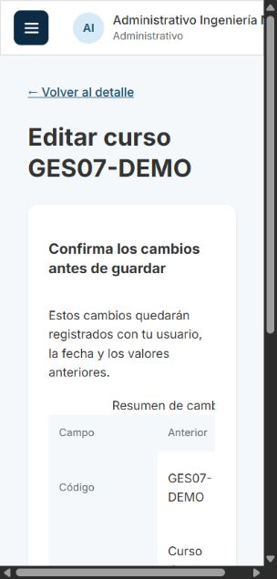
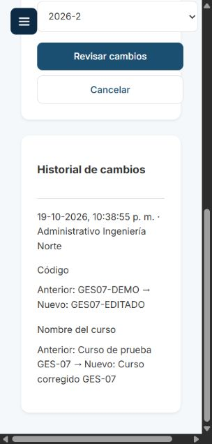

# GES-07: edición de cursos con historial

Tarjeta: [F2 GES-07 Administrativo edita los datos de un curso](https://trello.com/c/ACd1vhTY/94-f2-ges-07-administrativo-edita-los-datos-de-un-curso). Referencia: RN-04. Depende de GES-05.

## Comportamiento

Desde el detalle del curso, el administrativo abre **Editar curso**. El formulario precarga código, nombre, carrera y período actuales, aunque ese período no sea el activo. **Revisar cambios** muestra una comparación de valores anteriores y nuevos. Todavía no envía la edición. **Volver a editar** conserva el formulario; **Confirmar y guardar** envía el PATCH. Cancelar vuelve al detalle sin guardar.

La validación del backend reutiliza exactamente `CrearCursoDto`: código obligatorio de hasta 20 caracteres, recortado y en mayúsculas; nombre obligatorio de hasta 200 caracteres, recortado; carrera y período como UUID; rechazo de tipos incorrectos y campos extra. La carrera destino debe estar vigente y pertenecer a la facultad del administrativo; el período debe pertenecer a su universidad. RN-04 mantiene código único normalizado por período, incluidos cursos archivados. Un duplicado responde 409 y conserva el formulario.

Editar mantiene el ID y las secciones del curso. El listado, sus filtros y el detalle leen los valores actualizados. No se agregan eliminación, archivado, edición de secciones ni un mecanismo de traslado entre facultades/universidades.

## API

Las tres operaciones exigen sesión y permiso `update Curso`; el servicio también exige rol administrativo y consulta su facultad vigente en la BD. Se excluyen cursos/carreras, usuarios y facultades archivados. La universidad sale de la sesión y todas las consultas mantienen RLS y filtros de universidad/facultad.

| Método | Ruta                        | Resultado                                                                         |
| ------ | --------------------------- | --------------------------------------------------------------------------------- |
| GET    | `/api/cursos/:id/edicion`   | 200, datos actuales con los IDs de carrera y período para precargar el formulario |
| PATCH  | `/api/cursos/:id`           | Recibe los cuatro campos de `CrearCurso`; 200 con los datos actualizados          |
| GET    | `/api/cursos/:id/historial` | 200, entradas de historial del curso, más reciente primero                        |

`CursoEditable` contiene `{ id, codigo, nombre, carreraId, carreraNombre, periodoId, periodo: { id, anio, semestre } }`. El contrato de GET detalle existente se conserva. PATCH requiere los cuatro campos, con las mismas validaciones de creación; no acepta `responsableId`, fecha ni universidad proporcionados por el cliente.

Sin sesión: 401. Otros roles, incluido Director: 403 en estas operaciones de edición/historial; conservan su comportamiento previo en el detalle/listado. Curso ajeno, archivado o inexistente: 404. Carrera/período destino ajeno, archivado o inexistente: 404. Un UUID mal formado o cuerpo inválido: 400.

## Historial, concurrencia y migración

Cada guardado que modifica alguno de los cuatro campos añade **una entrada** con fecha de PostgreSQL, ID del responsable y snapshots completos anterior/nuevo. Si se cambian cuatro campos a la vez, la misma entrada conserva los cuatro valores y la interfaz muestra cada diferencia. Los snapshots incluyen los nombres de carrera y año/semestre que se vieron al editar, sin reconstruir los valores antiguos a partir de referencias renombradas posteriormente. La identidad del responsable se conserva por ID; su nombre visible se obtiene del usuario.

El backend toma `FOR UPDATE OF c` antes de leer el valor anterior y conserva ese bloqueo hasta guardar curso e historial en la misma transacción RLS. Así dos ediciones simultáneas registran una cadena de valores anteriores reales, y el bloqueo también coordina con creación de secciones (GES-09). Si falla la auditoría, se revierte el curso. Si hay un duplicado, no se modifica ni el curso ni el historial. Un guardado sin cambios reales, incluidos normalización y UUID en mayúsculas, no añade entradas.

La confirmación es un paso de interfaz. No se implementa control de versiones: con dos formularios abiertos, el último guardado exitoso prevalece y el historial registra ambas ediciones.

La migración aditiva `CrearHistorialCurso1792480000000` crea `curso_cambio`, su índice por curso/fecha, claves foráneas compuestas que vinculan curso y responsable a la misma universidad, y RLS. `cursus_app` tiene únicamente SELECT/INSERT sobre el historial; no UPDATE/DELETE/TRUNCATE. El contrato de RLS documenta esta excepción de solo adición. No se cambian migraciones anteriores. Aplicarla antes de arrancar la nueva API. Su reversión elimina el historial; conserva los cursos, así que el rollback no recupera sus valores anteriores.

El registro cubre las ediciones hechas por este endpoint desde su despliegue. No se reconstruye historial de datos anteriores ni de cambios administrativos hechos directamente por el dueño de la base.

## Preparación

La branch integra `develop` mediante merge, incluida GES-15. `CrearHistorialCurso1792480000000` se ejecuta después de `CrearInscripcion1792470000000` y reutiliza su clave `uq_usuario_id_universidad`; al revertir auditoría, esa clave se conserva para Inscripción. La edición y la acción de agregar alumnos coexisten en el detalle del curso.

Desde la raíz del repositorio:

```bash
git fetch origin
git switch feature/gestion-editar-curso
npm ci
# Si falta .env, prepararlo desde .env.example.
docker compose up -d --wait
npm run migration:run --workspace=backend
npm run seed --workspace=backend
# En dos terminales:
npm run dev:back
npm run dev:front
```

Usar `http://localhost:5173`, los usuarios del seed y `SEED_PASSWORD` de `.env` (`cursus_demo` en el ejemplo local). Si no hay cursos, crear uno desde Mis Cursos con código libre. Para probar cambios de carrera/período, crear otra carrera de Ingeniería y otro período desde sus secciones de gestión.

## Pasos para el reviewer

1. Entrar con `administrativo.ingenieria@norte.cursus.test`. Crear un curso, abrir su detalle y pulsar Editar curso. Comprobar que los cuatro campos reflejan el curso y que el historial inicial está vacío.
2. Cambiar código y nombre, elegir otra carrera propia y otro período de Norte. Pulsar Revisar cambios: comprobar la comparación de los cuatro campos y que Network todavía no muestra PATCH. Volver a editar conserva los valores. Cancelar vuelve al detalle con los valores anteriores y sin entrada nueva.
3. Repetir la edición y confirmar. Esperar PATCH 200, mensaje Cambios guardados y una entrada que muestre fecha, responsable y cada valor anterior/nuevo. Recargar y comprobar persistencia. Ir al detalle y al listado: muestran los valores nuevos. Al cambiar de período, buscar el curso con ese filtro. Si tenía secciones, sus IDs/números se mantienen.
4. Guardar sin cambios: aviso y ningún PATCH desde la interfaz. Enviar el mismo PATCH por API también devuelve 200 sin entrada adicional. Probar código con espacios/minúsculas y nombre con espacios en extremos: el resumen y la respuesta usan los valores normalizados.
5. Crear otro curso en el mismo período e intentar usar su código en el primero, también en minúsculas/con espacios: 409, sin cambios ni entrada adicional. Probar también la colisión cambiando de período y un código ocupado por un curso archivado (prueba automática). El mismo código en otro período libre sí se permite.
6. Verificar validaciones de creación: vacío/solo espacios, código de más de 20, nombre de más de 200, UUID inválidos, campo faltante y campos extra como `responsableId`/`universidadId`. Esperar 400 por API. Comprobar que los errores de guardado conservan el formulario y exigen volver a confirmar.
7. Con Economía o Sur, intentar abrir/editar el ID de Ingeniería o leer su historial: 404. Desde Ingeniería, usar carrera de Economía/Sur o período de Sur como destino: 404. Profesor, ayudante, alumno y Director no ven el enlace de edición y reciben 403 por API. Sin sesión, las tres operaciones reciben 401.
8. Abrir dos formularios del mismo curso y guardar nombres distintos. Se espera que el último guardado prevalezca y que el historial muestre ambas ediciones, con el nuevo valor de una como anterior de la siguiente. La suite de BD verifica el caso simultáneo y el rollback si no puede insertarse la auditoría.
9. Probar carga/error/reintento, desconexión al guardar y pantalla angosta. Mientras guarda, Confirmar y guardar y Volver a editar permanecen deshabilitados. Un error no debe mostrar éxito ni borrar los datos. La comparación permite desplazamiento horizontal.
10. Ejecutar las suites indicadas abajo. Revisar la migración, permisos de solo adición, pruebas de concurrencia, unicidad y rollback. Aprobar con CI verde.

## Validación automática y evidencia

```bash
npm run lint
npm test
npm run test:db --workspace=backend
npm run test:e2e --workspace=backend
npm run build
```

`backend/test/gestion/editar-curso.db-spec.ts` usa una base PostgreSQL propia que se crea y elimina al terminar. Las migraciones se aplican/revierten en la suite de esquema, y el contrato RLS verifica la excepción de auditoría. `frontend/src/pages/EditarCurso.test.tsx` cubre precarga, confirmación, cancelación, errores, historial, roles y guardado pendiente. El test del detalle ahora verifica el enlace de edición habilitado.

Las capturas corresponden a un curso de prueba local. Al terminar se archiva ese curso; se conserva su historial. No se agregan cursos de prueba al seed ni a las migraciones.




