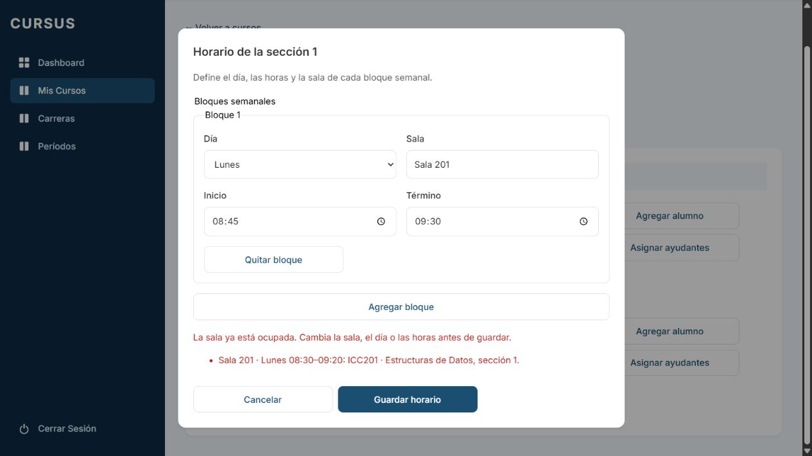
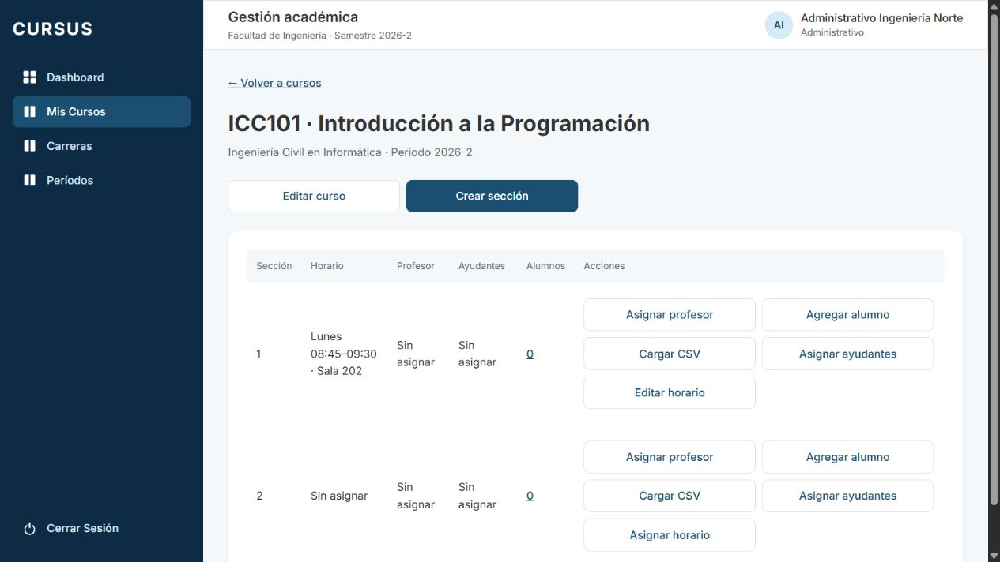

# GES-11: aviso de sala ocupada

Tarjeta: [F2 · GES-11 Aviso si la sala ya está ocupada en ese bloque](https://trello.com/c/ZSeM8Ux9/98-f2-ges-11-aviso-si-la-sala-ya-est%C3%A1-ocupada-en-ese-bloque). Referencia: RN-04. Depende de GES-10, integrada en develop por el PR #57.

## Comportamiento

Al guardar desde **Asignar horario** o **Editar horario**, se comprueba cada bloque contra los horarios vigentes de otras secciones de la misma universidad y del **mismo período del curso**. Se consideran también otras facultades: una sala compartida no puede reservarse dos veces. El permiso de editar sigue limitado a la facultad del administrativo.

Un choque requiere la misma sala, el mismo día y un intervalo superpuesto. Por ejemplo, lunes 08:45–09:30 choca con lunes 08:30–09:20. Se admiten bloques consecutivos (09:20–10:10 después de 08:30–09:20), días distintos y salas distintas. Las salas se comparan sin distinguir mayúsculas y con espacios extremos/repetidos normalizados; `Sala 201` y `SALA   201` son la misma sala. Se mantiene el nombre libre de GES-10: variantes como `201` y `Sala 201` siguen siendo nombres distintos.

El aviso muestra sala, día, intervalo ya reservado, código/nombre del curso y número de sección que la ocupa. El guardado completo se rechaza: no se archivan los bloques anteriores, no se crean los nuevos y no cambia la versión. El diálogo conserva la edición y deshabilita Guardar hasta modificar o quitar un bloque. Al corregir se vuelve a validar todo en el servidor.

La comprobación excluye los bloques de la propia sección al reemplazarlos, y horarios, secciones o cursos archivados. Compara por el ID del período, incluso si no es el activo: un período diferente no causa choque aunque las fechas coincidan. No consulta información de otras universidades.

## API y concurrencia

Se mantiene `PUT /api/secciones/:id/horario` y su DTO de GES-10. Un choque responde **409**:

```json
{
  "statusCode": 409,
  "code": "SALA_OCUPADA",
  "message": "La sala ya está ocupada. Cambia la sala, el día o las horas antes de guardar.",
  "choques": [
    {
      "sala": "Sala 201",
      "dia": 1,
      "inicio": "08:30",
      "termino": "09:20",
      "cursoCodigo": "ICC201",
      "cursoNombre": "Estructuras de Datos",
      "seccionNumero": 1
    }
  ]
}
```

El contrato compartido agrega `ChoqueSala` y `CODIGO_SALA_OCUPADA`. Los datos del curso que ocupa la sala permiten resolver el choque entre facultades, sin entregar IDs de recursos, profesores, alumnos ni datos personales. Un 409 por versión antigua mantiene el comportamiento anterior: exige **Recargar horario**, distinto del choque de sala, que se puede corregir en el mismo formulario.

Un bloqueo transaccional advisory por universidad se toma **antes** de bloquear sección/curso y consultar la ocupación. Serializa los guardados de horarios entre cursos y facultades. La consulta posterior a la espera usa READ COMMITTED y ve lo confirmado por el guardado previo; dos solicitudes simultáneas no pueden ambas reservar la misma sala. Se conserva el control de versión y la transacción de reemplazo de GES-10. El bloqueo se libera al confirmar o revertir y no serializa universidades distintas salvo una improbable colisión del hash.

No hay migraciones ni dependencias nuevas. Esta comprobación se ejecuta al guardar horarios por la API; no agrega una restricción SQL para escrituras directas ni revalida los horarios al cambiar el período de un curso desde GES-07. Los choques que ya existan en datos anteriores se detectan al intentar guardar el horario afectado.

## Preparación y revisión manual

```bash
git fetch origin
git switch feature/gestion-aviso-sala-ocupada
npm ci
# Preparar .env desde .env.example si falta.
docker compose up -d --wait
npm run migration:run --workspace=backend
npm run seed --workspace=backend
# En dos terminales:
npm run dev:back
npm run dev:front
```

1. En `http://localhost:5173`, ingresar con `administrativo.ingenieria@norte.cursus.test` y `SEED_PASSWORD` del entorno local. Usar cursos/secciones de prueba del mismo período (o los cursos ICC101/ICC201 del seed en una base limpia).
2. En ICC201, sección 1, guardar lunes 08:30–09:20, Sala 201. En ICC101, sección 1, intentar guardar lunes 08:45–09:30, Sala 201. Debe responder 409 e identificar ICC201, Estructuras de Datos, sección 1, con su intervalo.
3. Confirmar que Guardar queda deshabilitado y se conservan los campos. Cancelar y recargar: el horario de ICC101 sigue igual que antes. Si había varios bloques previos, se conservan todos; ningún bloque libre del intento se guarda parcialmente.
4. Repetir el intento y cambiar únicamente a Sala 202. El aviso se limpia, Guardar se habilita y el guardado responde 200. Recargar: persiste la sala corregida. Quitar el bloque que choca también permite corregir y revalidar el conjunto.
5. Probar `sala   201`, un intervalo idéntico, contenido y otro que contenga al reservado: todos chocan. Probar lunes 09:20–10:10, otro día u otra sala: se permite.
6. Preparar un curso en otro período de la misma universidad. La misma sala/día/horas se permite. En el mismo período, incluso inactivo, el choque se rechaza.
7. Reservar una sala con el administrativo de Economía y luego intentar el mismo bloque desde Ingeniería: se informa el curso/sección de Economía. La edición directa de la sección ajena sigue respondiendo 404. La ocupación de otra universidad no bloquea Norte ni se muestra en sus avisos.
8. Desde dos pestañas, asignar simultáneamente la misma sala libre a secciones de **cursos diferentes** del mismo período: un guardado pasa y el otro recibe el aviso. Desde dos editores de la misma sección, conservar la comprobación de versión: la sesión antigua exige recargar.
9. Verificar que un curso/sección/bloque archivado no ocupa sala y que editar los bloques de la propia sección no se considera un choque consigo misma. Comprobar permisos de GES-10: Director, profesor, ayudante y alumno no acceden al editor ni al PUT.
10. Ejecutar las suites de abajo y revisar CI. Descartar o archivar únicamente los datos creados para esta prueba según el procedimiento del entorno.

## Pruebas y evidencia

```bash
npm run lint
npm test
npm run test:db --workspace=backend
npm run test:e2e --workspace=backend
npm run build
```

Las 39 pruebas de horarios con PostgreSQL cubren los casos anteriores, versiones, reemplazo/rollback y concurrencia. Se reemplaza la expectativa provisional de GES-10 que permitía ocupar una sala dos veces. La interfaz agrega dos pruebas de aviso, múltiples ocupantes, conservación de campos, corrección sin recarga y quitar un bloque; se conserva la regresión de versión antigua.

La comprobación en navegador usa una base aislada con el seed y todas las migraciones, sin cambios en el seed del repositorio. Se verifican el choque parcial y la persistencia de Sala 202 después de corregir y recargar.

Nota del entorno local: la base antigua contiene inscripciones archivadas anteriores a GES-19 que impiden aplicar `ArchivarInscripcionConResponsable` por su nueva restricción. Se usó una base limpia para la comprobación visual, sin alterar esos registros ni la migración de develop. La suite completa también presenta el desfase de reloj Windows/PostgreSQL ya observado en #54: falla la comparación temporal de `quitadoEn`; los demás casos pasan. Los resultados de CI se informan separadamente en el PR.




