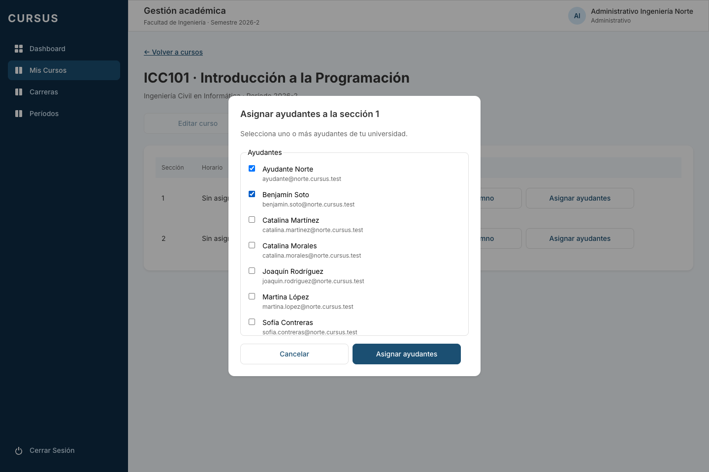
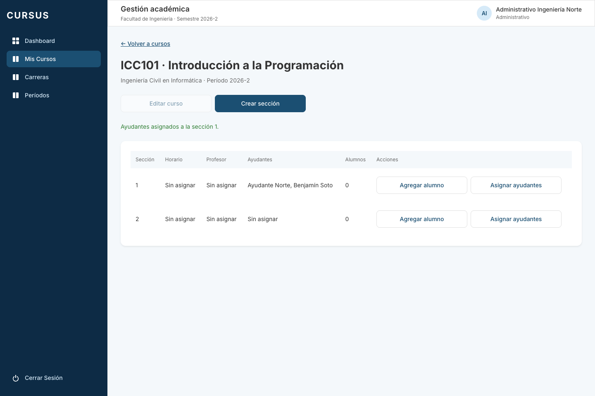

# GES-13: asignar ayudantes a una sección

Historia: **F2 · [GES-13] Administrativo asigna ayudantes a una sección**. Referencia: RN-05. Dependencia: GES-09, ya integrada en `develop`.

## Comportamiento

En el detalle del curso, cada sección ofrece **Asignar ayudantes** al Administrativo. El diálogo lista los usuarios activos con rol Ayudante de su universidad, incluyendo los de otras facultades. Permite marcar varias opciones y muestra los ya asignados como seleccionados y deshabilitados. Al guardar, los nombres aparecen en la fila de esa sección y se conservan al recargar.

La acción agrega asignaciones: no reemplaza ni quita las anteriores. Repetir un envío o asignar simultáneamente el mismo ayudante no lo duplica. Quitar asignaciones corresponde a GES-14. El Director puede consultar los nombres en el detalle consolidado, sin acceder al diálogo ni a los endpoints de asignación.

El Administrativo solo puede modificar secciones vigentes de cursos de su facultad. Una sección ajena, inexistente o archivada devuelve 404. Un conjunto que contenga un usuario inexistente, archivado, de otra universidad o con otro rol devuelve 400 y no guarda ninguna asignación del envío.

En staging se usan los ayudantes del seed GES-22; las cuentas de producción se crean mediante GES-21. Esta historia no crea cuentas.

## API y datos

- `GET /api/secciones/:id/ayudantes`: opciones `{ id, nombre, correo, asignado }`, ordenadas por nombre, correo e identificador.
- `POST /api/secciones/:id/ayudantes`: recibe `{ ayudanteIds: string[] }` y devuelve 200 con todos los ayudantes activos asignados `{ id, nombre, correo }`. El DTO exige entre 1 y 100 UUID distintos por envío.
- Ambos endpoints requieren `update` sobre `Seccion` (solo Administrativo). No se aceptan identificadores de universidad o facultad en el body.
- El detalle existente `GET /api/cursos/:id` devuelve los nombres en `secciones[].ayudantes`.

La migración `1792490000000-CrearAyudanteSeccion` crea `ayudante_seccion`, con claves foráneas compuestas por universidad, un índice único para asignaciones activas, fechas y `archived_at`. Reutiliza las claves compuestas incorporadas en GES-15, ya integrado. Las políticas RLS aíslan las universidades y permiten lectura consolidada al Director; solo el Administrativo escribe. No se otorga DELETE. La validación de usuarios y las inserciones se ejecutan en una transacción con bloqueos para evitar asignaciones parciales o duplicadas.

## Verificación

Desde la raíz, con Node 24.15+, dependencias instaladas y PostgreSQL disponible:

```bash
npm run lint
npm test
npm run test:e2e --workspace=backend
npm run test:db --workspace=backend
npm run build
```

Las pruebas cubren selección múltiple, persistencia en el detalle, ayudantes de otra facultad de la misma universidad, exclusión de otros roles y cuentas archivadas, rechazo de otras universidades, aislamiento entre facultades, permisos, DTO, envíos simultáneos e idempotencia. La suite de base también comprueba aplicación y reversión de la migración, sus claves foráneas y RLS. El frontend cubre guardar, cancelar, selección ya asignada, estado vacío, error y reintento.

## Revisión en local

1. Ejecutar las migraciones (`npm run migration:run --workspace=backend`) y el seed (`npm run seed --workspace=backend`). Levantar backend y frontend.
2. Ingresar con `administrativo.ingenieria@norte.cursus.test` y la contraseña `SEED_PASSWORD` del `.env`.
3. Abrir Gestión académica, un curso y **Asignar ayudantes** en la sección 1. Confirmar que las opciones son ayudantes de Norte, sin usuarios de Sur ni otros roles.
4. Seleccionar dos ayudantes, guardar y confirmar que sus nombres aparecen en la sección. Recargar: deben seguir visibles.
5. Reabrir: los asignados aparecen marcados y deshabilitados. Asignar uno más y comprobar que los anteriores se conservan. Cancelar otra selección: no debe modificar la sección.
6. Revisar otra sección: sus asignaciones son independientes. El mismo ayudante puede apoyar varias secciones.
7. Ingresar como Director y abrir el curso: debe ver los nombres, sin acciones de asignación. Las peticiones directas a los endpoints de ayudantes deben responder 403 para ese rol.

## Evidencia




