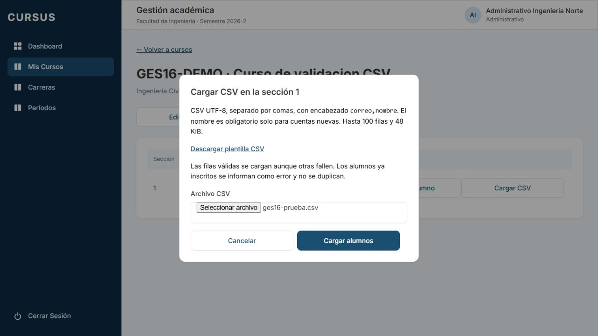
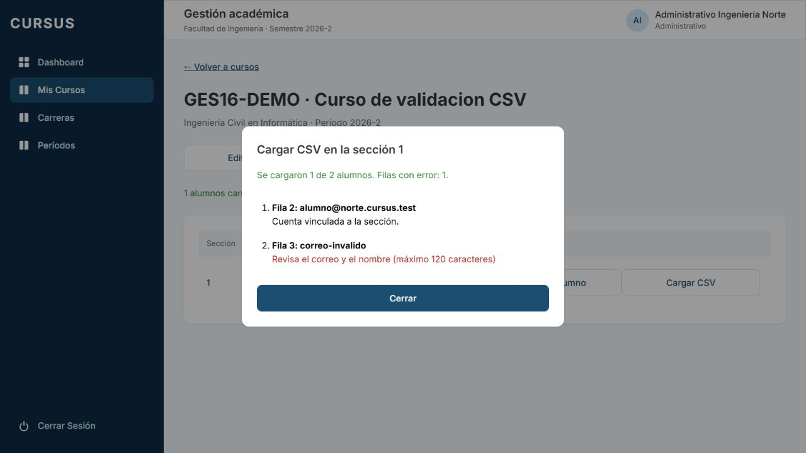

# GES-16: carga de alumnos desde CSV

Tarjeta: [F2 GES-16 Administrativo carga alumnos desde un CSV](https://trello.com/c/jtq0ezcR/103-f2-ges-16-administrativo-carga-alumnos-desde-un-csv). Referencia: RN-06. Depende de GES-09 y reutiliza las reglas de inscripción de GES-15.

## Formato y plantilla

En el detalle de un curso, cada sección ofrece **Cargar CSV** al administrativo. El diálogo permite descargar [la plantilla](../frontend/public/plantilla-alumnos.csv), que contiene únicamente el encabezado, sin cuentas de ejemplo que puedan inscribirse accidentalmente.

- Archivo de texto **UTF-8**, con o sin BOM, separado por **comas**. No se acepta punto y coma como delimitador.
- Encabezado obligatorio `correo,nombre`, en ese orden y en minúsculas. Se permiten espacios alrededor de los nombres de columna.
- Dos columnas en cada fila. Para vincular una cuenta existente, dejar nombre vacío **manteniendo la coma**.
- Nombre obligatorio solo si la cuenta no existe; máximo 120 caracteres, como GES-15. Si ya existe, se conserva su nombre actual.
- Correo institucional válido de la universidad del administrativo. Se recortan espacios y se convierte a minúsculas; el nombre se recorta.
- Se admiten LF, CRLF o CR, comillas dobles, comas/saltos dentro de un campo entre comillas y `""` para una comilla literal. Las líneas totalmente vacías se ignoran; una fila `,` sí se valida y falla por correo vacío.
- Máximo **100 filas de alumnos** (sin contar encabezado/líneas vacías) y **48 KiB en UTF-8** por archivo. Para grupos mayores, dividir el archivo conservando el encabezado en cada parte.

Ejemplo para la universidad demo Norte:

```csv
correo,nombre
alumno@norte.cursus.test,
nueva.alumna@norte.cursus.test,"Pérez, Ana"
otro.alumno@norte.cursus.test,"Juan ""Pepe"" Soto"
```

En otra universidad, reemplazar el dominio por el institucional correspondiente. Guardar como CSV UTF-8 delimitado por comas; si la herramienta exporta punto y coma, cambiar el delimitador al guardar.

## Resultado y reglas de inscripción

El backend comprueba la sección y analiza la estructura completa antes de escribir. Un encabezado incorrecto, comillas inválidas/sin cerrar, exceso de filas/bytes o un archivo sin alumnos rechaza el archivo entero sin cargar ninguna fila.

Con estructura válida, cada fila usa `AgregarAlumnoDto` y `GestionService.agregarAlumno`, igual que GES-15. Cada cuenta e inscripción se confirma en su propia transacción RLS. Las filas correctas se conservan aunque otras fallen; un error de una fila no deja una cuenta nueva huérfana de inscripción. Se rechazan cuentas de otros roles, archivadas, dominios ajenos y alumnos ya inscritos. Una inscripción archivada se trata como en GES-15. No se modifica ni reactiva una cuenta existente.

Al finalizar se muestran total, cargados, errores y resultado por fila. **Cargados** cuenta únicamente inscripciones creadas en esta petición; una cuenta vinculada también suma, pero un alumno ya inscrito no suma ni se duplica. Reenviar el mismo archivo produce errores para las filas ya inscritas. Para corregir, preparar un CSV con solo las filas rechazadas.

La fila indicada corresponde al número de línea de inicio en el archivo original, incluido el encabezado. Para campos con saltos entre comillas, puede no coincidir con el número de alumno dentro de la lista.

Si se crea una cuenta, se devuelve y muestra su contraseña provisoria una sola vez en el resultado de esa petición, con botón para copiarla. Solo queda en memoria del diálogo; no se guarda en storage, logs ni archivos de resultados. Al cerrar se descarta. La API responde `Cache-Control: no-store`. Las capturas usan una cuenta existente y no contienen contraseñas.

Mientras procesa se bloquean otra carga y el cierre con botones/Escape. Ante un error de red, algunas filas pueden haberse confirmado antes de perder la respuesta: la interfaz pide revisar la lista antes de reintentar. La historia no agrega trabajos en segundo plano, recuperación de respuestas perdidas ni reinicio de contraseñas.

## API y permisos

`POST /api/secciones/:id/alumnos/csv` recibe JSON `{ "csv": "correo,nombre\n..." }`: el navegador lee el archivo y envía su contenido, sin almacenar el archivo original en el servidor. La respuesta HTTP 200 incluye `{ total, cargados, errores, filas }`, también cuando todas las filas son rechazadas por reglas individuales.

Una fila exitosa contiene `{ fila, correo, estado: "cargado", alumno, cuentaCreada, passwordProvisoria? }`. Una fallida contiene `{ fila, correo, estado: "error", mensaje }`. Los fallos internos de una fila usan un mensaje genérico, sin detalles de BD, y se conservan los resultados ya obtenidos. Los errores 500 o superiores y las excepciones inesperadas se registran con `Logger` de Nest: número de fila original, sección, universidad y estado HTTP (500 para errores inesperados). No se registra la excepción original, su mensaje/consulta, el correo, el CSV ni contraseñas. Los errores de validación y reglas de inscripción (4xx) no generan este log de error interno.

- Requiere sesión y permiso `create Inscripcion`; el servicio también exige rol administrativo. Sin sesión: 401; otros roles: 403.
- La sección debe pertenecer a la universidad y facultad del usuario, y estar vigente junto con su curso. El ámbito y las reglas se reutilizan de GES-15, comprobándose también en cada inscripción.
- Sección ajena, archivada o inexistente: 404 antes de procesar. UUID/cuerpo inválido o campos extra como `universidadId`: 400.
- Formato/límites inválidos: 400; el límite HTTP global puede responder 413 a cuerpos demasiado grandes. No se modifica su configuración.
- No hay migración ni dependencias nuevas. Se reutilizan las restricciones de cuentas/inscripciones existentes, incluidas las que evitan duplicados con solicitudes concurrentes.

## Preparación y pasos de revisión

La branch integra `develop` mediante merge, incluidos los PR #53, #55 y #56. En el detalle se conservan Asignar profesor, Agregar alumno, Cargar CSV y Asignar ayudantes, con los permisos respectivos, además de quitar alumnos y cambiar la contraseña del perfil.

```bash
git fetch origin
git switch feature/gestion-carga-alumnos-csv
npm ci
# Si falta .env, prepararlo desde .env.example.
docker compose up -d --wait
npm run migration:run --workspace=backend
npm run seed --workspace=backend
# En dos terminales:
npm run dev:back
npm run dev:front
```

1. Abrir `http://localhost:5173`. Entrar con `administrativo.ingenieria@norte.cursus.test` y `SEED_PASSWORD` de `.env` (`cursus_demo` con el ejemplo local). Abrir un curso de Ingeniería con una sección; crear uno si hace falta para no alterar inscripciones demo.
2. Pulsar Cargar CSV en esa sección. Descargar plantilla y comprobar encabezado `correo,nombre`, sin alumnos de ejemplo. Revisar las instrucciones de UTF-8, comas y límites. Cancelar no envía POST.
3. Preparar un archivo con una cuenta nueva y nombre, `alumno@norte.cursus.test` con nombre vacío y un correo inválido. Usar un correo nuevo distinto en cada prueba. Seleccionarlo y cargar. Esperar HTTP 200 y resumen con dos cargados, un error y su línea/motivo. El conteo de la sección aumenta solo en dos.
4. Copiar la contraseña provisoria de la cuenta nueva, cerrar y comprobar que el resultado/contraseña ya no aparecen al reabrir. La cuenta existente no recibe contraseña nueva ni cambia su nombre. Verificar que el alumno nuevo puede iniciar sesión con la contraseña entregada.
5. Abrir el enlace del conteo de alumnos de la sección. Deben aparecer los dos inscritos; recargar y comprobar persistencia. Reenviar el archivo: no se duplican y el conteo no aumenta. Corregir únicamente las filas rechazadas y cargar otro CSV con ellas.
6. Probar una fila con nombre de más de 120 caracteres, correo de profesor, cuenta archivada, dominio distinto y cuenta nueva sin nombre. Esas filas fallan, mientras una fila válida posterior sí se carga. Probar nombre con coma y comillas escapadas según el ejemplo.
7. Probar encabezado incorrecto, delimitador punto y coma, comillas sin cerrar después de una fila válida, archivo vacío/solo encabezado, más de 100 filas y más de 48 KiB: rechazo completo, sin inscripciones. La interfaz también rechaza archivos grandes y codificación UTF-8 inválida antes de enviarlos.
8. Con Economía o Sur, intentar el POST al ID de una sección de Ingeniería: 404 y ningún cambio. Sin sesión: 401. Director, profesor, ayudante y alumno: 403 por API; no ven la acción de carga. Probar UUID y body inválidos/campos extra: 400.
9. Mientras carga, no debe permitir otra carga ni cerrar el diálogo con Cancelar/Escape. Probar fallo de red y revisar el aviso sobre posibles filas ya confirmadas. No debe inventar un conteo exitoso. Verificar pantalla angosta y desplazamiento del resultado si hay muchas filas.
10. Ejecutar las suites de abajo y revisar especialmente duplicados/concurrencia, aislamiento, validación compartida, resultados parciales y contraseñas. Aprobar con CI verde.

## Prueba pendiente en staging después del merge

La carga es secuencial y síncrona. Un archivo de 100 cuentas nuevas requiere 100 hashes de contraseña; falta comprobar su duración real frente al corte de API Gateway a los 30 segundos.

1. Tras el merge y despliegue, usar una sección de prueba y 100 correos institucionales nuevos, con nombre y sin cuentas previas. Registrar el conteo inicial y la hora de inicio.
2. Cargar el archivo completo desde la interfaz. Medir la duración del POST en Network y revisar los logs del servidor. Se espera HTTP 200 antes de los 30 segundos, resumen de 100 cargados/0 errores y aumento de 100 alumnos, también después de recargar.
3. No adjuntar al PR el CSV real, la respuesta con contraseñas ni capturas que las expongan. Registrar duración, estado HTTP y conteos; manejar las credenciales solo en el entorno de prueba.
4. Si hay timeout, revisar inscripciones y logs antes de reintentar: algunas filas pueden haberse confirmado. Documentar duración, cantidad persistida y resultado de la interfaz. Si alcanza o supera el límite, esta comprobación falla y se requiere ajustar el procesamiento antes de dar por validada la carga máxima.
5. Archivar las inscripciones y cuentas de prueba según el procedimiento del equipo al terminar.

## Validación y evidencia

```bash
npm run lint
npm test
npm run test:db --workspace=backend
npm run test:e2e --workspace=backend
npm run build
```

El parser tiene pruebas de BOM, comillas, escapes, saltos, encabezado y límites. El servicio prueba la conservación de éxitos ante errores inesperados/500, el registro de la fila sin datos personales y la ausencia de ese log ante errores 4xx o de validación. `backend/test/gestion/cargar-alumnos.db-spec.ts` usa PostgreSQL real en una base propia creada/eliminada por la suite, junto con las regresiones de GES-15. La interfaz cubre plantilla, envío con sesión, resumen, errores, contraseñas, conteo, cierre y espera.

Se unifica la propiedad `enMenu` duplicada que llegó en `develop`, conservando `enMenu?: boolean` y el comportamiento del perfil/lista de alumnos, para permitir compilar la integración. No cambia los permisos ni los elementos del menú.

Las capturas muestran una carga real con un alumno existente y un correo inválido. El curso/sección/inscripción de validación local se archivan al terminar; la cuenta demo se conserva. No se agregan datos de prueba al seed ni a las migraciones.




