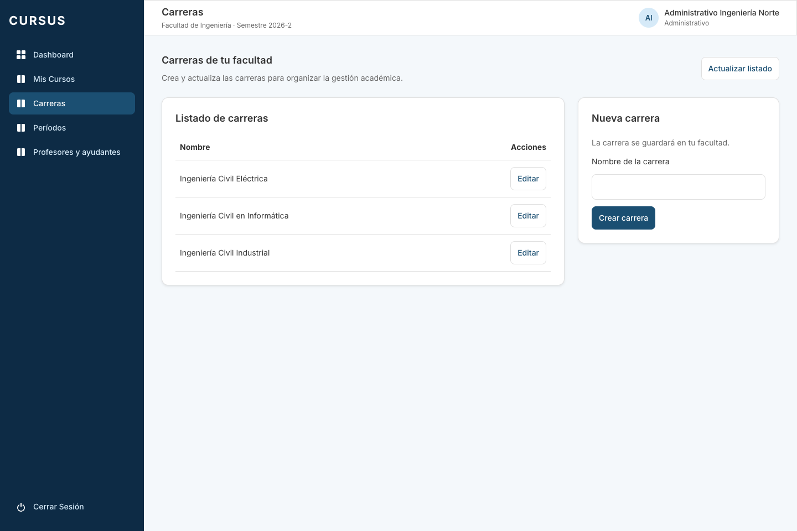
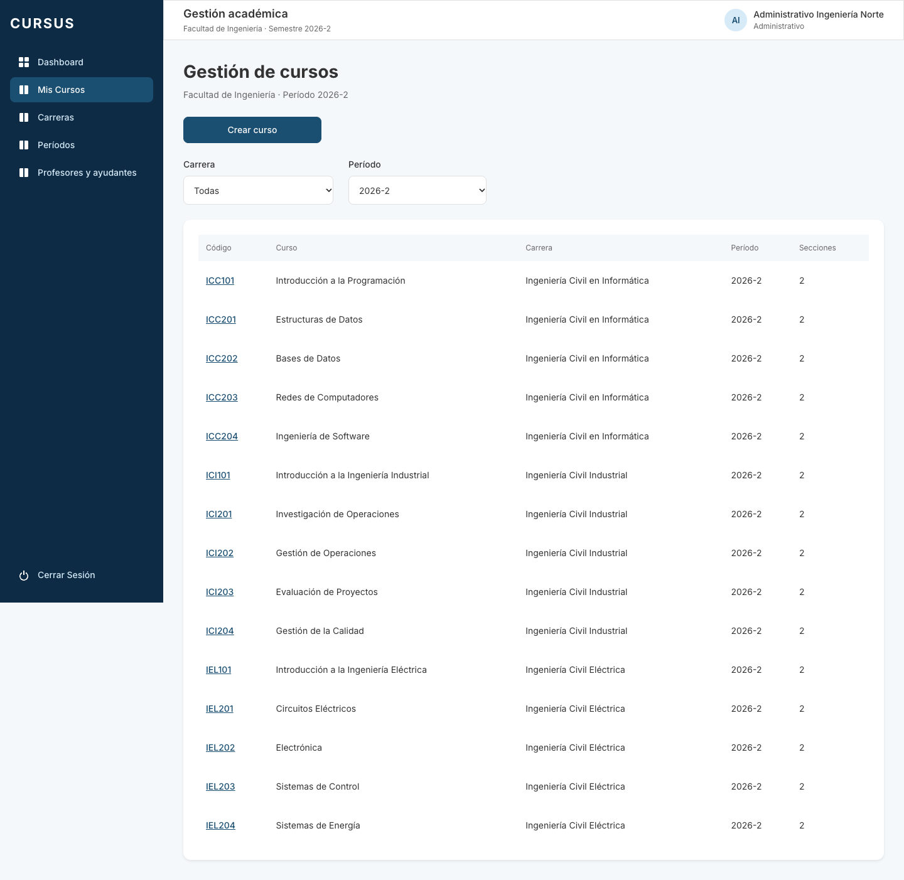
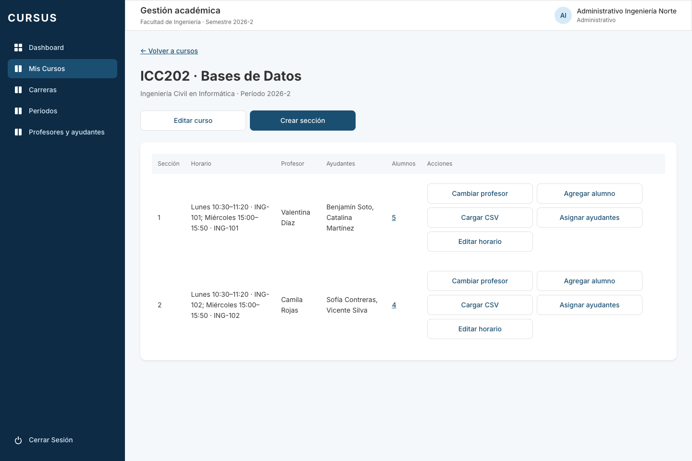

# GES-20: seed de una facultad completa

Tarjeta: [F2 · GES-20 Seed de una facultad completa con cursos, secciones y usuarios](https://trello.com/c/kNnHu3JH/107-f2-ges-20-seed-de-una-facultad-completa-con-cursos-secciones-y-usuarios). Referencia: RN-17. Depende de GES-05, GES-09, GES-10, GES-12, GES-13 y GES-16, ya integradas en `develop`.

Como desarrollador, quiero datos simulados de una facultad completa, para mostrarle al cliente la plataforma funcionando con datos realistas.

## Datos de la demo

El comando habitual `npm run seed --workspace=backend` carga las dos universidades del seed base y completa la **Facultad de Ingeniería de Universidad Demo Norte** en su período activo:

| Carrera                         | Cursos                                 |
| ------------------------------- | -------------------------------------- |
| Ingeniería Civil en Informática | ICC101, ICC201, ICC202, ICC203, ICC204 |
| Ingeniería Civil Industrial     | ICI101, ICI201, ICI202, ICI203, ICI204 |
| Ingeniería Civil Eléctrica      | IEL101, IEL201, IEL202, IEL203, IEL204 |

En una base nueva son **3 carreras, 15 cursos, 30 secciones, 60 bloques horarios, 60 asignaciones de ayudantes y 125 inscripciones**. Cada curso tiene las secciones 1 y 2, cada una con un profesor, dos ayudantes, cuatro o cinco alumnos y dos encuentros semanales con día, inicio, término y sala.

Se reutilizan los **3 profesores, 4 ayudantes y 25 alumnos** de demo de Ingeniería (GES-22), con nombres y correos institucionales simulados. Los alumnos se distribuyen en tres grupos de carrera y, dentro de cada curso, en una de sus dos secciones: cada alumno cursa cinco asignaturas. Las dos secciones simultáneas tienen distinto profesor, distintos ayudantes y diferentes alumnos.

Los horarios se distribuyen de lunes a viernes entre 08:30 y 15:50, con salas **ING-101** e **ING-102**. Los intervalos de distintos cursos no se superponen: tampoco hay choques de profesor, ayudante o alumno. Los datos pertenecen a la misma facultad/universidad y respetan los roles y dominios institucionales. No se duplican códigos en el período.

El Administrativo de Ingeniería (`administrativo.ingenieria@norte.cursus.test`) ve las tres carreras y los quince cursos. El Director puede consultar la demo; los administrativos de Economía y Sur mantienen su ámbito. La contraseña sigue siendo `SEED_PASSWORD`, hasheada con argon2id. No se agregan credenciales nuevas al código.

## Ejecución y repetición

Desde la raíz, con Node 24.15+, `.env` y PostgreSQL local preparados:

```bash
npm ci
docker compose up -d --wait
npm run migration:run --workspace=backend
npm run seed --workspace=backend
# Repetir para comprobar que no se duplican los datos.
npm run seed --workspace=backend
```

No hay migraciones ni dependencias nuevas. `seed:prod` usa la misma carga completa, por lo que el procedimiento existente `bash infra/aws/seed.sh staging` la incluye cuando el equipo lo ejecute después del despliegue. Se conserva la protección `SEED_ALLOW` y el script AWS sigue admitiendo únicamente staging.

La carga completa comparte una transacción con el seed base. Un bloqueo transaccional serializa dos ejecuciones simultáneas, incluida la primera carga de una base vacía. Un error de escritura, un código demo ocupado por otra carrera o un horario que choque con una sala existente en la misma universidad y período revierte toda la ejecución y muestra el motivo. Los períodos distintos pueden reutilizar la misma sala e intervalo. No se eliminan ni se reemplazan datos para despejar conflictos.

Las carreras y cursos usan claves únicas; las secciones se identifican por curso y número. Solo se inicializan secciones vigentes sin profesor, versión de horario cero y sin ninguna fila de horario, ayudantes o inscripciones, incluido historial archivado. Por ello una segunda ejecución conserva IDs, asignaciones e inscripciones; tampoco restaura profesores quitados ni horarios o participantes retirados. Los cursos editados o archivados y las secciones archivadas se conservan. Si el cliente ya modificó datos de la demo, sus secciones se omiten, por lo que los totales anteriores describen la carga inicial, no una restauración forzada.

El seed base mantiene su comportamiento anterior: actualiza los usuarios simulados y sus hashes usando `SEED_PASSWORD`. La conservación de ediciones descrita arriba corresponde a cursos, secciones y sus asignaciones. El período demo 2026-2 solo se activa cuando no hay otro activo; la facultad completa se carga en el que esté activo, sin modificar las asignaciones de períodos anteriores.

## Verificación

```bash
npm run lint
npm test
npm run test:e2e --workspace=backend
npm run test:db --workspace=backend
npm run build
```

`backend/test/database/seed-facultad.db-spec.ts` utiliza PostgreSQL real y una base propia, creada y eliminada por la suite. Comprueba cantidades, participantes y DTO de gestión, ausencia de choques, aislamiento por API, el comando real ejecutado dos veces, conservación de cambios e historial, selección del período activo, rollback y dos cargas simultáneas. Las suites de otras historias conservan sus fixtures base mediante `ejecutarSeed`; el CLI y esta suite activan `facultadCompleta` explícitamente.

Para revisar en la interfaz:

1. Cargar el seed e ingresar como Administrativo de Ingeniería de Norte con la contraseña de `.env`.
2. Abrir Carreras: aparecen Informática, Industrial y Eléctrica. Abrir Gestión académica: hay cinco cursos de cada carrera en el período activo.
3. Abrir un curso: las dos secciones muestran horario/sala, profesor, dos ayudantes y un enlace al conteo de alumnos. Abrir ese enlace y comprobar los alumnos.
4. Recargar y confirmar persistencia. Ejecutar otra vez el seed y comprobar que no aumenten secciones, bloques o inscripciones.
5. Editar un horario o retirar un participante; volver a ejecutar el seed y comprobar que respeta el cambio.
6. Ingresar con Economía o Sur y comprobar que no ven los cursos de Ingeniería de Norte. El Director sí puede consultar su detalle.

## Evidencia local

Validado en Chrome con API y PostgreSQL reales, en una base de demo separada. Se comprobaron las tres carreras, los quince cursos y sus filtros, el detalle de las secciones y sus alumnos, la persistencia tras repetir el comando, el aislamiento y la lectura del Director, sin errores inesperados de JavaScript ni respuestas 500.






