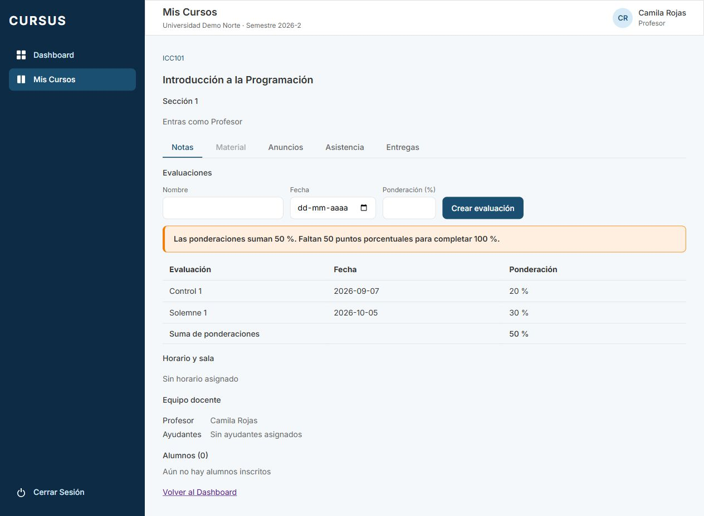

# NOT-02 · Aviso si las ponderaciones no suman 100 %

[Tarjeta Trello](https://trello.com/c/4RbSWVZi/115-f4-not-02-aviso-si-las-ponderaciones-no-suman-100) · RN-10 · Depende de NOT-01.

## Qué ve el profesor

En **Mis Cursos → sección → Notas → Evaluaciones**, la lista muestra un aviso destacado cuando el total de ponderaciones activas de esa sección no es 100 %. Usa `sumaPonderaciones` de NOT-01 y se actualiza al recargar la lista después de crear una evaluación:

| Total                 | Aviso esperado                                 |
| --------------------- | ---------------------------------------------- |
| 0 %, sin evaluaciones | Faltan 100 puntos porcentuales                 |
| 50 %                  | Faltan 50 puntos porcentuales                  |
| 99 %                  | Falta 1 punto porcentual                       |
| 100 %                 | No hay aviso; se conserva el total de la tabla |
| 101 %                 | Sobra 1 punto porcentual                       |
| 110 %                 | Sobran 10 puntos porcentuales                  |

Se puede seguir preparando evaluaciones con cualquier suma. El aviso no bloquea crear evaluaciones, registrar propuestas, enviarlas a revisión ni aprobar/publicar **las notas de una evaluación** en NOT-11. Durante carga o error no se muestra una suma inventada. Las secciones de un mismo curso y las evaluaciones archivadas no se mezclan en el total.

## Validación para publicar la nota final

**Alcance acordado:** la regla del 100 % aplica solo a publicar la **nota final del curso**, calculada con las evaluaciones de la sección. Actualmente el producto no tiene botón, endpoint ni persistencia de esa nota final. Este PR aporta el aviso y la validación de servidor probada, pero el criterio de bloqueo de extremo a extremo queda pendiente de conectar en la tarjeta que incorpore ese flujo. NOT-11 sigue publicando notas individuales por evaluación.

`NotasModule` exporta `PonderacionesService`. El futuro servicio de publicación deberá ejecutar la escritura de la nota final y su auditoría dentro del callback de `conNotaFinalValidada(contexto, profesorId, seccionId, publicar)`, usando la conexión que recibe el callback. `contexto` y `profesorId` deben salir de la sesión; la sección, del acceso validado por ESP-06. Esta validación no es un endpoint de comprobación previo a una escritura separada.

- Exige rol PROFESOR y valida en SQL al profesor activo asignado (desde [GES-25](ges-25-varios-profesores.md), cualquiera de los profesores vigentes de la sección, con `es_profesor_de_seccion`), la universidad y el curso/sección vigentes. Fija el usuario de sesión en la transacción para las políticas y la auditoría que lo requieran.
- Suma en PostgreSQL todas las ponderaciones de evaluaciones activas de esa sección, bajo RLS. Si no suma 100, devuelve `ConflictException` (409) con `sumaPonderaciones`, `faltan`, `sobran` y el aviso; el callback no se ejecuta. Con 100 ejecuta el callback, y cualquier fallo revierte su escritura.
- Crear evaluaciones (NOT-01) y validar la nota final comparten un advisory lock de transacción por universidad y sección. La escritura queda dentro del mismo bloqueo que la suma. Las futuras ediciones/archivos de evaluaciones deberán tomar `bloquearPonderaciones` antes de fijar filas, usando la misma conexión; las publicaciones por evaluación mantienen su propio bloqueo de NOT-11.

No agrega endpoints, migraciones ni permisos. La futura nota final deberá definir sus propias reglas de cálculo, datos y auditoría, además de usar este requisito de ponderaciones.

## Cómo revisar

1. En una sección de prueba con profesor asignado, abrir **Notas** con dos evaluaciones de 20 % y 30 %. Esperar total 50 % y un aviso visible que dice que faltan 50 puntos porcentuales.
2. Crear una tercera de 50 % con una fecha válida del período. La lista se recarga, muestra 100 % y el aviso desaparece.
3. Crear otra evaluación de 10 %. Esperar total 110 % y aviso de que sobran 10 puntos. La creación debe seguir disponible. Una sección vacía indica 0 % y conserva el estado vacío.
4. En el dashboard de profesor, con una evaluación enviada a revisión y un total inferior a 100 %, probar **Aprobar y publicar** de NOT-11: se aprueban las notas de esa evaluación. El test de integración de NOT-11 cubre este comportamiento.
5. Ejecutar las pruebas de base para comprobar el requisito de nota final: 0/99/101/200 no ejecutan la operación de prueba; 100 sí, sin contar archivadas ni otras secciones. Las pruebas verifican que una creación concurrente espera, el siguiente cálculo lee el total actualizado, el callback fallido revierte su escritura y roles o secciones ajenas no publican.

```sh
npm run build
npm run lint
npm run format:check
npm run test --workspace=frontend -- src/pages/PestanaNotas.test.tsx src/pages/PendientesRevision.test.tsx src/pages/NotasDeEvaluacion.test.tsx --maxWorkers=1
npm run test:db --workspace=backend -- test/notas/evaluaciones.db-spec.ts test/notas/notas.db-spec.ts
```

Prueba de navegador en una base temporal con datos simulados: total de 50 % con aviso, y creación de Examen (50 %) que lleva a 100 % y quita el aviso. El exceso y la validación transaccional se cubren en los tests. Se eliminó la base temporal al terminar.


