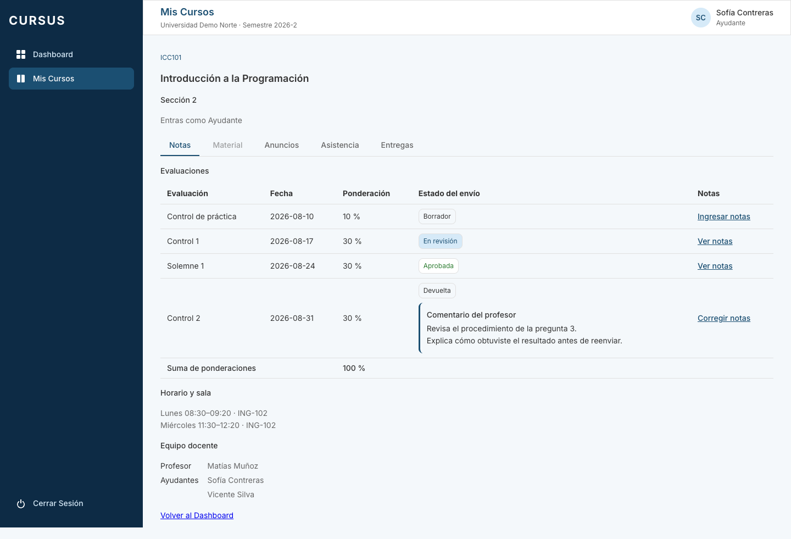
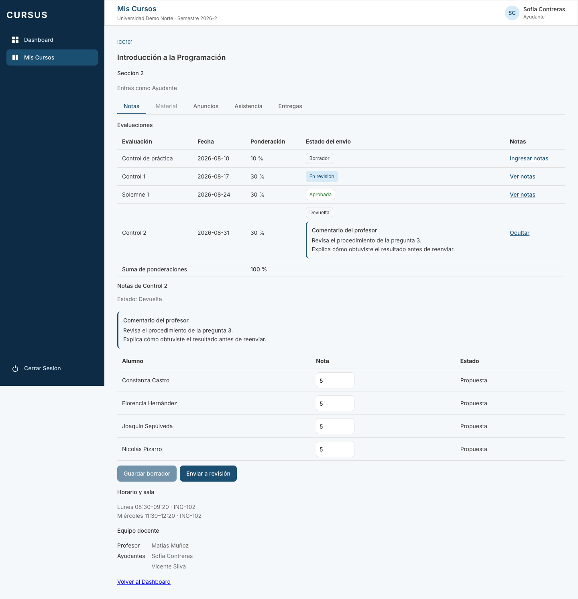
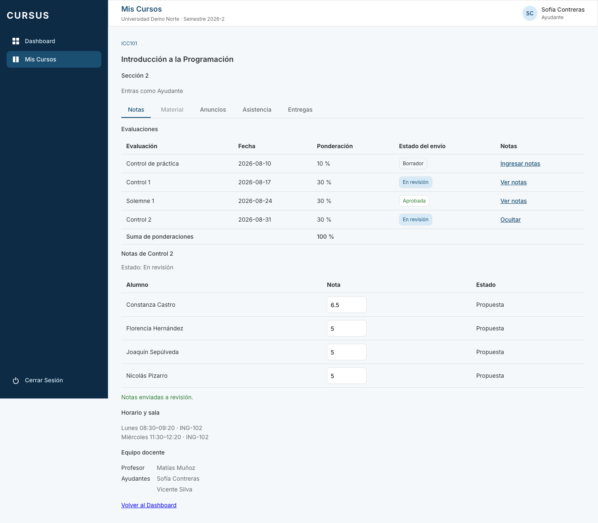
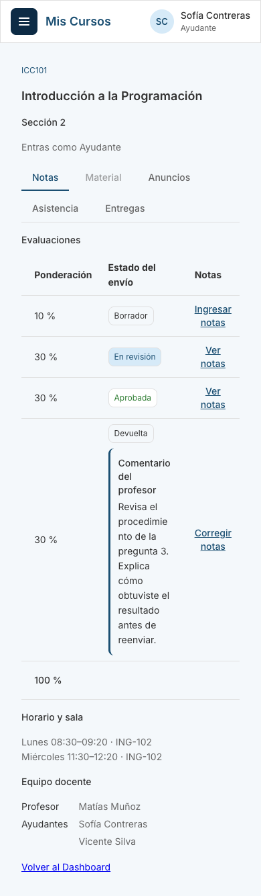

# NOT-09: el ayudante ve el estado de sus envíos

Tarjeta: [F4 · NOT-09 Ayudante ve el estado de sus envíos](https://trello.com/c/ujckmSSk/122-f4-not-09-ayudante-ve-el-estado-de-sus-env%C3%ADos). Referencia: RN-10. Depende de NOT-08, integrada en `develop`. Aprovecha la aprobación de NOT-11 y el comentario de devolución de NOT-12.

**Como** ayudante, **quiero** ver el estado de mis envíos de notas, **para** saber si fueron aprobados o devueltos.

## Criterios cubiertos

| Criterio                                                            | Comportamiento                                                                                                                                                                                                     |
| ------------------------------------------------------------------- | ------------------------------------------------------------------------------------------------------------------------------------------------------------------------------------------------------------------ |
| Cada evaluación muestra borrador, en revisión, aprobada o devuelta. | La pestaña Notas del ayudante agrega **Estado del envío**. No hay que abrir cada evaluación para consultar su estado. Una evaluación sin revisión guardada es Borrador.                                            |
| Si fue devuelta, se muestra el comentario del profesor.             | Aparece debajo de Devuelta y junto a las notas al abrirlas. Conserva los saltos de línea y se muestra como texto, sin interpretar HTML.                                                                            |
| Una evaluación devuelta vuelve a ser editable para el ayudante.     | **Corregir notas** abre los campos editables; permite guardar y volver a enviar. En revisión y Aprobada ofrecen **Ver notas**, con los campos de solo lectura. Se reutilizan los permisos y bloqueos de NOT-08/12. |

## Estados y actualización

- **Borrador:** permite ingresar notas, guardar avances y enviar cuando estén completas.
- **En revisión:** las notas no se editan mientras el profesor responde.
- **Devuelta:** muestra el comentario y permite corregir. Guardar conserva el comentario y el estado Devuelta; reenviar pasa a En revisión y limpia el comentario actual.
- **Aprobada:** las notas publicadas se consultan en solo lectura. Una recorrección del profesor corresponde a NOT-15.

Los estados pertenecen a la evaluación y los comparten los ayudantes activos de la sección, aunque otro ayudante haya hecho el último envío. No se filtran por el autor del envío: eso impediría colaborar en la corrección.

La lista se consulta al abrir la pestaña. Al abrir un detalle se sincroniza su fila con el estado actual del servidor; guardar, reenviar y recibir una respuesta actualizada también actualizan la fila sin desmontar el formulario ni perder su edición. Los cambios de otra sesión se ven al volver a abrir la evaluación o recargar la página; no hay difusión en tiempo real.

Si una respuesta anterior no incluye los metadatos nuevos del listado, se muestra **Estado no disponible**, sin inventar un Borrador. El detalle sigue consultando el estado real. Una devolución antigua sin comentario muestra **No hay comentario disponible**.

## API y acceso

No se agregan endpoints, permisos ni migraciones.

**`GET /api/espacio/secciones/:id/evaluaciones`** conserva el formato y la suma de ponderaciones. Solo cuando el rol en la sección es `AYUDANTE`, cada evaluación agrega:

```json
{
  "envio": {
    "estado": "DEVUELTA",
    "comentarioDevolucion": "Revisa el procedimiento de la pregunta 3."
  }
}
```

La lectura usa un LEFT JOIN de `revision_notas`, no una petición por evaluación. El estado es `BORRADOR` si no existe revisión, y el comentario se entrega solo mientras está `DEVUELTA`. Se mantienen el orden por fecha y las exclusiones de evaluaciones archivadas.

Los listados del alumno, profesor y Director no reciben `envio` ni comentarios. Los ayudantes de otras secciones reciben 403 y los de otra universidad, 404, mediante los controles existentes de ESP-06 y el aislamiento de universidad.

**El detalle `GET .../evaluaciones/:evaluacionId/notas` y las respuestas de guardar, enviar, aprobar o devolver** agregan `comentarioDevolucion`. La API actual siempre lo incluye: comentario en Devuelta y null en los demás estados. Esas rutas conservan el acceso previo a propuestas: ayudante y profesor de la sección y Director; el alumno no recibe las propuestas ni el comentario desde ellas.

`EstadoEnvioNotas` y los campos nuevos son aditivos en `@cursus/shared`. `revision-notas.sql.ts` comparte las expresiones de lectura entre el listado y el detalle. No se cambian las políticas de escritura o los locks de notas.

## Cómo probar

1. Levantar la API y el frontend con las migraciones y el seed habituales.
2. Como profesor, crear varias evaluaciones de una sección con ayudantes y alumnos.
3. Como ayudante, abrir la sección → **Notas**: las evaluaciones nuevas muestran Borrador.
4. Completar las notas de una evaluación y enviar: la fila y el detalle pasan a En revisión y los campos se bloquean.
5. Como profesor, devolverla desde pendientes con un comentario de varias líneas.
6. Como ayudante, volver a abrir la evaluación: muestra Devuelta y el comentario, y permite corregir las notas.
7. Guardar una corrección: sigue Devuelta. Reenviar: lista y detalle pasan a En revisión y desaparece el comentario actual.
8. Aprobar como profesor: al consultar otra vez como ayudante, se muestra Aprobada y las notas son de solo lectura.

## Verificación

- API y PostgreSQL: recorrido completo sin revisión previa, borrador guardado, envío, devolución, corrección, reenvío y aprobación; coincidencia entre listado y detalle y lectura por dos ayudantes de la sección.
- Privacidad: los listados de otros roles no incluyen el comentario; otro ayudante de la universidad sin esa sección recibe 403 y uno de otra universidad, 404. Se excluyen evaluaciones archivadas y de otras secciones.
- Frontend: cuatro estados, acciones, comentario multilínea como texto, edición y reenvío con limpieza del comentario, sincronización de una devolución posterior a la carga inicial y consulta de una aprobada.
- Se conservan las pruebas existentes de ingreso, revisión, aislamiento y concurrencia de notas.





