# UI/UX-03: primitivas compartidas de UI

Tarjeta: UI/UX-03. Siete piezas para que cada página no reinvente encabezados, estados vacíos, errores, confirmaciones, campos, tablas y el selector de archivo, más las fechas en es-CL. Viven en `frontend/src/components/shared/` (un archivo por primitiva) y se importan desde el índice:

```ts
import {
  PageHeader,
  EmptyState,
  ErrorState,
  ConfirmDialog,
  FormField,
  DataTable,
  FileInput,
} from '@/components/shared'
import { formatearFecha, formatearFechaHora } from '@/lib/fechas'
```

Todas usan solo clases de Tailwind, componentes de shadcn y los tokens existentes: el color sale de `--color-primary` (el de cada universidad; el Director conserva el de CURSUS). Los textos de la interfaz están en español. Las capturas son de Norte y de Sur, a 1280 y 375 px.

## Qué cambia

- **Las siete primitivas** y `lib/fechas.ts`, cada una con su prueba (render, props, accesibilidad por rol y etiqueta, y teclado).
- **`components/ui/alert-dialog.tsx`**: el `AlertDialog` de shadcn, que `ConfirmDialog` necesita y que UI/UX-01 no incluyó. Es el único archivo nuevo en `components/ui/`; no se modificó ninguno de los existentes.
- **`ErrorEstado` ahora es `ErrorState`.** `components/ErrorEstado.tsx` reexporta la primitiva con el nombre de siempre y las mismas props, así que sus usos (39 archivos, entre páginas y el `ErrorBoundary`) no cambian de código; solo cambia su estilo, que ahora sale de Tailwind y del botón de shadcn.
- **El encabezado publica su último paso.** `layout/migas-contexto.ts` suma `useMigaActual` y `usePublicarMigaActual`; el `Header` publica el título de la página (el h1) y `PageHeader` lo lee.
- **`VistaSeccion`**: «Aún no hay alumnos inscritos» usa `EmptyState`.

## PageHeader

Título, descripción y acciones de una página. El h1 de cada página ya está en el encabezado de la app (es el último paso del breadcrumb), así que el título va como `h2` y, **si repite ese paso, no se dibuja**: quedan la descripción y las acciones. Sin descripción ni acciones, no deja un bloque vacío.

| Prop          | Tipo        |                                                                                                                                |
| ------------- | ----------- | ------------------------------------------------------------------------------------------------------------------------------ |
| `titulo`      | `string`    | Se compara, sin mayúsculas ni espacios de más, con el paso actual del breadcrumb.                                              |
| `descripcion` | `ReactNode` | Opcional.                                                                                                                      |
| `acciones`    | `ReactNode` | Opcional: botones o enlaces, a la derecha.                                                                                     |
| `miga`        | `string`    | Opcional: nombre de la página en el breadcrumb cuando solo ella lo conoce (como «ICC101 · Sección 1»). Se retira al desmontar. |

```tsx
<PageHeader
  titulo="Cursos del período"
  descripcion="Los cursos de tu facultad."
  acciones={
    <Button>
      <Plus />
      Nuevo curso
    </Button>
  }
/>
```

Fuera del AppShell (por ejemplo, en una prueba) no hay breadcrumb y el título siempre se muestra.

| Vista   | Norte                                            | Sur                                            |
| ------- | ------------------------------------------------ | ---------------------------------------------- |
| 1280 px |  |  |
| 375 px  |   |   |

## EmptyState y ErrorState

`EmptyState` dice qué falta y, si hay algo que hacer, ofrece la acción. `ErrorState` anuncia el error con `role="alert"` y un botón para reintentar. No usa el router: el `ErrorBoundary` lo muestra por fuera de `BrowserRouter`. Con `pantallaCompleta` se centra en la ventana y lleva el isotipo.

```tsx
<EmptyState icono={Users} mensaje="Aún no hay alumnos inscritos." accion={<Button variant="outline">Inscribir alumnos</Button>} />
<ErrorState mensaje="No pudimos cargar los cursos." onReintentar={recargar} />
```

| `EmptyState` | Tipo         |                                  |
| ------------ | ------------ | -------------------------------- |
| `mensaje`    | `string`     | Obligatorio.                     |
| `titulo`     | `string`     | Opcional, como `h3`.             |
| `icono`      | `LucideIcon` | Por defecto `Inbox`. Decorativo. |
| `accion`     | `ReactNode`  | Opcional.                        |

| `ErrorState`              | Tipo                   |                          |
| ------------------------- | ---------------------- | ------------------------ |
| `mensaje`, `onReintentar` | `string`, `() => void` | Obligatorios.            |
| `titulo`                  | `string`               | «No se pudo cargar».     |
| `textoBoton`              | `string`               | «Reintentar».            |
| `pantallaCompleta`        | `boolean`              | Para el `ErrorBoundary`. |

| EmptyState | Norte                                            | Sur                                            |
| ---------- | ------------------------------------------------ | ---------------------------------------------- |
| 1280 px    | 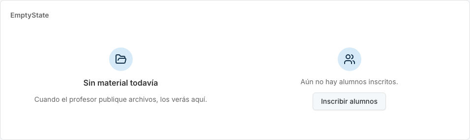 | 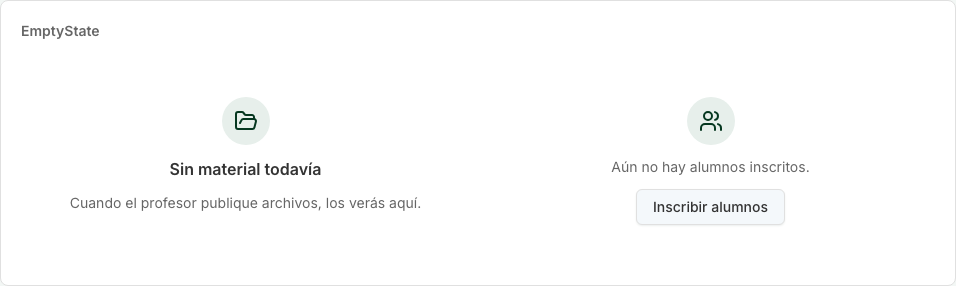 |
| 375 px     | 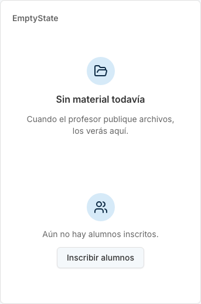  | 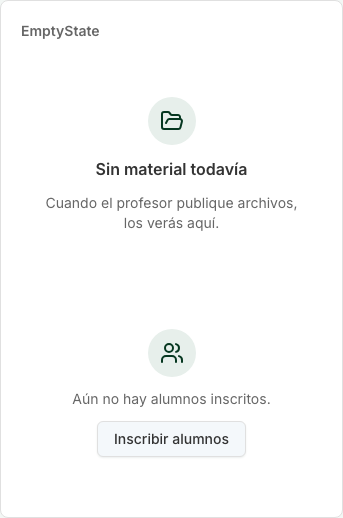  |

| ErrorState | Norte                                            | Sur                                            |
| ---------- | ------------------------------------------------ | ---------------------------------------------- |
| 1280 px    | 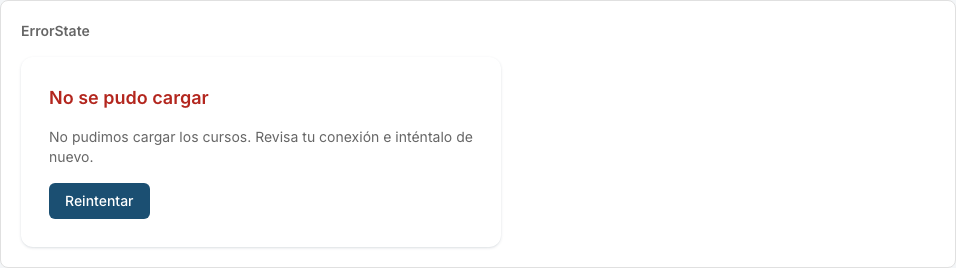 | 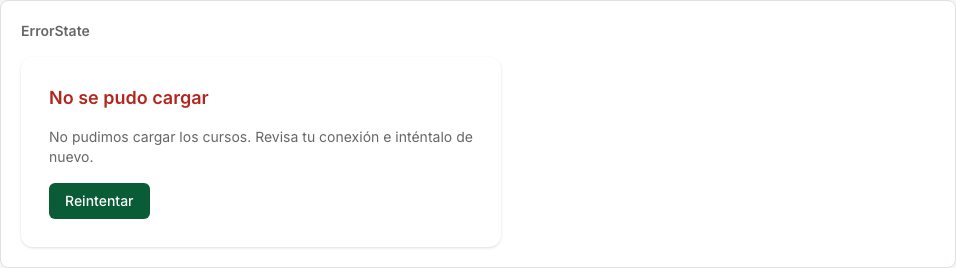 |
| 375 px     | 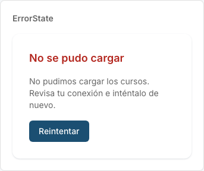  | 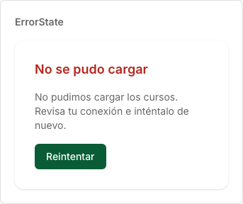  |

## ConfirmDialog

Confirmación de una acción sobre `AlertDialog`: el foco empieza en **Cancelar** (la opción segura), Escape cancela, y el título y la descripción nombran al diálogo (`role="alertdialog"`). **Confirmar no cierra**: quien lo usa cierra cuando termina, así puede mostrar `cargando` mientras espera a la API; con `cargando` los dos botones se deshabilitan, se anuncia «Procesando…» y no se puede cerrar con Escape ni con el fondo.

```tsx
const [abierto, setAbierto] = useState(false)
const [cargando, setCargando] = useState(false)

<ConfirmDialog
  abierto={abierto}
  onAbiertoChange={setAbierto}
  titulo="¿Eliminar el curso?"
  descripcion="Se archiva con sus secciones. Esta acción no se puede deshacer."
  textoConfirmar="Eliminar"
  destructivo
  cargando={cargando}
  onConfirmar={async () => {
    setCargando(true)
    await eliminar()
    setCargando(false)
    setAbierto(false)
  }}
/>
```

`textoConfirmar` es «Confirmar» y `textoCancelar` «Cancelar» por defecto; `destructivo` pinta Confirmar con `--destructive`.

| Variante    | Norte, 1280 px                                                  | Sur, 1280 px                                                  |
| ----------- | --------------------------------------------------------------- | ------------------------------------------------------------- |
| Normal      | 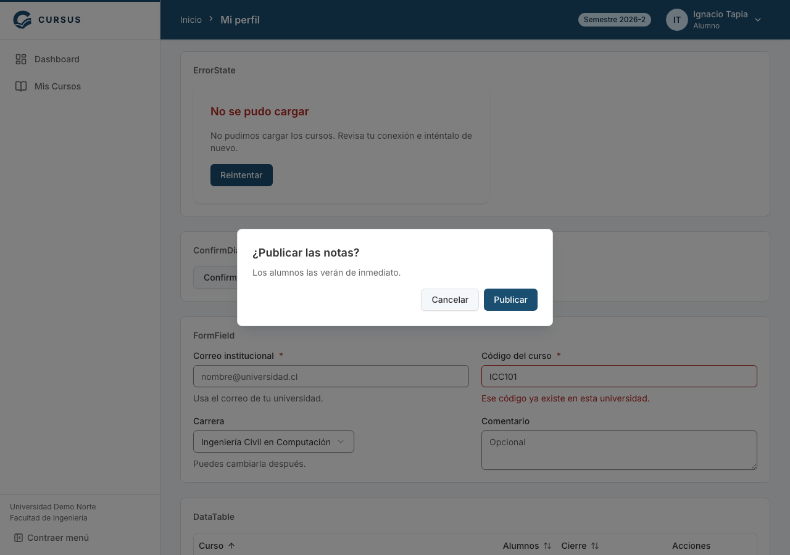      | 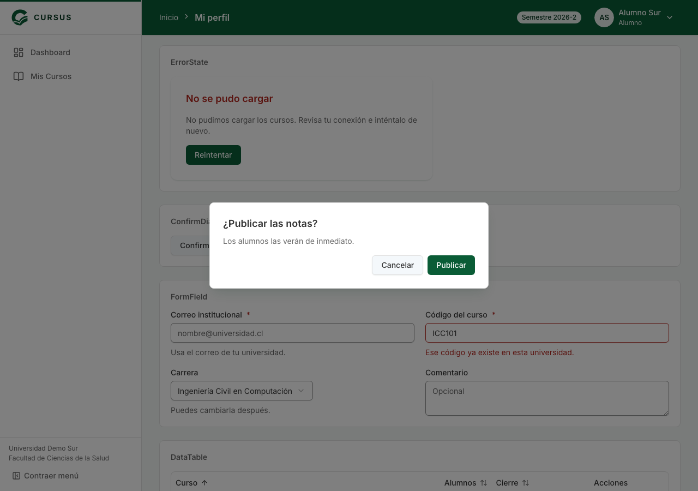      |
| Destructiva | 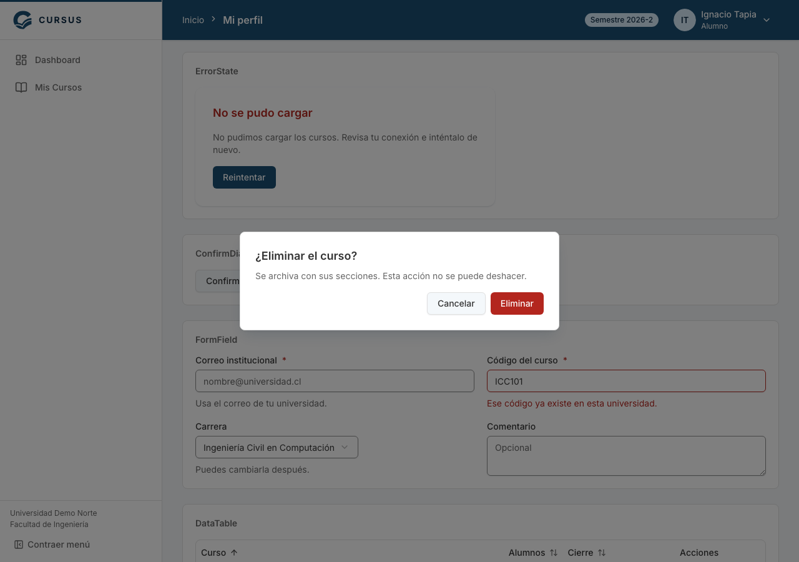 | 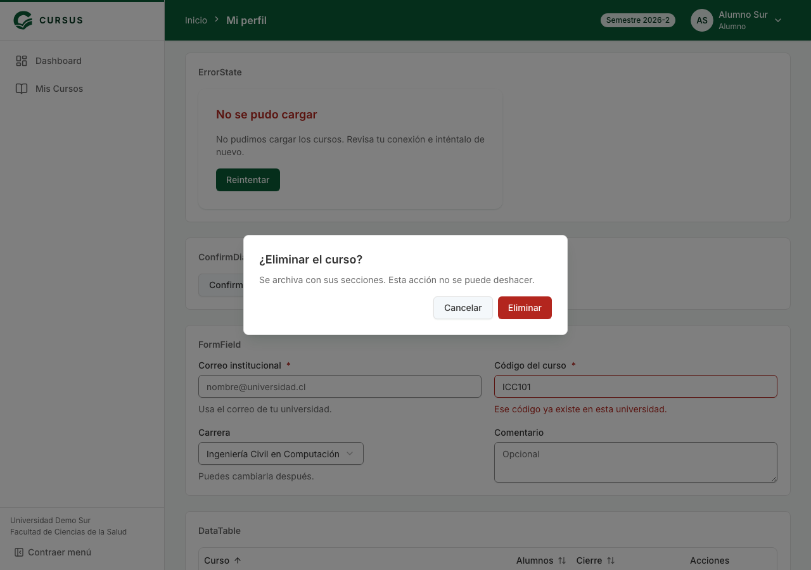 |
| Cargando    | 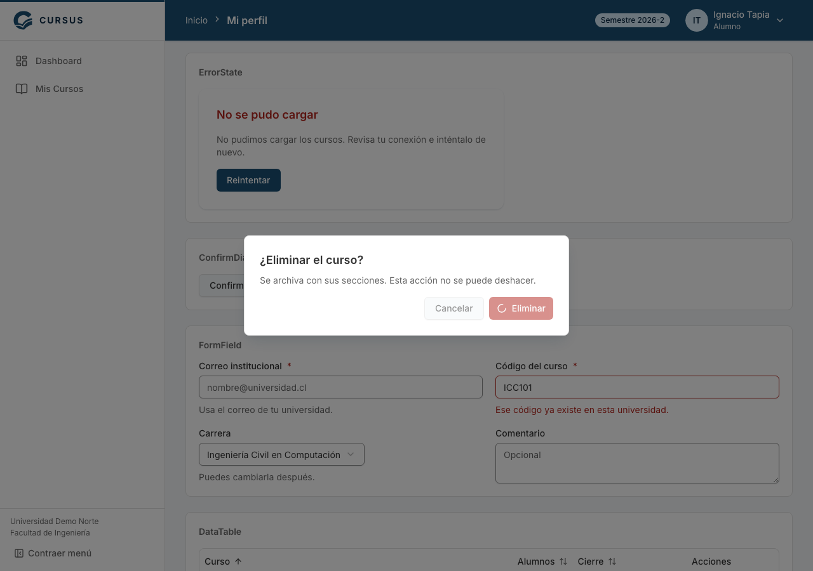    | 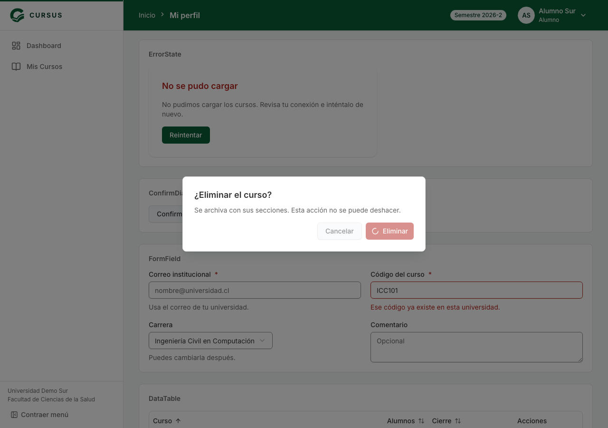    |

| Variante, 375 px | Norte                                                          | Sur                                                          |
| ---------------- | -------------------------------------------------------------- | ------------------------------------------------------------ |
| Normal           | 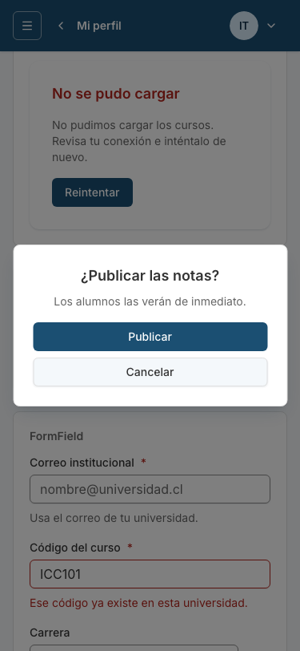      | 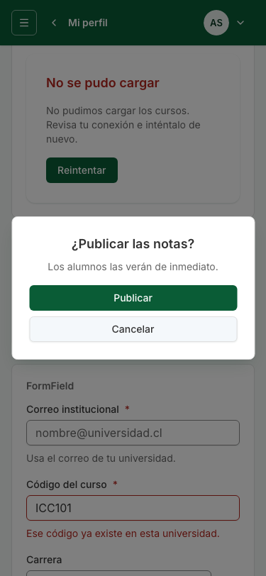      |
| Destructiva      | 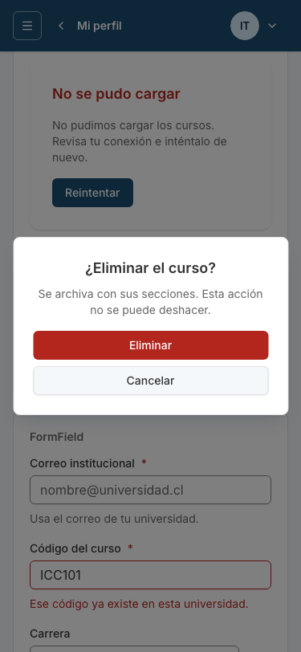 | 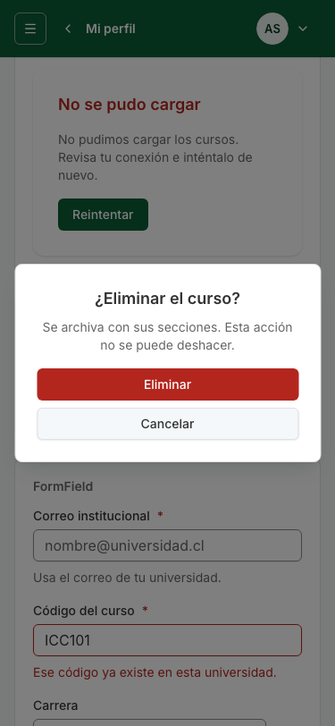 |
| Cargando         | 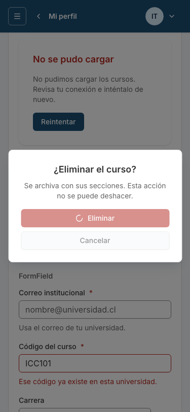    | 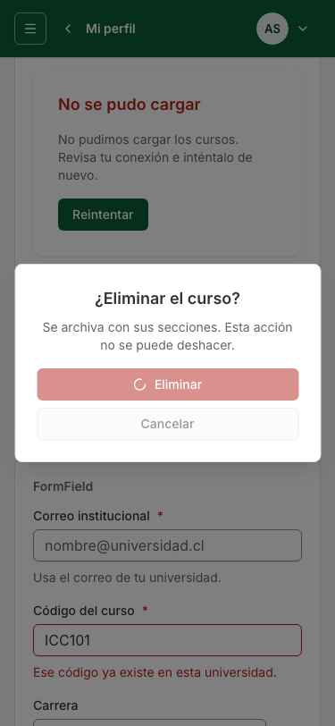    |

## FormField

Etiqueta, control, ayuda y error. El control se dibuja con una función que recibe lo necesario para quedar unido al campo: `id`, `aria-describedby` (ayuda y error), `aria-invalid` y `required`. Con `requerido` se ve un asterisco, que es solo visual: el nombre accesible no lo incluye y el control lleva `required`. El error usa `role="alert"` y pinta el control como inválido.

```tsx
<FormField
  etiqueta="Código del curso"
  ayuda="Es único en tu universidad."
  error={errores.codigo}
  requerido
>
  {(control) => <Input {...control} />}
</FormField>
```

Sirve con `Input`, `Textarea`, `NativeSelect` y `FileInput`.

| Vista   | Norte                                           | Sur                                           |
| ------- | ----------------------------------------------- | --------------------------------------------- |
| 1280 px |  | 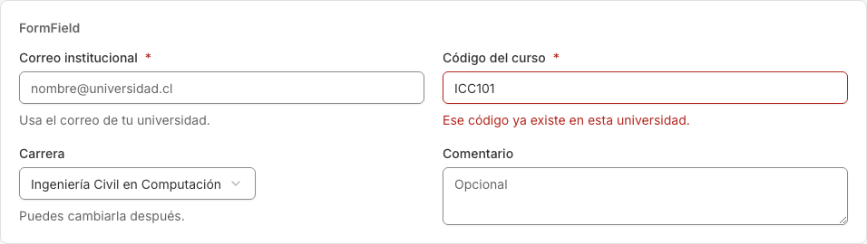 |
| 375 px  | 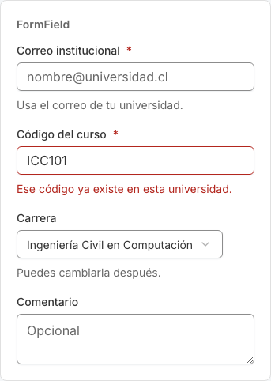  |   |

## DataTable

Tabla base sobre `Table` de shadcn, sin paginación del lado del servidor: la página entrega las filas que quiere mostrar.

- **Columnas tipadas** (`Columna<T>`): `clave`, `encabezado`, `celda(fila)` y, si se puede ordenar, `valor(fila)` (texto, número o fecha).
- **Orden simple** por columna: un clic ordena de menor a mayor, otro de mayor a menor y el tercero lo quita. Compara con el criterio del español (tildes y mayúsculas), los números como números y las fechas por instante, y deja las filas sin valor siempre al final. El encabezado es un botón y la celda lleva `aria-sort`.
- **Carga** con `Skeleton` (`cargando`, `filasDeCarga`), anunciada con «Cargando…» y `aria-busy`.
- **Vacío**: un `EmptyState` genérico, o el que se pase en `vacio`.
- El nombre de la tabla (`etiqueta`) va como `caption` oculto para los lectores de pantalla.

```tsx
const columnas: Columna<Curso>[] = [
  { clave: 'nombre', encabezado: 'Curso', celda: (c) => c.nombre, valor: (c) => c.nombre },
  { clave: 'cierre', encabezado: 'Cierre', celda: (c) => formatearFecha(c.cierre), valor: (c) => c.cierre },
  { clave: 'acciones', encabezado: 'Acciones', celda: (c) => <Button size="sm" variant="outline">Ver</Button> },
]

<DataTable
  etiqueta="Cursos del período"
  columnas={columnas}
  filas={cursos ?? []}
  claveFila={(c) => c.id}
  cargando={cursos === undefined}
  vacio={<EmptyState mensaje="Aún no hay cursos en este período." />}
  ordenInicial={{ clave: 'nombre', direccion: 'asc' }}
/>
```

| Vista   | Norte                                           | Sur                                           |
| ------- | ----------------------------------------------- | --------------------------------------------- |
| 1280 px | 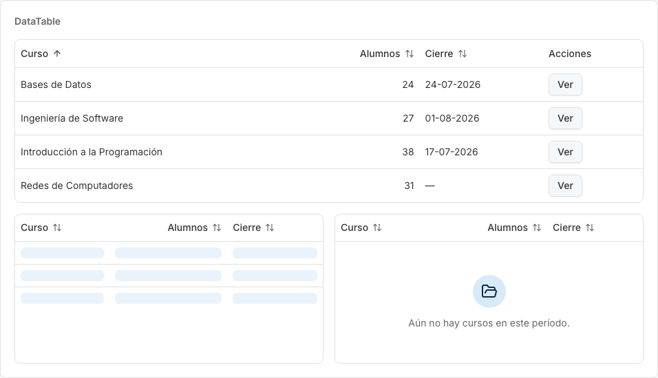 | 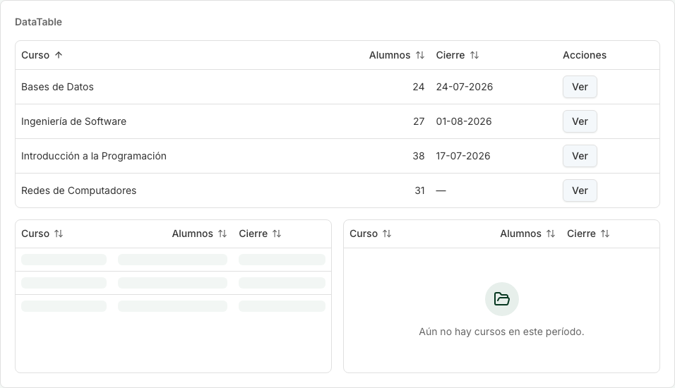 |
| 375 px  | 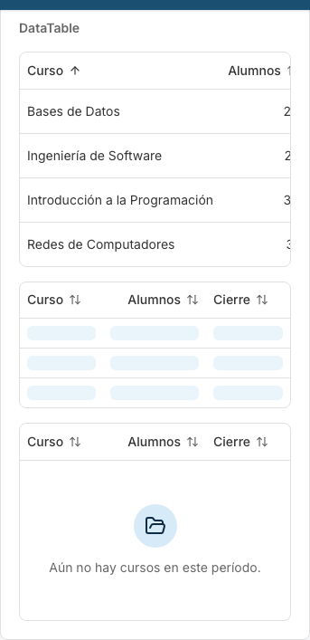  | 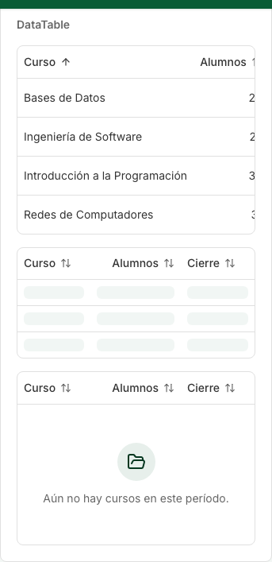  |

## FileInput

Reemplaza al input nativo («Choose File» / «No file chosen», según el idioma del navegador): botón **Seleccionar archivo** y el nombre del archivo, o **Ningún archivo seleccionado**. El control sigue siendo el `<input type="file">` nativo, solo que oculto: conserva el teclado (Tab para enfocarlo, Enter o Espacio para abrir el selector), `required`, `accept`, `multiple`, el envío del formulario y el lector de pantalla; su etiqueta se dibuja como botón y muestra el anillo de foco. El nombre del archivo describe al control y se anuncia sin interrumpir. Si el formulario se restablece (`<button type="reset">` o `form.reset()`), el nombre vuelve a «Ningún archivo seleccionado» y se avisa con `onChange([])`: el reset nativo vacía el input pero no dispara `change`, y sin esto la pantalla seguiría mostrando un archivo que ya no se enviará. Si alguien cancela el restablecimiento, el archivo y el nombre se conservan.

```tsx
<FormField etiqueta="Informe" ayuda="PDF o Word, hasta 10 MB." requerido>
  {(control) => (
    <FileInput
      {...control}
      accept=".pdf,.docx"
      onChange={(archivos) => guardar(archivos[0])}
    />
  )}
</FormField>
```

| Vista   | Norte                                           | Sur                                           |
| ------- | ----------------------------------------------- | --------------------------------------------- |
| 1280 px | 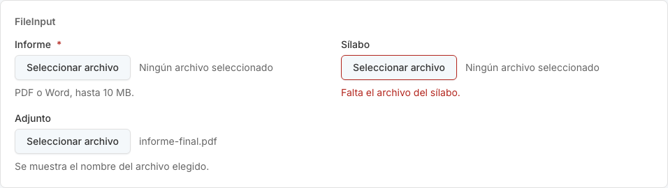 |  |
| 375 px  |   | 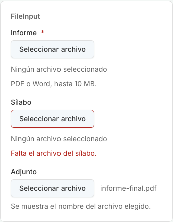  |

Con el foco en el selector:

| Foco    | Norte                                                | Sur                                                |
| ------- | ---------------------------------------------------- | -------------------------------------------------- |
| 1280 px | 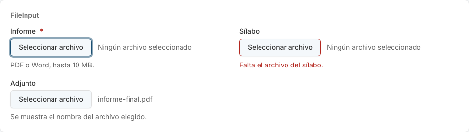 | 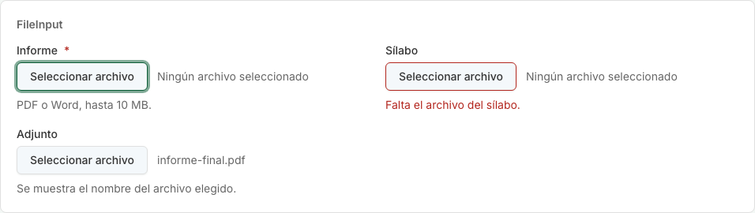 |
| 375 px  | 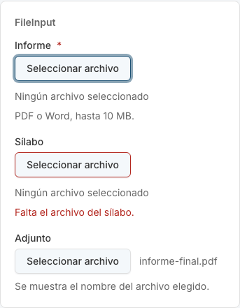  | 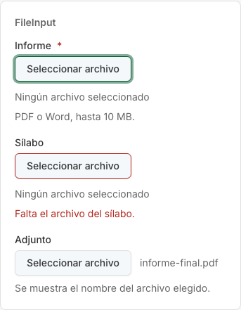  |

## Fechas (es-CL)

`lib/fechas.ts`, con `Intl`. Aceptan lo que entrega la API (texto ISO), un `Date` o un número; sin valor o con un valor inválido devuelven «—». Un texto de solo fecha (`"2026-11-14"`) es un día del calendario: se lee como fecha local para que la zona horaria no lo corra al día anterior. La hora va de 0 a 23, en la zona del navegador.

```ts
formatearFecha('2026-11-14') // 14-11-2026
formatearFechaHora('2026-11-14T15:30:00') // 14-11-2026 15:30
formatearFechaHora(new Date(2026, 2, 4, 9, 5)) // 04-03-2026 09:05
formatearFecha(null) // —
```

| Vista   | Norte                                       | Sur                                       |
| ------- | ------------------------------------------- | ----------------------------------------- |
| 1280 px |  | 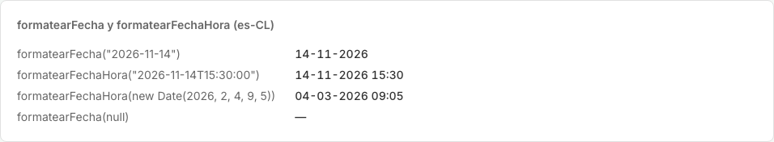 |
| 375 px  | 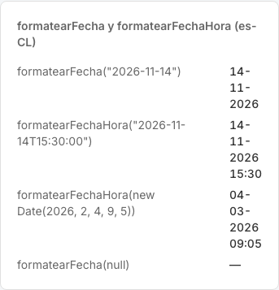  |   |

## Notas para quien las use

- **Sin preflight.** El CSS de Tailwind no incluye el reset global todavía (ver UIX-01): un `<button>` o un `<label>` sueltos muestran el borde del navegador. Las primitivas llevan `data-slot` en esos elementos para recibir el mini-reset; haz lo mismo si agregas uno.
- **Las páginas de cada rol** se migran a estas primitivas en sus propias tarjetas. Aquí solo se migró lo ya tocado en UI/UX-04: los errores (`ErrorEstado`) y el estado vacío de los alumnos de `VistaSeccion`. El 404 conserva su isotipo, que `EmptyState` no tiene.
