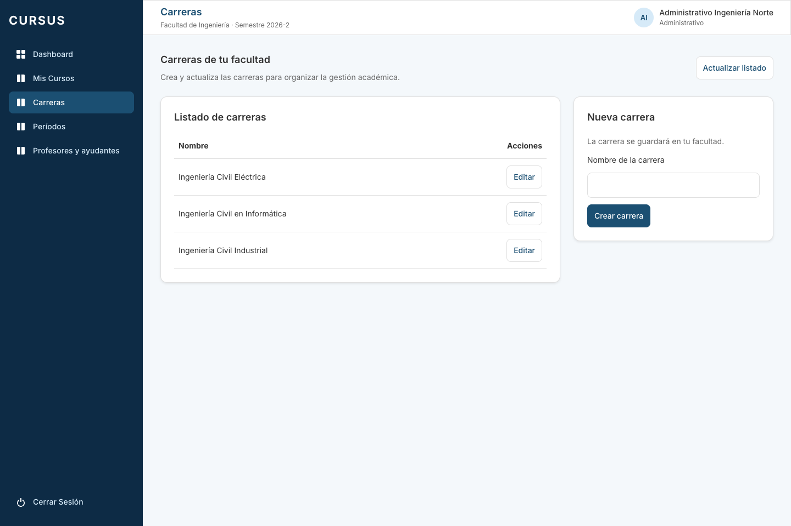
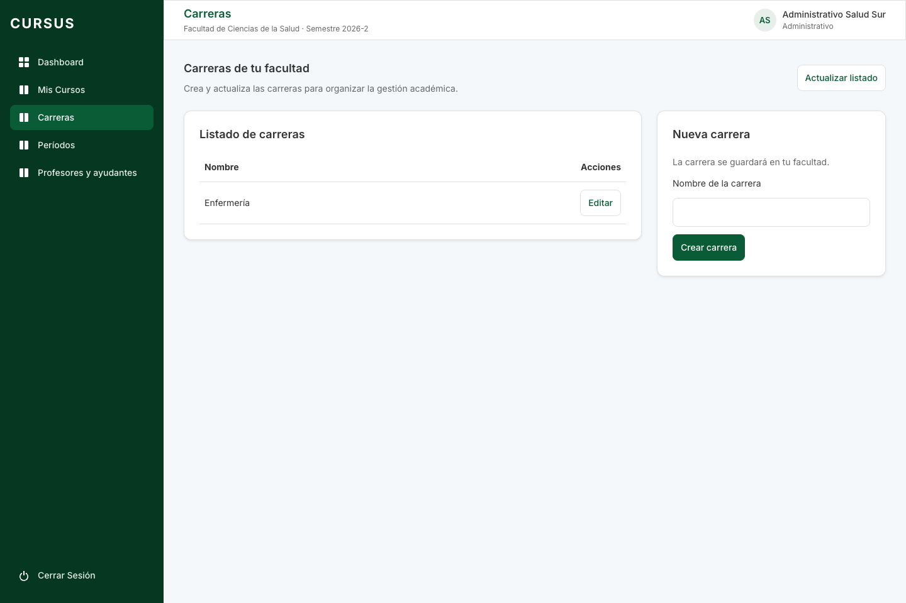
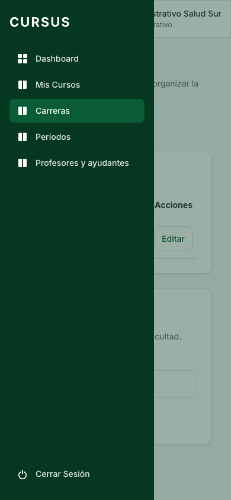
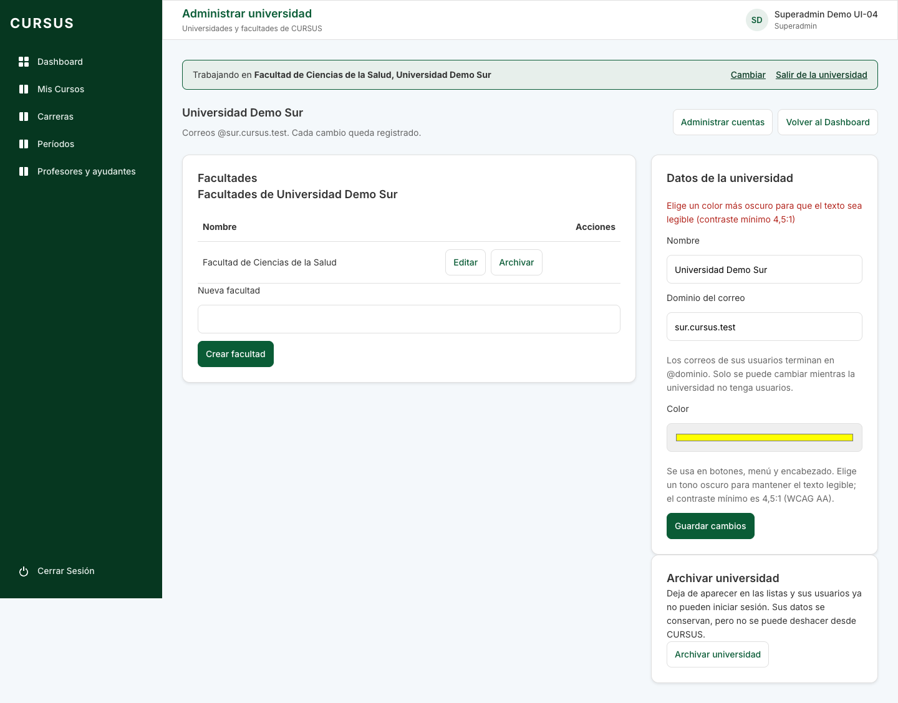

# UI-04: tema de color por universidad

Tarjeta: [F4 · UI-04 Tema de color según la universidad del usuario](https://trello.com/c/SHpKb1Mf/187-f4-ui-04-tema-de-color-seg%C3%BAn-la-universidad-del-usuario). Referencia: feedback de la demo (27-10-2026). Depende de UI-01, UI-02 y GES-23, integradas en `develop`.

**Como** usuario, **quiero** que la aplicación use el color de mi universidad, **para** reconocer a qué institución corresponde mi sesión.

## Criterios cubiertos

| Criterio                                                             | Comportamiento                                                                                                                                                                                                                                                     |
| -------------------------------------------------------------------- | ------------------------------------------------------------------------------------------------------------------------------------------------------------------------------------------------------------------------------------------------------------------ |
| Color institucional en botones, menú y encabezado al iniciar sesión. | `GET /api/auth/yo` agrega `universidadColor`. El tema aplica el principal exacto a los tokens existentes; el menú usa su variante oscura, y el título y el avatar del encabezado usan el tema.                                                                     |
| Login y Director con CURSUS; superadmin con su universidad elegida.  | El login y las vistas globales conservan los tokens de CURSUS. Elegir, cambiar o salir de la universidad actualiza el tema del superadmin. Se restaura con la sesión y se limpia al cerrar sesión. También se aplica en el cambio obligatorio de contraseña.       |
| Universidades existentes con colores distintos, editables en GES-23. | La migración `1792750000000-InicializarColoresUniversidad` inicializa colores diferentes en las universidades que conservan el azul por defecto. Respeta los colores ya personalizados. El seed crea Norte azul y Sur verde y no sobrescribe colores al repetirse. |
| Rechazar colores sin contraste WCAG AA suficiente.                   | El formulario y los DTO de creación y edición rechazan el color con un mensaje explicativo; la API devuelve 400 sin guardar cambios.                                                                                                                               |

## Color y contraste

El color sigue siendo `#rrggbb`, normalizado a minúsculas por GES-23. Se conserva exactamente el elegido: no se cambia silenciosamente a otro tono.

`shared/src/colores.ts` calcula la luminancia relativa sRGB y el contraste conforme a [WCAG 2.2](https://www.w3.org/WAI/WCAG22/Understanding/contrast-minimum.html). Exige al menos **4,5:1**, sin redondear, entre el principal y:

- el blanco (`#ffffff`), usado como texto en los botones y como fondo de la aplicación;
- la superficie (`#f4f8fb`), donde también aparecen enlaces con el principal.

El fondo claro del avatar se deriva del principal y se aclara hasta mantener ese contraste con su texto. La variante oscura del menú conserva contraste con texto blanco y claro. Los colores semánticos de error, éxito y advertencia no cambian.

Ejemplos: se aceptan `#1b4f72`, `#0a5c36`, `#6b2d84`; se rechazan `#ffffff`, `#ffff00`, `#00ff00`, `#ff0000` y `#777777`. Un color antiguo inválido o ausente usa CURSUS como respaldo. La validación corresponde a la API y al formulario; la restricción de la base sigue validando el formato hexadecimal.

## Sesión y actualización

- Administrativo, profesor, ayudante y alumno reciben el color de su propia universidad, mediante la consulta de sesión existente.
- El Director recibe `universidadColor: null`; la interfaz conserva CURSUS aunque su universidad tenga otro color.
- El superadmin recibe el color de la universidad de su contexto, o null en la vista global.
- Al guardar un color para la universidad en la que está trabajando, el superadmin ve el cambio inmediatamente. Las demás sesiones lo reciben al recargar o volver a iniciar sesión; no hay difusión en tiempo real.
- Los tokens se aplican antes de pintar y se eliminan al cerrar sesión o cambiar de contexto. No se guarda el tema en `localStorage`, no se agrega un endpoint público ni se altera el JWT o los permisos.
- El frontend anterior ignora el campo nuevo; el frontend nuevo conserva CURSUS si recibe una respuesta antigua sin color.

## Migración y seed

Aplicar las migraciones con el procedimiento habitual. La nueva migración solo inicializa datos: no cambia tablas, permisos ni políticas de notas o archivos. Ordena las universidades por dominio, evita repetir colores personalizados y dispone de tonos oscuros adicionales si se agota la paleta inicial.

El `down` conserva los colores: deshacer una migración no debe pisar una elección posterior del superadmin. Esta decisión también se comprueba en la prueba de migración. El seed solo asigna el color al insertar una universidad y conserva las personalizaciones al ejecutarse otra vez.

## Cómo probar

1. Aplicar migraciones y ejecutar el seed local.
2. Entrar como Administrativo de Ingeniería Norte: botones y encabezado azules y menú azul oscuro.
3. Cerrar sesión: el login usa CURSUS. Entrar como Administrativo de Sur: tema verde; al recargar se conserva.
4. Entrar como Director de Sur: usa CURSUS.
5. Entrar como superadmin: vista global con CURSUS; elegir Salud Sur y después Ingeniería Norte verifica el cambio de tema. Salir de la universidad vuelve a CURSUS.
6. Administrar una universidad y probar `#ffff00`: explica el contraste y no envía el cambio. Enviar ese mismo color directamente por POST/PATCH devuelve 400.
7. Guardar `#6b2d84`: si es la universidad elegida, cambia inmediatamente; al entrar con un usuario de ella también usa el nuevo color.

## Verificación y evidencias

- Pruebas de la fórmula de contraste y de las combinaciones usadas por los tokens.
- Interfaz: restauración por rol, Director, cierre y nuevo inicio de sesión, cambio de contexto, actualización inmediata y validación antes de enviar.
- API con PostgreSQL: color propio por universidad, cambio sin renovar JWT, contexto del superadmin y rechazo al crear/editar sin escritura ni auditoría adicional.
- Migración: diez universidades, paleta agotada, colores personalizados, ausencia de duplicados, contraste y conservación al revertir. Seed: repetición sin pisar personalizaciones.

