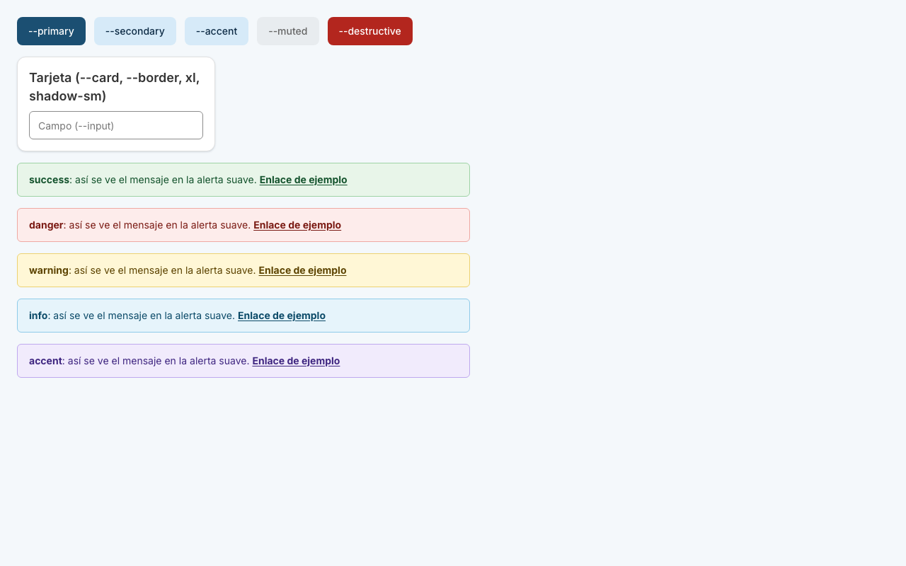
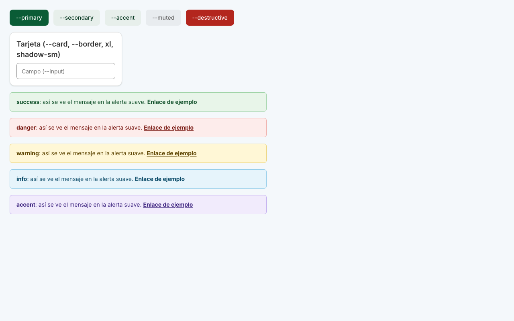
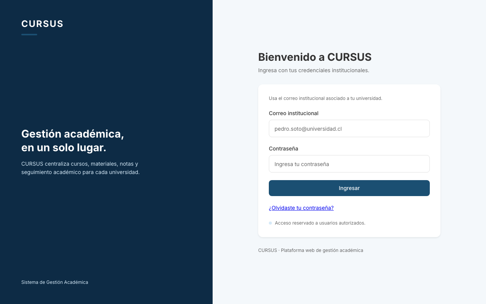
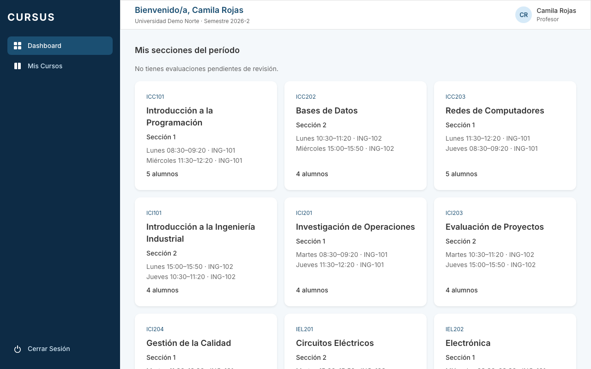
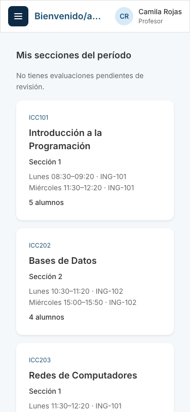
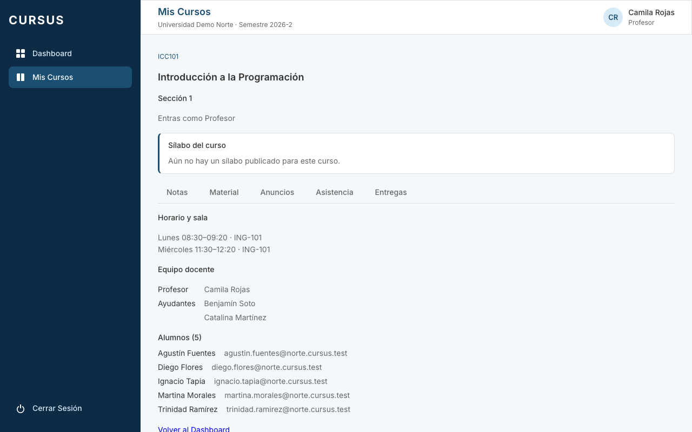
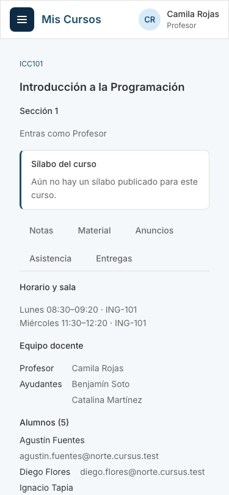

# UIX-01: Tailwind v4, shadcn y tokens (fundación de UI)

Tarjeta: UIX-01. Es la base para los componentes de shadcn (UIX-02) y la migración de las páginas. Esta tarjeta no migra ninguna página ni agrega componentes: ninguna página cambia.

## Qué cambia

- **Dependencias del frontend.** En `dependencies`: `class-variance-authority`, `clsx`, `tailwind-merge` y `lucide-react`. En `devDependencies`: `tailwindcss`, `@tailwindcss/vite` y `tw-animate-css` (se usan al compilar). El plugin va registrado en `vite.config.ts`.
- **Alias `@/` hacia `src/`.** En `vite.config.ts` (que también lee Vitest) y en `tsconfig.app.json` (editor y `tsc`).
- **`components.json`** de shadcn: estilo `new-york`, variables CSS, `@/components`, `@/lib`, íconos de lucide, y `src/styles/tailwind.css` como archivo de estilos. **`src/lib/utils.ts`** con `cn()`.
- **Tres archivos de estilos nuevos**, importados desde `index.css` después de `tokens.css`:
  - `styles/tailwind.css`: las capas de Tailwind (sin preflight), el mapeo de utilidades y los radios y sombras.
  - `styles/shadcn.css`: las variables de shadcn apuntando a los tokens existentes.
  - `styles/alertas.css`: los tokens de las alertas suaves.

`tokens.css`, `TemaUniversidad`, `navigation.ts`, `AppShell` y el CSS de cada página no cambian.

## Por qué sin preflight

Preflight es un reset global: márgenes a cero, títulos y listas sin estilo, enlaces sin color, botones sin apariencia, imágenes en bloque. Las páginas que todavía no se migraron dependen de los estilos por defecto del navegador y de su propio `.css`; con preflight cambiarían todas a la vez (por ejemplo, el enlace «Volver al Dashboard» de la vista de sección pasaría de azul subrayado a texto plano). Por eso solo se importan las capas `theme` y `utilities`:

```css
@layer theme, base, components, utilities;
@import 'tailwindcss/theme.css' layer(theme);
@import 'tailwindcss/utilities.css' layer(utilities);
```

El CSS legacy no está en capas, y una regla sin capa gana siempre a cualquier regla en capa. Así, lo que declara Tailwind no puede pisar a las páginas existentes. Un chequeo sobre el CSS compilado lo confirma: las 471 reglas de nivel superior del CSS anterior siguen idénticas y solo el bloque `:root` creció con las variables nuevas.

**Cuándo se activa:** en UIX-24, cuando no quede ninguna página legacy. Entonces se reemplazan las dos importaciones por `@import 'tailwindcss';`, se retiran de `index.css` las reglas que preflight ya cubre y se puede usar la regla global de shadcn (`* { border-color… }`). El comentario de `tailwind.css` deja escrito el motivo y el plan.

Consecuencias mientras tanto:

- Una utilidad pierde contra una regla legacy sobre el mismo elemento (por ejemplo, `p { margin: 0 }` de `index.css` gana a `mb-4`). Los componentes de shadcn llevan clases propias y no chocan con ellas.
- Sin preflight no hay color de borde por defecto. shadcn lo pone con un `*` global; aquí se acota a `[data-slot]` (todos sus componentes lo llevan) para no tocar las páginas legacy.

## Variables de shadcn sobre los tokens

Ninguna es un color nuevo: cada una apunta a un token existente o lo deriva, así que cuando `TemaUniversidad` sobrescribe `--color-primary` (y sus derivados) para una universidad, los componentes de shadcn cambian con ella.

| Variable de shadcn                                          | Valor                                                 | Nota                                                                                                                     |
| ----------------------------------------------------------- | ----------------------------------------------------- | ------------------------------------------------------------------------------------------------------------------------ |
| `--primary`, `--ring`                                       | `var(--color-primary)`                                | Comprobado en el navegador con Norte (`#1b4f72`) y Sur (`#0a5c36`).                                                      |
| `--primary-foreground`                                      | `#ffffff`                                             | `colorConContraste` rechaza al guardar un color sin contraste 4,5:1 con blanco, así que el texto blanco siempre se lee.  |
| `--secondary`, `--accent`                                   | `var(--color-primary-light)`                          | `--accent` de shadcn es el hover de los menús, no el violeta de las alertas.                                             |
| `--secondary-foreground`, `--accent-foreground`             | `var(--color-primary-dark)`                           |                                                                                                                          |
| `--background`                                              | `var(--color-surface)`                                | El fondo de la página.                                                                                                   |
| `--card`, `--popover`                                       | `var(--color-background)`                             | Blanco.                                                                                                                  |
| `--foreground`, `--card-foreground`, `--popover-foreground` | `var(--color-text-primary)`                           |                                                                                                                          |
| `--muted`                                                   | 6 % de `--color-text-primary` sobre `--color-surface` | Se distingue del fondo y del blanco; `--muted-foreground` tiene contraste 4,8:1 sobre él.                                |
| `--muted-foreground`                                        | `var(--color-text-secondary)`                         |                                                                                                                          |
| `--destructive`                                             | `var(--color-error)`                                  |                                                                                                                          |
| `--border`                                                  | `var(--color-border)`                                 |                                                                                                                          |
| `--input`                                                   | 75 % de `--color-text-secondary` sobre blanco         | Contraste 3:1 o más con blanco y con la superficie de la página (WCAG 1.4.11), más marcado que el borde de las tarjetas. |
| `--radius`                                                  | `var(--radius-md)` (8 px)                             |                                                                                                                          |

No se definieron las variables de `sidebar` ni de `chart` de shadcn: no hay componentes que las usen todavía. Sin modo oscuro: el proyecto no lo soporta.

### Radios y sombras

- Radios: `rounded-sm` 4 px (controles pequeños), `rounded-md` 6 px (botones e inputs), `rounded-lg` 8 px (menús) y `rounded-xl` 12 px (tarjetas, como las del dashboard). Una escala, no un radio único. Los nombres coinciden con `--radius-sm/md/lg` de `tokens.css` (2, 8 y 12 px): las utilidades usan la escala nueva y el CSS legacy conserva la suya, porque `@theme inline` inserta el valor y no define la variable.
- Sombras (`shadow-xs`, `-sm`, `-md`, `-lg`): bajas y teñidas con `--color-primary-dark` de la universidad en lugar de un gris neutro. La jerarquía la dan el borde y el espacio, no la sombra. `--shadow-card` de `tokens.css` no cambia.

## Alertas suaves

Fondo muy claro, borde de intensidad media y texto oscuro del mismo tono; el enlace va en negrita y subrayado (`alert-link`). Cinco estados, con colores semánticos fijos (no cambian con la universidad). El contraste del texto sobre su fondo es de 8,1:1 o más (AA pide 4,5:1), y también sobre blanco y sobre la superficie de la página.

| Estado             | Fondo     | Borde     | Texto     |
| ------------------ | --------- | --------- | --------- |
| success (verde)    | `#e8f5e9` | `#9fd3a6` | `#14532d` |
| danger (rojo)      | `#fdeceb` | `#efa9a3` | `#7a1a13` |
| warning (amarillo) | `#fff7d6` | `#ecd272` | `#5c4300` |
| info (celeste)     | `#e6f4fb` | `#8fcbe9` | `#0b4a68` |
| accent (violeta)   | `#f1ebfc` | `#bfa9ee` | `#3f2680` |

Variables: `--alert-<estado>`, `--alert-<estado>-border` y `--alert-<estado>-foreground`. Utilidades: `bg-alert-success`, `border-alert-success-border`, `text-alert-success-foreground` (y lo mismo para los demás estados) y `alert-link`:

```tsx
<div className="rounded-md border border-alert-danger-border bg-alert-danger px-4 py-3 text-alert-danger-foreground">
  No pudimos guardar el curso.{' '}
  <a className="alert-link" href="…">
    Revisa los campos
  </a>
  .
</div>
```





## Cómo verificar

```sh
npm run lint -w frontend
(cd frontend && npx tsc -b)
npm test -w frontend
npm run build -w frontend
```

- `src/lib/utils.test.ts`: el alias `@/` llega a Vitest y `cn()` resuelve conflictos de Tailwind.
- `src/styles/estilos.test.ts`: `--primary` y `--ring` siguen a `--color-primary` y `TemaUniversidad` lo cambia por universidad; las variables de shadcn no duplican `tokens.css`; el texto blanco sobre `--primary` tiene contraste en toda universidad aceptada; las alertas cumplen AA y se registran como colores de Tailwind; Tailwind no importa preflight (y `tailwind.css` explica por qué y cuándo se activa).

### Antes y después (Chromium, 1280 y 375 px)

Capturas del login, el dashboard y la vista de una sección (profesora de Norte), la gestión de cursos y el detalle de un curso (administrativo de Norte) y el dashboard de la universidad Sur, antes y después del cambio. Las 14 capturas son idénticas byte a byte (SHA-256, primeros 12 caracteres):

| Captura                                       | SHA-256 antes y después |
| --------------------------------------------- | ----------------------- |
| `curso-camila-norte-1280.png`                 | `54fc3ee43dc0`          |
| `curso-camila-norte-375.png`                  | `95ab889abeed`          |
| `curso-detalle-administrativo-norte-1280.png` | `abac6b31fa11`          |
| `curso-detalle-administrativo-norte-375.png`  | `13f707e27e7d`          |
| `cursos-administrativo-norte-1280.png`        | `0c964a3c1db7`          |
| `cursos-administrativo-norte-375.png`         | `4ce39f498655`          |
| `dashboard-administrativo-norte-1280.png`     | `64ba145b47e5`          |
| `dashboard-administrativo-norte-375.png`      | `da9ecb60ba3d`          |
| `dashboard-camila-norte-1280.png`             | `0078628302b3`          |
| `dashboard-camila-norte-375.png`              | `6ba56fc43cdd`          |
| `dashboard-profesor-sur-1280.png`             | `ce2e896e21e6`          |
| `dashboard-profesor-sur-375.png`              | `d7a74c8e67df`          |
| `login-1280.png`                              | `6d5867137e39`          |
| `login-375.png`                               | `edb71460f161`          |

Se incluyen las del login, el dashboard y la vista de sección en los dos tamaños:












## Para UIX-02

- `components.json` apunta a `src/styles/tailwind.css`. Al agregar un componente, el CLI de shadcn puede escribir variables o una regla `@layer base` global en ese archivo: hay que revisar el diff y mantener la regla acotada a `[data-slot]`. El CLI no se probó en esta tarjeta.
- Los componentes se mezclan con `cn()` de `@/lib/utils`.
