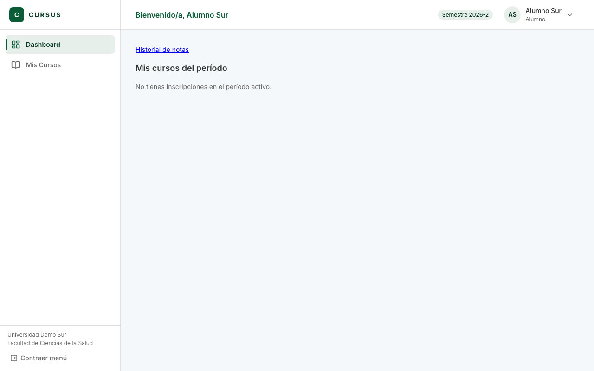
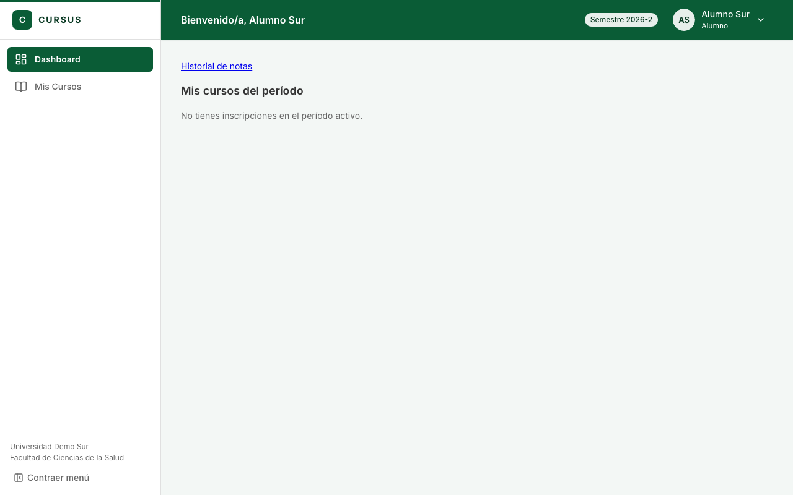
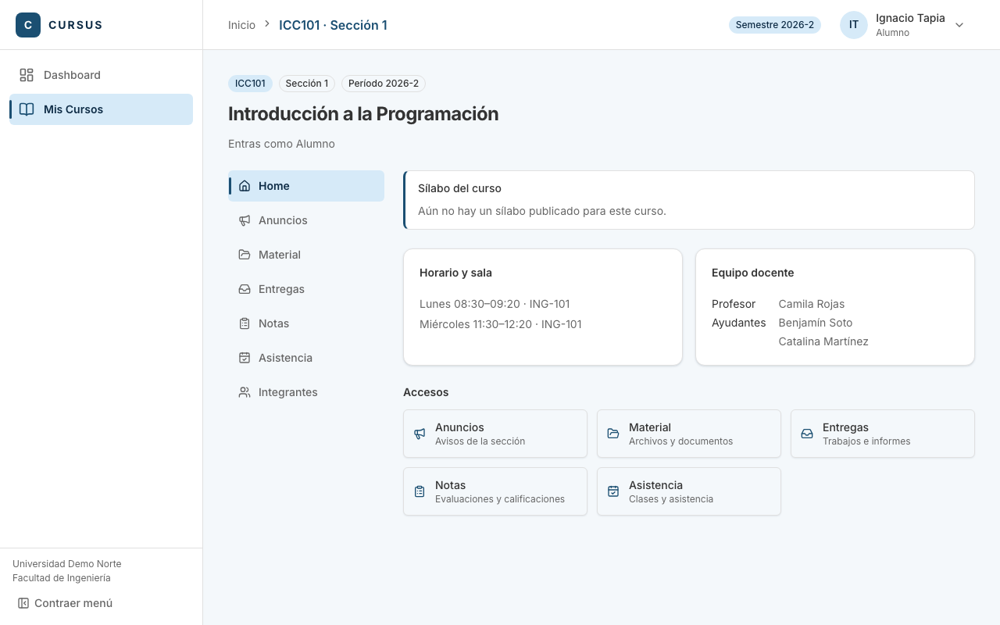
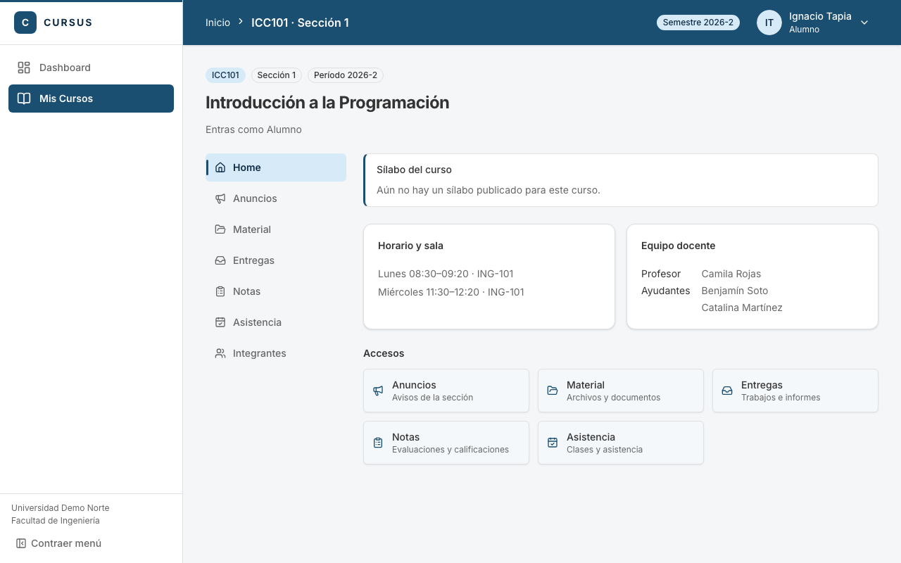
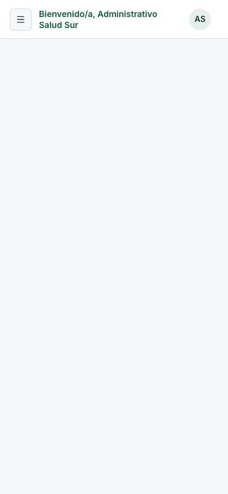
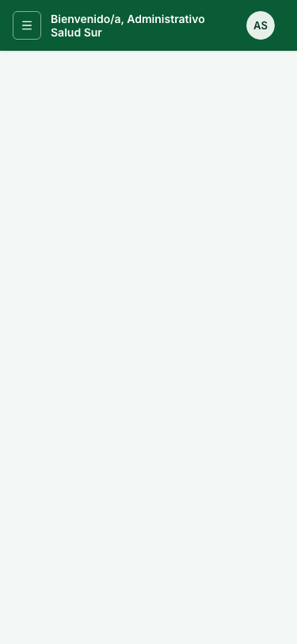
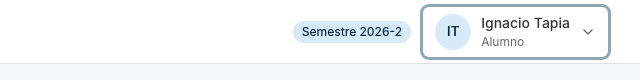
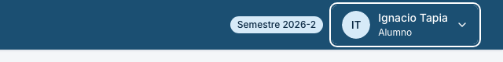

# UIX-04: AppShell y layout de curso

Tarjeta: UIX-04. Reemplaza el menú lateral, el encabezado y la vista de una sección por componentes de shadcn, sobre la base de UIX-01. Las rutas, los permisos (CASL) y las páginas internas no cambian.

## Qué cambia

- **Menú lateral** (`layout/Sidebar.tsx`, `layout/AppShell.tsx`). Riel claro, con la marca arriba, la navegación en el medio y la universidad y la facultad abajo (antes eran el subtítulo del encabezado).
  - Cada ítem de `NAV_ITEMS` lleva un ícono de lucide (campo `icon` en `navigation.ts`); rutas y permisos son los mismos.
  - El ítem activo lleva relleno sólido `--primary` con texto e ícono blancos; el hover es un tinte suave (`--accent`). Una franja de 3 px de `--primary` arriba del menú continúa el color del encabezado. El menú sigue en blanco para que el color destaque. Todo cambia con el color de la universidad (el Director y el login conservan el de CURSUS).
  - Desde 1024 px se puede contraer a solo íconos (`w-16`); el ítem pasa a tener un `Tooltip` con su nombre. La preferencia se guarda en `localStorage` (`cursus-menu-colapsado`) solo cuando la persona la cambia, y la pantalla funciona igual si el navegador no deja guardar.
  - Bajo 1024 px el menú es un `Sheet` que se abre desde el botón «Menú» del encabezado y se cierra al elegir un ítem. `TooltipProvider` se monta una vez en `AppShell`.
  - El egresado sigue viendo solo su historial (el filtro de `navItemsFor` no cambió).
- **Encabezado** (`layout/Header.tsx`, `layout/MenuUsuario.tsx`, `layout/migas.ts`).
  - Va sobre el color de la universidad: fondo `--primary` y texto blanco (título, breadcrumbs y menú de usuario). El pill de semestre y el avatar son claros (`--accent` con texto `--accent-foreground`). El hover y el menú abierto usan `--color-primary-dark`, y el foco es un aro blanco separado del fondo (`layout/sobre-color.ts`).
  - Ya no repite el título de la página: la ruta es el breadcrumb y su último paso es el `h1`.
  - El breadcrumb sale de `NAV_ITEMS` y de las pocas subrutas con nombre propio (Historial, Pendientes). La sección de un curso aporta su nombre con `useEtiquetaDeMiga` (`layout/migas-contexto.ts`, `layout/MigasProvider.tsx`).
  - Bajo 640 px el camino no cabe: queda el título y un botón «Volver a …». El título pasa a dos líneas en vez de cortarse con «…».
  - Menú de usuario (`DropdownMenu`): avatar con iniciales, nombre y rol, «Mi perfil» (solo si la persona tiene la ruta; el egresado no la tiene) y «Cerrar sesión», que salió del menú lateral.
  - El período activo es una `Badge` («Semestre 2026-2»), oculta bajo 768 px.
- **Layout de curso** (`pages/VistaSeccion.tsx`). Navegación del curso a la izquierda y el contenido a la derecha; bajo 1024 px es una fila de pestañas que se desplaza y deja a la vista la elegida.
  - Vistas: Home, Anuncios, Material, Entregas, Notas, Asistencia e Integrantes. Los cinco contenidos que ya existían (ESP-04 a MAT-08) se montan tal cual.
  - La vista elegida va en `?vista=` (sin cambiar los patrones de ruta): se puede compartir y recargar. Sin parámetro se muestra el Home.
  - **Home**, solo con datos de `/api/espacio/secciones/:id/resumen`: sílabo, horario y sala, equipo docente y accesos a las demás vistas. Integrantes muestra el equipo docente y, para el profesor, los alumnos.
- **Se borran** `AppShell.css`, `Header.css`, `Sidebar.css` e `icons.tsx` (íconos SVG a mano). `VistaSeccion.css` queda con lo que todavía usan las pestañas internas.

## Decisiones de diseño

- **Sobrio e institucional, estilo Canvas.** Riel blanco con el nombre de la universidad abajo, bordes de 1 px y radios de 8 px. El color de la universidad aparece en cuatro lugares y en ningún otro: el encabezado, el ítem activo del menú, la franja fina sobre el menú y un tinte leve en el fondo de la página.
- **Fondo de la página.** `--color-fondo-pagina` (`tokens.css`) es un 5 % de `--color-primary` sobre blanco: Norte queda `#f4f6f8` y Sur `#f3f7f5`, y las tarjetas siguen blancas. Se eligió 5 % porque con más, el título o los enlaces en `--primary` de las páginas sin migrar pierden margen de contraste en colores cercanos al mínimo de 4,5:1.
- **Sin color nuevo.** Todo sale de los tokens de UIX-01 (`--primary`, `--accent`, `--muted`, `--border`). Inter es la tipografía. Para el texto sobre el color no hace falta calcular otro: `colorConContraste` solo guarda un color que tenga 4,5:1 con blanco, así que el blanco siempre cumple AA.
- **El menú no repite el cierre de sesión ni el nombre de la universidad en el encabezado.** Cada dato vive en un solo lugar.
- **Anchos.** `--sidebar-width` en el riel abierto, `w-16` contraído; el contenido tiene `p-4`, `sm:p-6`, `lg:p-8`.

### Contraste del color de la universidad

Calculado con `contrasteColores` de `@cursus/shared` y comprobado en `layout/contraste-color.test.ts` con cinco colores de universidad (los dos del seed, el de CURSUS que usa el Director y tres más):

| Universidad              | Blanco sobre `--primary` (encabezado, ítem activo) | Blanco sobre el tono oscuro (hover) | Oscuro sobre claro (pill, avatar) | `#666` sobre el fondo | `--primary` sobre el fondo |
| ------------------------ | -------------------------------------------------- | ----------------------------------- | --------------------------------- | --------------------- | -------------------------- |
| CURSUS, Norte y Director | 8,72:1                                             | 14,50:1                             | 11,72:1                           | 5,30:1                | 8,05:1                     |
| Sur                      | 8,09:1                                             | 13,33:1                             | 11,39:1                           | 5,31:1                | 7,48:1                     |

Se exige 4,5:1 para texto y 3:1 para el aro de foco, la franja y el ícono (WCAG 1.4.11). Además, una prueba recorre colores al azar y confirma que todo color que acepta `colorConContraste` admite texto blanco con AA, junto con sus tonos claro y oscuro.

## Cómo verificar

1. `npm run dev -w frontend` y entra con cada rol (profesor, ayudante, alumno, administrativo, director y un egresado).
2. A 1280 px: el riel muestra el ítem activo con relleno sólido; «Contraer menú» deja solo íconos con tooltip y el estado se mantiene al recargar.
3. A 768 y 375 px: el botón «Menú» abre el `Sheet`; elegir un ítem lo cierra.
4. Entra a una sección (`/mis-cursos/secciones/:id`): el breadcrumb dice «Inicio › ICC101 · Sección 1», la navegación del curso está a la izquierda y `?vista=notas` abre Notas. A 375 px son pestañas.
5. Menú de usuario: nombre y rol, «Mi perfil» (no para el egresado) y «Cerrar sesión».
6. Con la universidad Sur el verde reemplaza al azul en el ítem activo; el Director conserva el azul de CURSUS.

`npm run test -w frontend -- layout VistaSeccion` cubre el ícono de cada ítem, el sidebar del egresado, los breadcrumbs, el menú de usuario, el contraste y el layout del curso.

## Capturas antes y después

Todas en `docs/evidencias/uix-04-antes-*.png` y `uix-04-despues-*.png`, con el nombre `universidad-rol-pantalla-ancho`, a 1280, 768 y 375 px. Norte con los cinco roles y un egresado; Sur con los cinco roles.

| Pantalla                 | Antes                                                            | Después                                                            |
| ------------------------ | ---------------------------------------------------------------- | ------------------------------------------------------------------ |
| Profesor, sección (1280) |        |        |
| Administrativo (375)     |  |  |
| Egresado (768)           |        |        |
| Director, Sur (1280)     |         |         |

Solo «después»: [menú de usuario](evidencias/uix-04-despues-norte-profesor-menu-usuario-1280.png), [riel contraído](evidencias/uix-04-despues-norte-profesor-riel-contraido-1280.png), [Integrantes](evidencias/uix-04-despues-norte-profesor-curso-integrantes-1280.png), [menú móvil](evidencias/uix-04-despues-norte-alumno-panel-movil-375.png) y [Notas a 375 px](evidencias/uix-04-despues-norte-alumno-curso-notas-375.png).

El cuerpo de Inicio del Administrativo y del Director aparece vacío en «antes» y «después»: sus dashboards están fuera de esta tarjeta.

## Refuerzo del color de la universidad

Un segundo ajuste de esta tarjeta: el color casi no se notaba (solo un tinte claro en el ítem activo, el título y el avatar). Capturas con Director, Administrativo y Alumno, en Norte y Sur, a 1280 y 375 px, en `docs/evidencias/uix-04-color-antes-*.png` y `uix-04-color-despues-*.png` (también la sección del alumno y el foco del menú de usuario):

| Pantalla                  | Antes                                                          | Después                                                          |
| ------------------------- | -------------------------------------------------------------- | ---------------------------------------------------------------- |
| Alumno, Sur (1280)        |          |          |
| Alumno, sección (1280)    |  |  |
| Administrativo, Sur (375) |   |   |
| Foco del menú de usuario  |   |   |

## Isotipo de CURSUS

`components/brand/CursusLogo.tsx` dibuja el isotipo como SVG en línea con `fill="currentColor"`: toma el color del texto de donde se use. Props: `size` (32 por defecto), `className` y `title` (nombre accesible, «CURSUS» por defecto). Tiene `role="img"` y `aria-label`; con `decorativo` se oculta a los lectores de pantalla (junto al texto «CURSUS» para que no se lea dos veces). Los archivos de origen están en `src/assets/cursus-isotipo.svg` y `public/brand/` (PNG azul y blanco).

| Lugar                                                                                                                          | Cambio                                                                                                                                                                                                                                                                                           |
| ------------------------------------------------------------------------------------------------------------------------------ | ------------------------------------------------------------------------------------------------------------------------------------------------------------------------------------------------------------------------------------------------------------------------------------------------ |
| Menú lateral expandido (`layout/Sidebar.tsx`)                                                                                  | Isotipo de 32 px en `text-primary` (cambia con la universidad), sin recuadro, junto al texto «CURSUS». Reemplaza el recuadro con la «C».                                                                                                                                                         |
| Menú lateral contraído                                                                                                         | Solo el isotipo, con el nombre accesible «CURSUS».                                                                                                                                                                                                                                               |
| Login, segundo paso de MFA, recuperar contraseña y cambio obligatorio (`components/PanelMarca.tsx`)                            | Isotipo blanco de 40 px junto al texto, sobre el panel oscuro. Solo cambia el logo.                                                                                                                                                                                                              |
| Carga de pantalla completa, error de la app y 404 (`Cargando`, `ErrorEstado` con `pantallaCompleta`, `pages/NoEncontrada.tsx`) | Isotipo de 56 px centrado en `text-primary`; en la tarjeta de error y en el 404 el contenido queda centrado (`.estado--centrado`).                                                                                                                                                               |
| `index.html` y `public/`                                                                                                       | `favicon.svg` (azul `#1b4f72` fijo: el favicon no hereda el tema), `favicon-32.png`, `apple-touch-icon.png` (180 px, fondo blanco porque iOS no admite transparencia), `icon-192.png` e `icon-512.png`; etiquetas `icon`, `apple-touch-icon`, `theme-color` `#1b4f72` y `<title>CURSUS</title>`. |

Los PNG de 32, 180, 192 y 512 px salen de `cursus-isotipo-azul.png` con `npx sharp-cli`, sin agregar dependencias.

El encabezado no lleva el isotipo (el menú lateral es quien lo muestra), así que no hay versión blanca sobre el color de la universidad fuera del login.

Aparece el nombre «CURSUS» como texto (no como logo) en: el título «Bienvenido a CURSUS» y el pie del login, el texto del panel de marca, la etiqueta accesible del panel móvil, el emisor del código de MFA (`backend/src/seguridad/totp.ts`), el asunto del correo de recuperación (`correo-recuperacion.service.ts`) y `NOMBRE_PLATAFORMA` (`auth.service.ts`). No se tocaron: el backend queda fuera de esta tarjeta y ninguno usa imagen ni una «C» como logo.

Capturas en `docs/evidencias/uix-04-logo-*.png`: Norte, Sur y Director con el menú expandido y contraído a 1280 px y el panel móvil a 375 px, el 404 con sesión, y sin sesión el login, la pantalla de error y la de carga a 1280 y 375 px. `uix-04-logo-iconos.png` muestra el favicon a 16 px (en una pestaña clara y una oscura) y los íconos; `uix-04-logo-isotipo-32px-sur.png` es el isotipo del menú a 32 px ampliado al doble.

## Fuera de alcance

Páginas internas, dashboards, backend, `@cursus/shared` y `components/ui/`. Las páginas todavía no migradas siguen con su `.css`; el tamaño del bundle principal (688 kB, 523 kB antes) crece por Radix (menú, panel, tooltip, pestañas) y el aviso de más de 500 kB de Vite ya existía.
