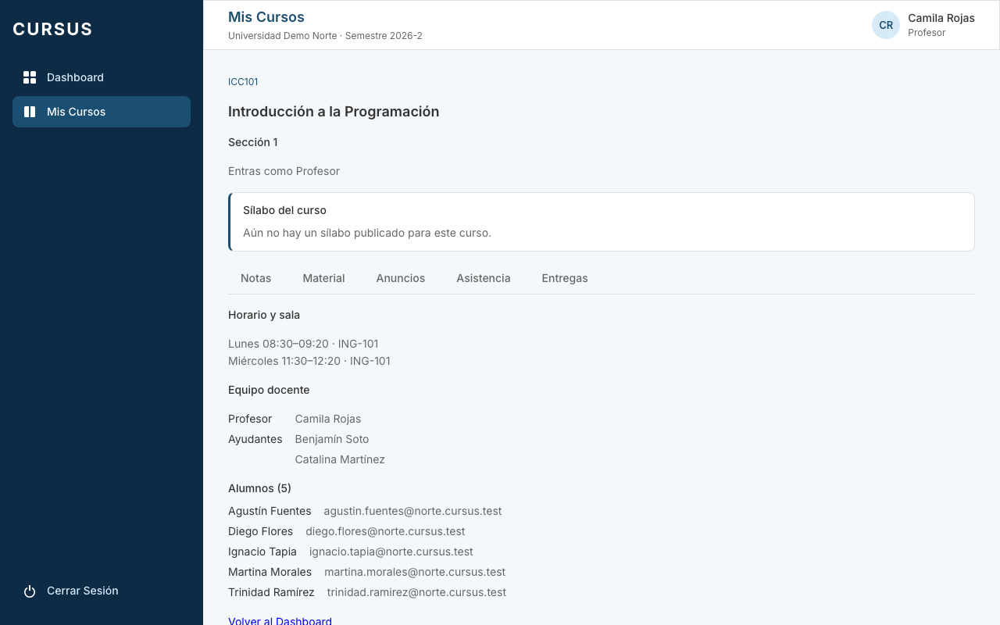
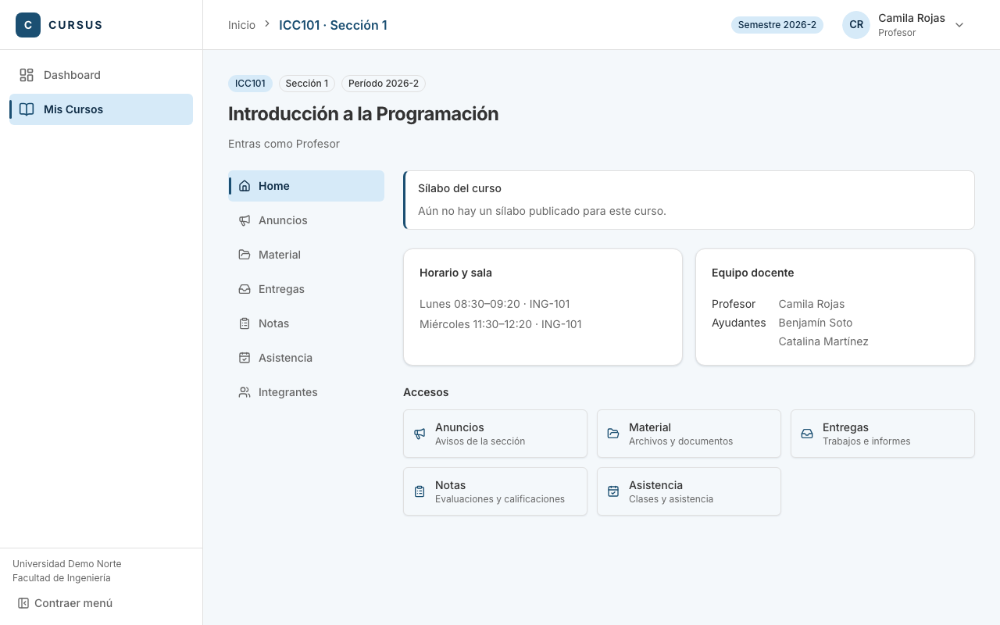
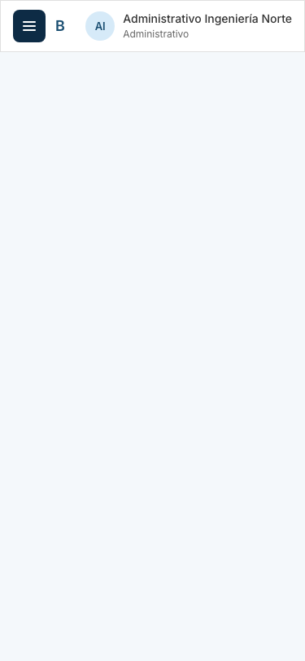
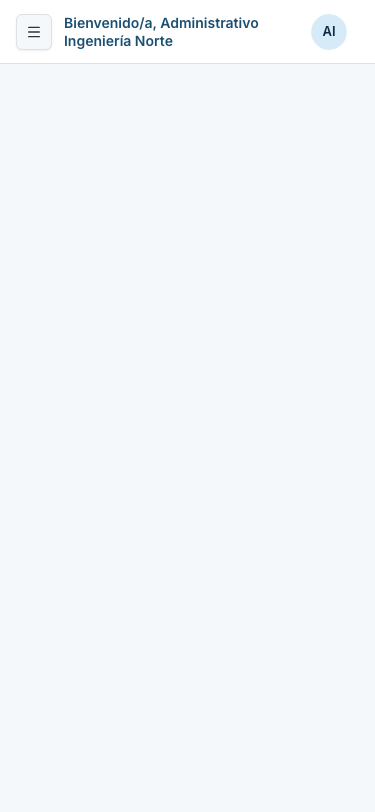
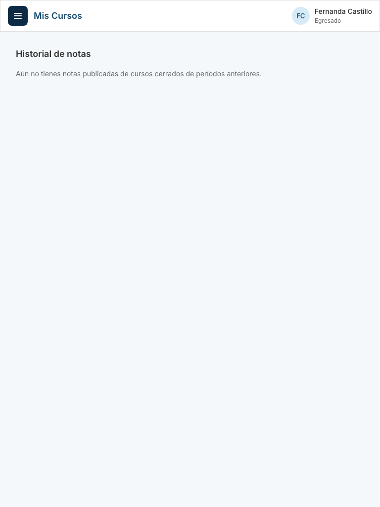
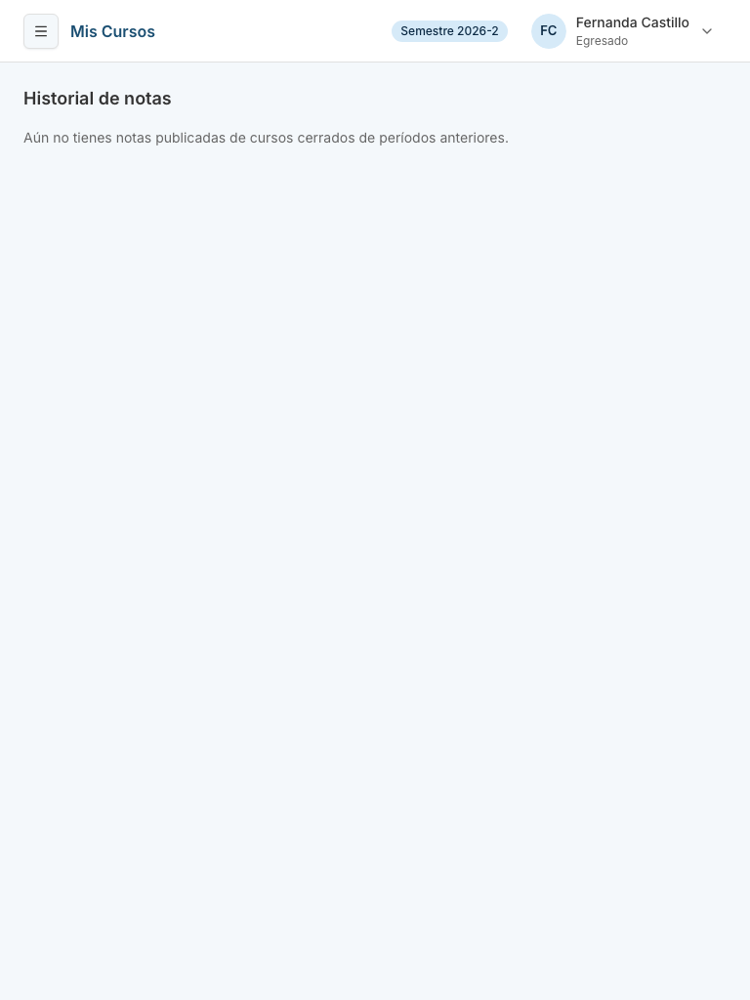
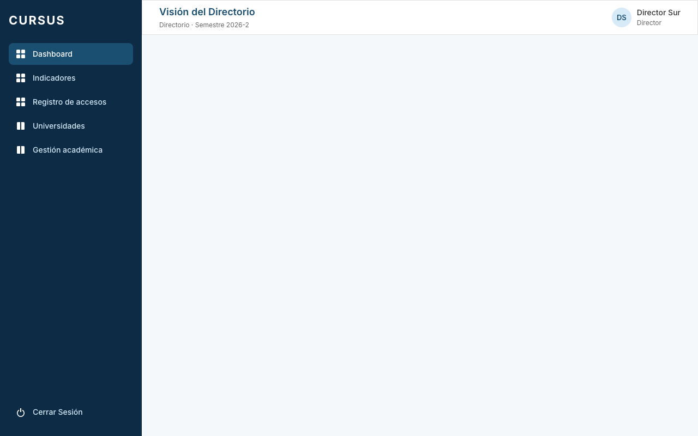
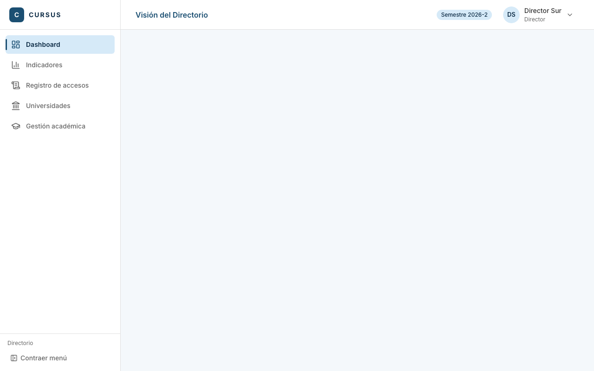

# UIX-04: AppShell y layout de curso

Tarjeta: UIX-04. Reemplaza el menú lateral, el encabezado y la vista de una sección por componentes de shadcn, sobre la base de UIX-01. Las rutas, los permisos (CASL) y las páginas internas no cambian.

## Qué cambia

- **Menú lateral** (`layout/Sidebar.tsx`, `layout/AppShell.tsx`). Riel claro, con la marca arriba, la navegación en el medio y la universidad y la facultad abajo (antes eran el subtítulo del encabezado).
  - Cada ítem de `NAV_ITEMS` lleva un ícono de lucide (campo `icon` en `navigation.ts`); rutas y permisos son los mismos.
  - El ítem activo se marca con fondo `--accent`, texto `--accent-foreground`, ícono y barra `--primary`: cambia con el color de la universidad (el Director y el login conservan el de CURSUS).
  - Desde 1024 px se puede contraer a solo íconos (`w-16`); el ítem pasa a tener un `Tooltip` con su nombre. La preferencia se guarda en `localStorage` (`cursus-menu-colapsado`) solo cuando la persona la cambia, y la pantalla funciona igual si el navegador no deja guardar.
  - Bajo 1024 px el menú es un `Sheet` que se abre desde el botón «Menú» del encabezado y se cierra al elegir un ítem. `TooltipProvider` se monta una vez en `AppShell`.
  - El egresado sigue viendo solo su historial (el filtro de `navItemsFor` no cambió).
- **Encabezado** (`layout/Header.tsx`, `layout/MenuUsuario.tsx`, `layout/migas.ts`).
  - Ya no repite el título de la página: la ruta es el breadcrumb y su último paso es el `h1`.
  - El breadcrumb sale de `NAV_ITEMS` y de las pocas subrutas con nombre propio (Historial, Pendientes). La sección de un curso aporta su nombre con `useEtiquetaDeMiga` (`layout/migas-contexto.ts`, `layout/MigasProvider.tsx`).
  - Bajo 640 px el camino no cabe: queda el título y un botón «Volver a …». El título pasa a dos líneas en vez de cortarse con «…».
  - Menú de usuario (`DropdownMenu`): avatar con iniciales, nombre y rol, «Mi perfil» (solo si la persona tiene la ruta; el egresado no la tiene) y «Cerrar sesión», que salió del menú lateral.
  - El período activo es una `Badge` («Semestre 2026-2»), oculta bajo 768 px.
- **Layout de curso** (`pages/VistaSeccion.tsx`). Navegación del curso a la izquierda y el contenido a la derecha; bajo 1024 px es una fila de pestañas que se desplaza y deja a la vista la elegida.
  - Vistas: Home, Anuncios, Material, Entregas, Notas, Asistencia e Integrantes. Los cinco contenidos que ya existían (ESP-04 a MAT-08) se montan tal cual.
  - La vista elegida va en `?vista=` (sin cambiar los patrones de ruta): se puede compartir y recargar. Sin parámetro se muestra el Home.
  - **Home**, solo con datos de `/api/espacio/secciones/:id/resumen`: sílabo, horario y sala, equipo docente y accesos a las demás vistas. Integrantes muestra el equipo docente y, para el profesor, los alumnos.
- **Se borran** `AppShell.css`, `Header.css`, `Sidebar.css` e `icons.tsx` (íconos SVG a mano). `VistaSeccion.css` queda con lo que todavía usan las pestañas internas.

## Decisiones de diseño

- **Sobrio e institucional, estilo Canvas.** Riel claro con el nombre de la universidad abajo, contenido sobre `--background`, bordes de 1 px y radios de 8 px. Una sola cosa llama la atención: la barra y el fondo del ítem activo, que llevan el color de la universidad.
- **Sin color nuevo.** Todo sale de los tokens de UIX-01 (`--primary`, `--accent`, `--muted`, `--border`). Inter es la tipografía.
- **El menú no repite el cierre de sesión ni el nombre de la universidad en el encabezado.** Cada dato vive en un solo lugar.
- **Anchos.** `--sidebar-width` en el riel abierto, `w-16` contraído; el contenido tiene `p-4`, `sm:p-6`, `lg:p-8`.

### Contraste del estado activo

Calculado con `contrasteColores` de `@cursus/shared` y comprobado en `layout/contraste-activo.test.ts` con cinco colores de universidad:

| Universidad    | Texto sobre fondo activo | Título (`--primary` sobre blanco) | Ícono sobre fondo activo |
| -------------- | ------------------------ | --------------------------------- | ------------------------ |
| CURSUS y Norte | 11,72:1                  | 8,72:1                            | 7,05:1                   |
| Sur            | 11,39:1                  | 8,09:1                            | 6,91:1                   |

Se exige 4,5:1 para texto y 3:1 para ícono y barra (WCAG 1.4.11). Los otros tres colores del test también pasan.

## Cómo verificar

1. `npm run dev -w frontend` y entra con cada rol (profesor, ayudante, alumno, administrativo, director y un egresado).
2. A 1280 px: el riel muestra el ítem activo con barra; «Contraer menú» deja solo íconos con tooltip y el estado se mantiene al recargar.
3. A 768 y 375 px: el botón «Menú» abre el `Sheet`; elegir un ítem lo cierra.
4. Entra a una sección (`/mis-cursos/secciones/:id`): el breadcrumb dice «Inicio › ICC101 · Sección 1», la navegación del curso está a la izquierda y `?vista=notas` abre Notas. A 375 px son pestañas.
5. Menú de usuario: nombre y rol, «Mi perfil» (no para el egresado) y «Cerrar sesión».
6. Con la universidad Sur el verde reemplaza al azul en el ítem activo; el Director conserva el azul de CURSUS.

`npm run test -w frontend -- layout VistaSeccion` cubre el ícono de cada ítem, el sidebar del egresado, los breadcrumbs, el menú de usuario, el contraste y el layout del curso.

## Capturas antes y después

Todas en `docs/evidencias/uix-04-antes-*.png` y `uix-04-despues-*.png`, con el nombre `universidad-rol-pantalla-ancho`, a 1280, 768 y 375 px. Norte con los cinco roles y un egresado; Sur con los cinco roles.

| Pantalla                 | Antes                                                            | Después                                                            |
| ------------------------ | ---------------------------------------------------------------- | ------------------------------------------------------------------ |
| Profesor, sección (1280) |        |        |
| Administrativo (375)     |  |  |
| Egresado (768)           |        |        |
| Director, Sur (1280)     |         |         |

Solo «después»: [menú de usuario](evidencias/uix-04-despues-norte-profesor-menu-usuario-1280.png), [riel contraído](evidencias/uix-04-despues-norte-profesor-riel-contraido-1280.png), [Integrantes](evidencias/uix-04-despues-norte-profesor-curso-integrantes-1280.png), [menú móvil](evidencias/uix-04-despues-norte-alumno-panel-movil-375.png) y [Notas a 375 px](evidencias/uix-04-despues-norte-alumno-curso-notas-375.png).

El cuerpo de Inicio del Administrativo y del Director aparece vacío en «antes» y «después»: sus dashboards están fuera de esta tarjeta.

## Fuera de alcance

Páginas internas, dashboards, backend, `@cursus/shared` y `components/ui/`. Las páginas todavía no migradas siguen con su `.css`; el tamaño del bundle principal (688 kB, 523 kB antes) crece por Radix (menú, panel, tooltip, pestañas) y el aviso de más de 500 kB de Vite ya existía.
